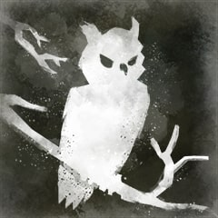

# Silent Hunter

<table class="infobox">
<caption>Silent Hunter</caption>
<colgroup>
<col style="width: 50%" />
<col style="width: 50%" />
</colgroup>
<tbody>
<tr>
<td colspan="2"><figure>

<figcaption>Silent_Hunter_icon.png</figcaption>
</figure></td>
</tr>
<tr>
<td colspan="2"></td>
</tr>
<tr>
<td>
Description
</td>
<td>
Survive the first 50 days without firing any firearms (single game).
</td>
</tr>
</tbody>
</table>

**Silent Hunter** is an <a href="./The%20Long%20Dark%20%E2%80%94%20Achievements.md" class="wikilink" title="Achievement">Achievement</a> in *<a href="./The%20Long%20Dark.md" class="wikilink" title="The Long Dark">The Long Dark</a>*.

## Guide

This achievement is obtained after surviving the first fifty days without firing the <a href="./Hunting%20Rifle.md" class="wikilink" title="Hunting Rifle">Hunting Rifle</a>, <a href="./Revolver.md" class="wikilink" title="Revolver">Revolver</a> or the <a href="./Distress%20Pistol.md" class="wikilink" title="Distress Pistol">Distress Pistol</a> in a single <a href="./Survival%20Mode.md" class="wikilink" title="Survival Mode">Survival Mode</a> game. It is most easily done on Pilgrim. It is highly recommended to utilize the <a href="./Snare.md" class="wikilink" title="snare">snare</a>, <a href="./Survival%20Bow.md" class="wikilink" title="Survival Bow">Survival Bow</a> and other craftables to their fullest extent as well as fishing in order to maximize chances of reaching fifty days survived.

This achievement must be attempted on the first fifty days of the play through. If the player fires the rifle, revolver or distress pistol within the first fifty days of surviving it will nullify the achievement for that entire play through.

This achievement can be earned on Interloper since the rifle is not required for this <a href="./The%20Long%20Dark%20%E2%80%94%20Achievements.md" class="wikilink" title="achievement">achievement</a>.

## Game History

Changed game description after the inclusion of the <a href="./Revolver.md" class="wikilink" title="Revolver">Revolver</a> to the game. Previous description was "Survive the first 50 days without firing any firearm - including flare gun (single game)."

**Lua execution error in Module:Navbox function navbox**<a href="ru:%D0%94%D0%BE%D1%81%D1%82%D0%B8%D0%B6%D0%B5%D0%BD%D0%B8%D1%8F_Steam" class="wikilink" title="ru:Достижения Steam">ru:Достижения Steam</a>

