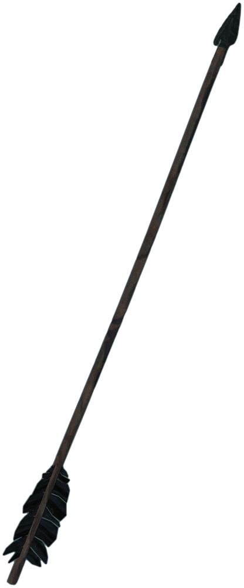

# Simple Arrow

**Contents**

- [Overview](#Overview)
- [Wear](#Wear)
- [Arrow condition loss on Impact (Increased by perpendicular hits)](#Arrow_condition_loss_on_Impact_%28Increased_by_perpendicular_hits%29)
- [Ricochet](#Ricochet)
- [Crafting](#Crafting)
- [Locations](#Locations)
- [Game history](#Game_history)

<table class="infobox">
<caption>Simple Arrow</caption>
<colgroup>
<col style="width: 50%" />
<col style="width: 50%" />
</colgroup>
<tbody>
<tr>
<td colspan="2"><figure>

<figcaption>Simple_Arrow_icon.png</figcaption>
</figure></td>
</tr>
<tr>
<td colspan="2" class="section">
<strong>General</strong>
</td>
</tr>
<tr>
<td>
Item Type
</td>
<td>
Tool|-
</td>
</tr>
<tr>
<td>
Renewable
</td>
<td>
Yes (<a href="./Beachcombing.md" class="wikilink" title="Beachcombing">Beachcombing</a>)
</td>
</tr>
<tr>
<td colspan="2" class="section">
<strong>Statistics</strong>
</td>
</tr>
<tr>
<td>
Weight
</td>
<td>
0.15 kg(0.33 lbs)
</td>
</tr>
<tr>
<td>
Harvest
</td>
<td>
1 × <a href="./Arrowhead.md" class="wikilink" title="Arrowhead">Arrowhead</a> 2 × <a href="./Crow%20Feather.md" class="wikilink" title="Crow Feather">Crow Feather</a>
</td>
</tr>
</tbody>
</table>

<table>
<colgroup>
<col style="width: 33%" />
<col style="width: 33%" />
<col style="width: 33%" />
</colgroup>
<tbody>
<tr>
<td style="vertical-align: top; font-size: 3em; color: #5d5980; padding-right: 10px">
“
</td>
<td>
A home-made Arrow, created by combining an Arrow shaft with Crow feathers and an Arrowhead.

&#10;

In-game description

</td>
<td style="vertical-align: bottom; font-size: 3em; color: #5d5980; padding-left: 10px">
”
</td>
</tr>
</tbody>
</table>

**Simple Arrows** are craftable ammunition items for Survival Bows.

## Overview

Arrows are reusable ammunition for the <a href="./Survival%20Bow.md" class="wikilink" title="Survival Bow">Survival Bow</a>. Arrows embed themselves in most soft targets when fired from a bow. Simple Arrows may occasionally be found in hunting blinds or near carcasses.

Simple arrows are one of three arrow types currently in the game, they have an easily accessible recipe and are very effective against all types of <a href="./Wildlife.md" class="wikilink" title="Wildlife">Wildlife</a>. <a href="./Fire%20Hardened%20Arrow.md" class="wikilink" title="Fire Hardened Arrows">Fire Hardened Arrows</a> are even easier to craft, but are only capable of killing small game animals such as <a href="./Rabbit.md" class="wikilink" title="Rabbits">Rabbits</a> and <a href="./Ptarmigan.md" class="wikilink" title="Ptarmigans">Ptarmigans</a> and are very brittle. <a href="./Manufactured%20Arrow.md" class="wikilink" title="Manufactured Arrows">Manufactured Arrows</a> are the most difficult arrow type to obtain; requiring the completion of Sutherland's first special request before they can be <a href="./Trader.md" class="wikilink" title="traded">traded</a> for, then up to 10 arrows can be bought each time. They are a pure upgrade from the simple arrow and inflict 12.5% more damage and are twice as durable, but are not available on <a href="./Interloper.md" class="wikilink" title="Interloper">Interloper</a> or <a href="./Misery.md" class="wikilink" title="Misery">Misery</a>.

## Wear

The total durability of arrows is variable and depends on a material table to determine it's condition loss; with the hardness of the material and the angle at which the arrow impacts the target determining the amount of degradation received. After a hit takes the arrow's condition below 0% it will break and turn into a <a href="./Broken%20Arrow.md" class="wikilink" title="Broken Arrow">Broken Arrow</a> then fall to the ground where it may be retrieved and harvested for 1 <a href="./Arrowhead.md" class="wikilink" title="Arrowhead">Arrowhead</a> and 2 <a href="./Crow%20Feather.md" class="wikilink" title="Crow Feathers">Crow Feathers</a>.

### Arrow condition loss on Impact (Increased by perpendicular hits)

| Material       | Snow | Flesh | Wood | Stone/Metal |
|----------------|------|-------|------|-------------|
| Condition Loss | 4%   | 24%   | 30%  | 55%         |

## Ricochet

Arrows hitting hard surfaces will bounce off. Bounces off hard vertical surfaces can be hard to predict and may even return back toward the player. Glancing bounces are a common occurrence when arrows hit horizontal surfaces, especially ice. These glancing arrows carry a lot of their original momentum through the bounce and can travel 15 or more meters further along their original trajectory, far out of sight of the player. In this case, arrows can be very difficult to locate for players that do not know how far they actually can bounce.

## Crafting

<table class="infobox">
<caption>Simple Arrow</caption>
<tbody>
<tr>
<td colspan="2">
<strong>Template:pic link plain</strong><a href="./Archery.md" class="wikilink" title="Archery">Archery</a>
</td>
</tr>
<tr>
<td colspan="2">
1
</td>
</tr>
<tr>
<td colspan="2">
90 minutes (1 hour 30 minutes)
</td>
</tr>
<tr>
<td colspan="2" class="section">
<strong>Requirements</strong>
</td>
</tr>
<tr>
<td>
Facility
</td>
<td>
<strong>Template:iconlink</strong>
</td>
</tr>
<tr>
<td colspan="2" class="section">
<strong>Materials</strong>
</td>
</tr>
<tr>
<td colspan="2" class="section">
<strong>Template:iconlink plain</strong>
</td>
</tr>
<tr>
<td>
Item
</td>
<td>
<a href="./Arrowhead.md" class="wikilink" title="Arrowhead">Arrowhead</a>
</td>
</tr>
<tr>
<td>
Quantity
</td>
<td>
1
</td>
</tr>
<tr>
<td colspan="2" class="section">
<strong>Template:iconlink plain</strong>
</td>
</tr>
<tr>
<td colspan="2">
<a href="./Arrow%20Shaft.md" class="wikilink" title="Arrow Shaft">Arrow Shaft</a>
</td>
</tr>
<tr>
<td colspan="2">
1
</td>
</tr>
<tr>
<td colspan="2" class="section">
<strong>Template:iconlink plain</strong>
</td>
</tr>
<tr>
<td colspan="2">
<a href="./Crow%20Feather.md" class="wikilink" title="Crow Feather">Crow Feather</a>
</td>
</tr>
<tr>
<td colspan="2">
3
</td>
</tr>
</tbody>
</table>

Crafting an arrow also contributes a bit of progress to the <a href="./Archery.md" class="wikilink" title="Archery">Archery</a> skill.

There are no tools required to craft an arrow, however, using tools reduces the crafting time significantly.

| Tool | Crafting Time | Reduction | Tool Durability Lost |
|----|----|----|----|
| Hands (no tool) | 90 minutes | 0% | n/a |
| <a href="./Simple%20Tools.md" class="wikilink" title="Simple Tools">Simple Tools</a> | 67 minutes | 25% | 2% |
| <a href="./Quality%20Tools.md" class="wikilink" title="Quality Tools">Quality Tools</a> | 45 minutes | 50% | 0.5% |

## Locations

Simple arrows can be found in a few places, some locations of note include:

- In <a href="./Hunter%27s%20Blinds.md" class="wikilink" title="Hunting Blinds">Hunting Blinds</a>
- Next to frozen corpses
- The corner of the <a href="./Mountaineer%27s%20Hut.md" class="wikilink" title="Mountaineers Hut">Mountaineers Hut</a> in <a href="./Timberwolf%20Mountain.md" class="wikilink" title="Timberwolf Mountain">Timberwolf Mountain</a>
- The target behind the Barn at the <a href="./Pleasant%20Valley%20Outbuildings.md" class="wikilink" title="Pleasant Valley Outbuildings">Pleasant Valley Outbuildings</a>
- Stuck in a bulkhead door in <a href="./Carter%20Hydro%20Dam.md" class="wikilink" title="Carter Hydro Dam">Carter Hydro Dam</a> in <a href="./Mystery%20Lake%20%28region%29.md" class="wikilink" title="Mystery Lake">Mystery Lake</a>
- One is always found next to a Survival Bow at <a href="./Katie%27s%20Secluded%20Corner.md" class="wikilink" title="Katie&#39;s Secluded Corner">Katie's Secluded Corner</a>
- In the rock cache by <a href="./Three%20Strikes%20Farmstead.md" class="wikilink" title="Three Strikes Farmstead">Three Strikes Farmstead</a>
- A few are imbedded in a tree near <a href="./Scaffolder%27s%20Hideout.md" class="wikilink" title="Scaffolder&#39;s Hideout">Scaffolder's Hideout</a>

<table class="gallery">
<colgroup>
<col style="width: 50%" />
<col style="width: 50%" />
</colgroup>
<tbody>
<tr>
<td><figure>
[Missing image: Different_Arrow_Types.jpg]
<figcaption>Fire Hardened Arrows on the left and Simple Arrows on the right.</figcaption>
</figure></td>
<td><figure>

<figcaption>Old model</figcaption>
</figure></td>
</tr>
</tbody>
</table>

## Game history

- Simple arrow and materials were introduced on 22 May 2015 in <a href="./The%20Long%20Dark%20%E2%80%94%20Changelog.md#0.233" class="wikilink" title="version 0.233">version 0.233</a>.

**Lua execution error in Module:Navbox function navbox** <a href="ru:%D0%9F%D1%80%D0%BE%D1%81%D1%82%D0%B0%D1%8F_%D1%81%D1%82%D1%80%D0%B5%D0%BB%D0%B0" class="wikilink" title="ru:Простая стрела">ru:Простая стрела</a>

