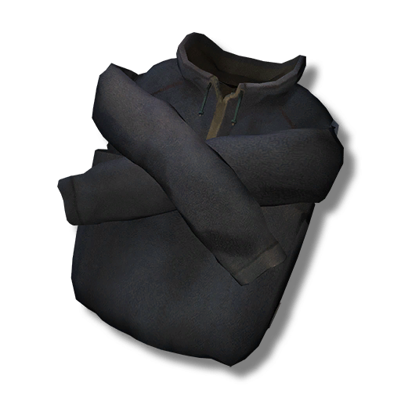
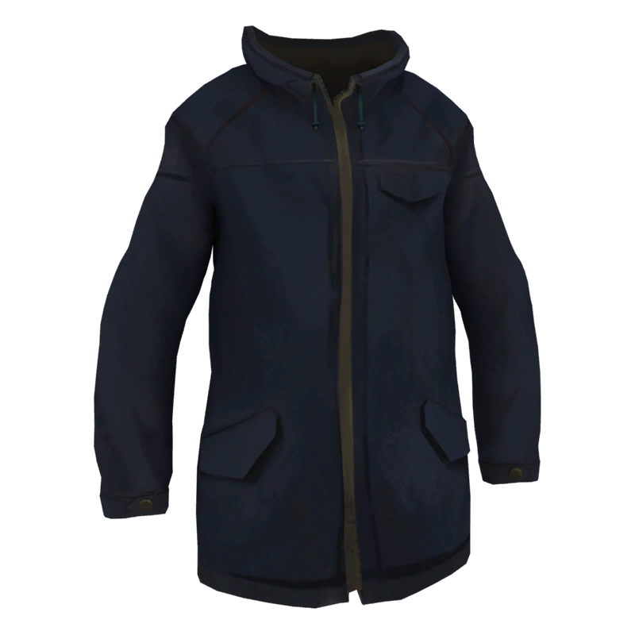
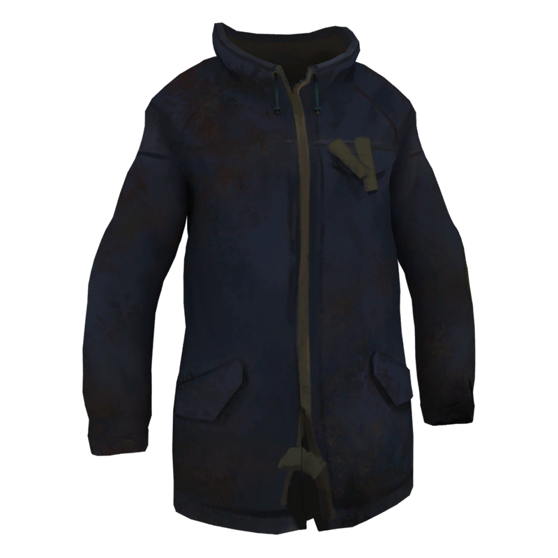

# Simple Parka

**Simple Parka**

| Property | Details |
| --- | --- |
|  |  / *Simple\_Parka\_icon.png* |
| **General** |  |
| Item Type | Clothing\|- |
| Clothing Slot | Outer torso |
| **Statistics** |  |
| Weight | 1.25 kg(2.75 lbs) |
| Warmth bonus | 2.0 °C(3.6 °F) |
| Windproof bonus | 2.0 °C(3.6 °F) |
| Waterproof bonus | 30% |
| Protection | 3% |
| Mobility | -4% |
| Harvest | 2 × [Cloth](./Cloth.md) / 20 minutes |
| Repair | 2 × [Cloth](./Cloth.md) / 45 minutes / 30% condition |

> “**A simple winter coat constructed using modern materials. Good weight to warmth ratio.**”
>
> — In-game description

**Simple Parka** is a type of [Clothing](./Clothing.md) in *The Long Dark*.

## Overview

The Simple Parka is a low-tier coat and common starting item.

Similar to the [Ski Jacket](./Ski%20Jacket.md), but the parka weighs 0.25 kg (0.55 lbs) more and has a 2% greater mobility penalty.

| Column 1 | Column 2 | Column 3 |
| --- | --- | --- |
|  / *Clothing model* |  / *Clothing model damaged* |  / *old model* |

## Update history

- UPDATE **19 December 2016 ([Update](./The%20Long%20Dark%20%E2%80%94%20Early%20Access%20Changelog.md#0.386)):**
  - Added to game

**Lua execution error in Module:Navbox function navbox** [ru:Обычная парка](ru:%D0%9E%D0%B1%D1%8B%D1%87%D0%BD%D0%B0%D1%8F_%D0%BF%D0%B0%D1%80%D0%BA%D0%B0)
