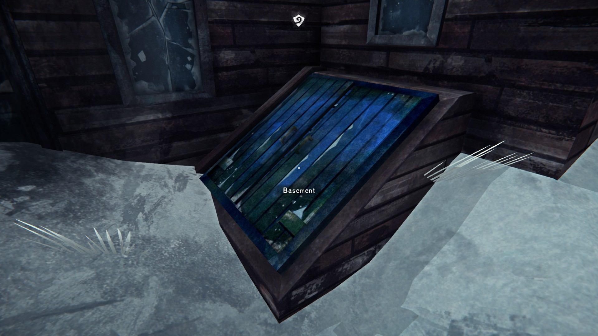

# Skeeter's Ridge

**Categories:** Indoor locations, Locations, Locations in Pleasant Valley, Outdoor locations · **Source:** [Fandom](https://thelongdark.fandom.com/wiki/Skeeter's_Ridge)

**Skeeter's Ridge**

_Skeeters\_ridge.jpg_

**Location**

_Skeeter's\_Ridge\_Location.png_

**Region:** [Pleasant Valley](./Pleasant%20Valley.md)

**General**

**Type:** Outdoors

Has an interior **Skeeter's Ridge** is a location in [Pleasant Valley](./Pleasant%20Valley.md).

## Overview

Skeeter's Ridge lies close to [Burned Ridge Cave](./Burned%20Ridge%20Cave.md) and west of [Draft Dodger's Cabin](./Draft%20Dodger%27s%20Cabin.md). The region's [Prepper Cache](./Prepper%20Cache.md) lies further north-west.

The most notable features of Skeeter's Ridge are the few ruined buildings in the area. Some [frozen corpses](./Frozen%20Corpse.md) may also be found nearby.

There is a bulkhead door to the basement next to one of the ruined house. The basement includes a washing machine, dryer, some cardboard / wooden boxes, a fridge, some canned goods and soda, a first aid kit, a plastic container, and two metal containers. There is a chance of spawning a [hatchet](./Hatchet.md) under the staircases.

In [Episode 3: Crossroads Elegy](./Episode%203%20-%20Crossroads%20Elegy.md), the player will need to visit this location to complete a side quest.

Also, the basement is one of the required survival locations in The [Nomad](./Nomad.md) challenge, and the player spawns right next to the basement at the start of [The Hunted, Part one](./The%20Hunted%2C%20Part%20One.md) challenge.

There is a [wolf](./Wolf.md) spawn point in the nearby forest. The player may encounter one when entering or exiting the basement, so caution is warranted.

## Gallery

_skeeters\_ridge\_basement\_door.jpg_
