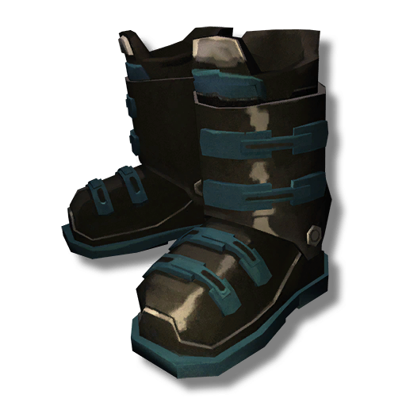
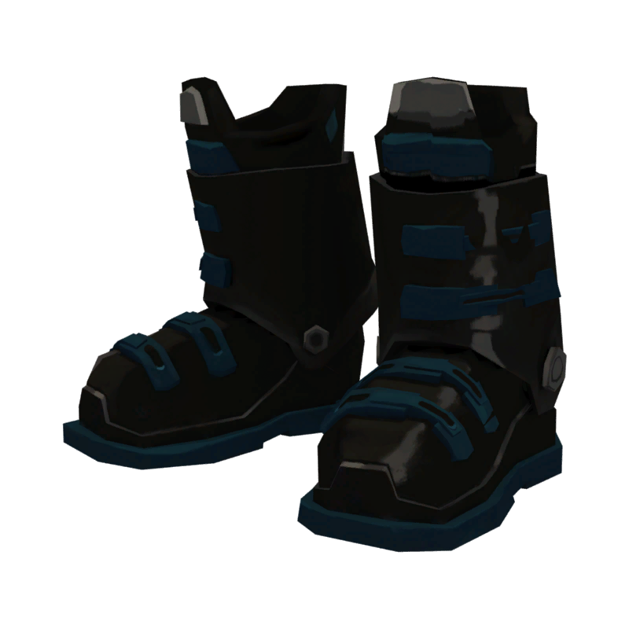

# Ski Boots

**Categories:** Clothing, Pages with update history, Story items · **Source:** [Fandom](https://thelongdark.fandom.com/wiki/Ski_Boots)

**Ski Boots**

_Ski\_Boots\_icon.png_

**General**

**Item Type:** Clothing\|-

**Statistics**

**Weight:** 4.00 kg(8.8 lbs)

**Warmth bonus:** 3.0 °C(5.4 °F)

**Windproof bonus:** 4.0 °C(7.2 °F)

**Waterproof bonus:** 30%

**Protection:** 10%

**Mobility:** -20%

**Harvest:** 1 × [Cured leather](./Cured%20Leather.md) / 90 minutes

**Repair:** 1 × [Cured leather](./Cured%20Leather.md), / 1 × [Cloth](./Cloth.md) / 90 minutes / 30% condition

> “**Hard plastic boots with high-tech synthetic insulation. Will keep your feet very warm at the expense of mobility.**”
>
> — In-game description

**Ski Boots** are a type of [footwear](./Clothing.md) in _The Long Dark_.

## Overview

Ski boots are extremely rare and high tier footwear. They offer the best warmth, windchill and protection bonuses of all footwear, but are extremely heavy and have a large mobility penalty. This makes them ideal for short hunting trips against [wolves](./Wolf.md) and [bears](./Bear.md), or for camping outside. They are poorly suited for long-distance travel and exploration.

Not available on Interloper.

_Clothing model icon_

_Clothing model icon damaged_

## Update history

- UPDATE **19 December 2016 ([Update](./The%20Long%20Dark%20%E2%80%94%20Early%20Access%20Changelog.md#0.386)):**
  - Added to game
