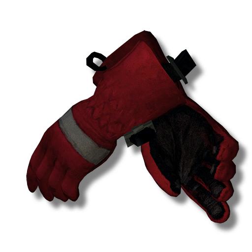
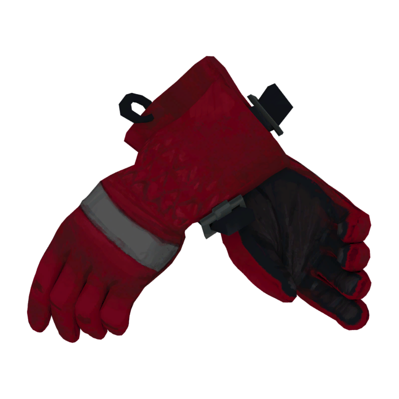
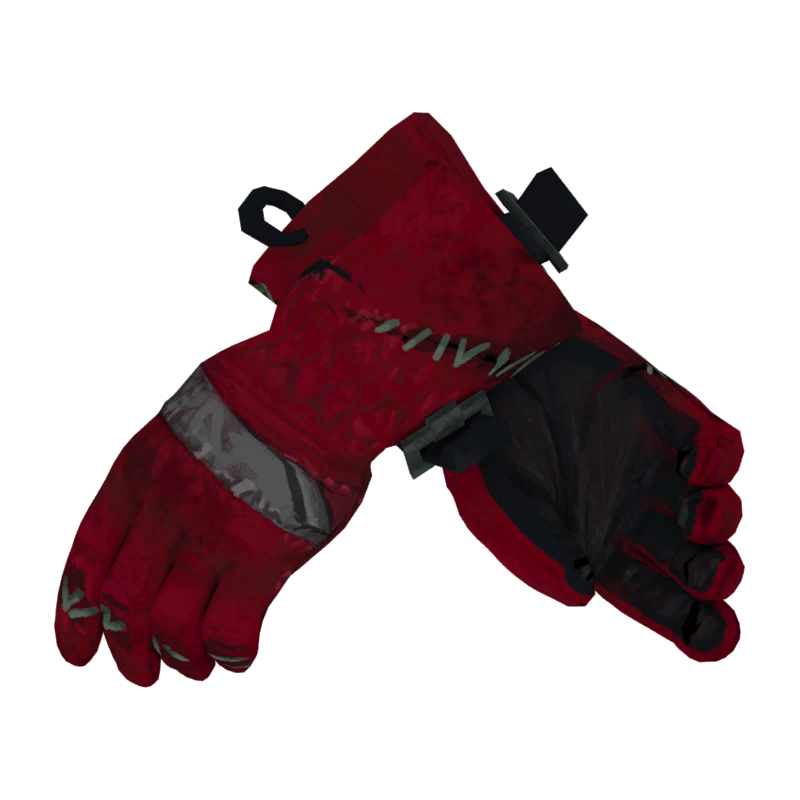

# Ski Gloves

**Categories:** Clothing · **Source:** [Fandom](https://thelongdark.fandom.com/wiki/Ski_Gloves)

**Ski Gloves**

_Ski\_Gloves\_icon.png_

**General**

**Item Type:** Clothing

**Clothing Slot:** Hands

**Statistics**

**Weight:** 0.50 kg(1.1 lbs)

**Warmth bonus:** 1.0 °C(1.8 °F)

**Windproof bonus:** 1.0 °C(1.8 °F)

**Waterproof bonus:** 30%

**Protection:** 3%

**Mobility:** -1%

**Harvest:** 1 × [Cloth](./Cloth.md) / 10 minutes

**Repair:** 1 × [Cloth](./Cloth.md) / 30 minutes / 25% condition

> “**Nylon ski gloves that go well beyond the wrist. Synthetic insulation keeps the hands warm, and the outer layer is nicely waterproof.**”
>
> — In-game description

**Ski Gloves** are low-to-mid tier [Clothing](./Clothing.md). They provide the same warmth bonus as the [Wool Mittens](./Wool%20Mittens.md), but offer 0.5°C (0.9°F) more windchill protection, 2% more wildlife protection, and 10% more waterproofing. This comes at the expense of the ski gloves being 0.4kg heavier.

They are tied for the lowest warmth-to-weight ratio gloves in the game with the [Gauntlets](./Gauntlets.md) and [Rabbitskin Mitts](./Rabbitskin%20Mitts.md).

_Clothing model_

_Clothing model damaged_
