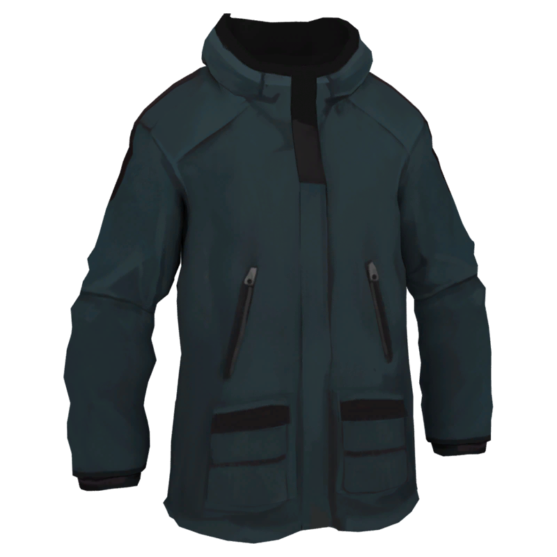
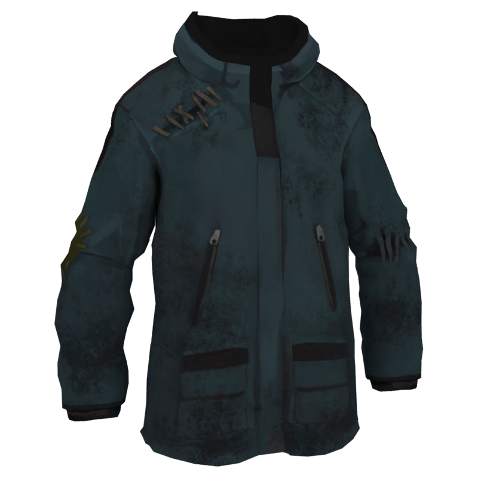

# Ski Jacket

**Categories:** Clothing, Pages with update history · **Source:** [Fandom](https://thelongdark.fandom.com/wiki/Ski_Jacket)

**Ski Jacket**

| Property | Details |
| --- | --- |
|  | [Ski Jacket icon](../assets/Ski_Jacket_icon.png) |
| **General** |  |
| Item Type | Clothing |
| Wintermute | No |
| Clothing Slot | Outer torso |
| **Statistics** |  |
| Weight | [Weight icon](../assets/Weight_icon.png)1.00 kg(2.2 lbs) |
| Warmth bonus | [Temp icon](../assets/Temp_icon.png)2.0 °C(3.6 °F) |
| Windproof bonus | [Windproofness icon](../assets/Windproofness_icon.png)2.0 °C(3.6 °F) |
| Waterproof bonus | [Waterproofness icon](../assets/Waterproofness_icon.png)30% |
| Protection | [Protection icon](../assets/Protection_icon.png)3% |
| Mobility | [Mobility icon](../assets/Mobility_icon.png)-2% |
| Harvest | 2 × [Cloth](./Cloth.md) / 90 minutes |
| Repair | 2 × [Cloth](./Cloth.md) / 45 minutes / 30% condition |

> “**Winter jacket made out of synthetic materials. Highly Windproof but not well insulated.**”
>
> — In-game description

The **Ski Jacket** is a type of [clothing](./Clothing.md) in _[The Long Dark](./The%20Long%20Dark.md)_.

## Overview

The Ski Jacket is a low-tier jacket and a common starting item.

It is a direct upgrade to the [Simple Parka](./Simple%20Parka.md). It weighs 0.25 kg less and has a 2% lower mobility penalty.

## Gallery

## Update history

- UPDATE **19 December 2016 ([Update](./The%20Long%20Dark%20%E2%80%94%20Early%20Access%20Changelog.md#0-386-resolute-outfitter-update)):**
  - Added to game
