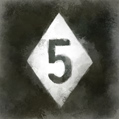

# Skilled Survivor

**Categories:** Achievements · **Source:** [Fandom](https://thelongdark.fandom.com/wiki/Skilled_Survivor)

**Contents**

- [Guide](#guide)
- [Strategy](#strategy)
- [Tips](#tips)
- [Skills](#skills)

**Skilled Survivor** is an [achievement](./The%20Long%20Dark%20%E2%80%94%20Achievements.md) in _[The Long Dark](./The%20Long%20Dark.md)._

**Skilled Survivor**

**Description:** Get all skills to level 5 in a single Survival Mode game.

## Guide

This achievement is obtained by getting all [Skills](./Skills.md) to level five in a single game in [Survival Mode](./Survival%20Mode.md).

The skills required are as follows:

- [Archery](./Archery.md)
- [Carcass Harvesting](./Carcass%20Harvesting.md)
- [Cooking](./Cooking.md)
- [Fire Starting](./Fire%20Starting.md)
- [Ice Fishing](./Ice%20Fishing.md)
- [Mending](./Mending.md)
- [Rifle Firearm](./Rifle%20Firearm.md)
- [Revolver Firearm](./Revolver%20Firearm.md)
- [Gunsmithing](./Gunsmithing.md)

**Note:** Because some of the skills require access to firearms, the achievement is unobtainable on [Interloper](./Interloper.md) or [Misery](./Misery.md). (This may no longer be true after introduction of Trader, as he sells rifle and revolver books in Interloper mode too.)

## Strategy

### Tips

- [Research Books](./Research%20Book.md) can be very helpful in leveling up skills faster and with less resources.
- If the player has the [Tales from the Far Territory](./Tales%20from%20the%20Far%20Territory.md) installed, the [Trader](./Trader.md) has a chance to offer Research Books for every skill.

### Skills

Most skills require 100 points to level up, unless noted. Generally, one successful action will provide 1 point towards the relevant skill.

- The hardest skill to level up by far is [Mending](./Mending.md), requiring a tremendous amount of [Cloth](./Cloth.md) and 350 points to reach level 5, not to mention [Sewing Kit](./Sewing%20Kit.md) / [Fishing Tackle](./Fishing%20Tackle.md) durability. One strategy is to fix every item of clothing the player finds, or to immediately repair worn clothing as soon as its durability falls below 100%. Buying [A Sewing Primer](./A%20Sewing%20Primer.md) from [Sutherland](./Trader.md) can help make this less tedious.
- [Carcass Harvesting](./Carcass%20Harvesting.md) will often be levelled up naturally over time, but the process can be sped up by hunting and harvesting larger animals such as [bear](./Bear.md) or [moose](./Moose.md).
- [Cooking](./Cooking.md) requires 350 points to reach level 5, but tends to be levelled up to level 5 fairly quickly through natural gameplay. It can require large amounts of fuel, however. Fully butchering and cooking a bear/moose can easily give 25-40 points towards this skill. Preparing beverages such as [Rose Hip Tea](./Rose%20Hip%20Tea.md), [coffee](./Cup%20of%20Coffee.md), [herbal tea](./Cup%20of%20Herbal%20Tea.md), [Reishi Tea](./Reishi%20Tea.md), and [Birch Bark Tea](./Birch%20Bark%20Tea.md) can also be a fast way to raise Cooking skill.
- Gunsmithing is one of the fastest to level up, so long as ample resources are available. The skill can be leveled to level 5 in only one day.
- [Rifle](./Hunting%20Rifle.md) and [Revolver](./Revolver.md) firearm skills are not difficult to increase, but do require lots of ammunition to be expended (minimum 100 rounds), and multiple [firearm cleaning kits](./Firearm%20Cleaning%20Kit.md) to keep the weapons in good condition. Frequent trips to Bleak Inlet or Blackrock may be required to restock on ammo and to repair damaged weapons at the [milling machine](./Milling%20Machine.md) if cleaning kits are in short supply. Ammo and cleaning kits can also be acquired from the [Trader](./Trader.md).
- [Archery](./Archery.md) requires 125 points and is relatively easy to level up, as one experience point is gained by crafting each [Simple Arrow](./Simple%20Arrow.md). It can also be levelled by crafting a large stash of cheap [Fire Hardened Arrows](./Fire%20Hardened%20Arrow.md) and shooting [rabbits](./Rabbit.md) or [ptarmigan](./Ptarmigan.md). Reaching level 5 will require a few [cured Maple Saplings](./Cured%20Maple%20Sapling.md) and [cured guts](./Cured%20Gut.md), along with many [feathers](./Crow%20Feather.md) and [sticks](./Stick.md) or [cured Birch Saplings](./Cured%20Birch%20Sapling.md), but these are generally easily acquired.
- [Fire Starting](./Fire%20Starting.md) requires 200 points, and can be acquired over the course of a game, but is most efficiently done by using the [magnifying lens](./Magnifying%20Lens.md) on a sunny day as to not consume [matches](./Matches%20%28disambiguation%29.md). Another option is to gather a bunch of [sticks](./Stick.md) and light/re-light campfires using a lit [Torch](./Torch.md).
- [Ice Fishing](./Ice%20Fishing.md) also requires more points to reach level 5 than most other skills (250) but it can also be acquired overtime and will require lots of [cured gut](./Cured%20Gut.md) and [scrap metal](./Scrap%20Metal.md) to provide [fishing tackle](./Fishing%20Tackle.md). Making some [lures](./Fishing%20Lure%20%28disambiguation%29.md) can help speed the process up somewhat. Catching enough fish to produce all the [lantern fuel](./Lantern%20Fuel.md) for [Sutherland's](./Trader.md) trades can provide good experience in both Ice Fishing and Cooking.
