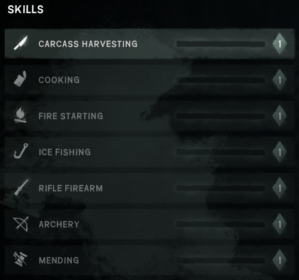
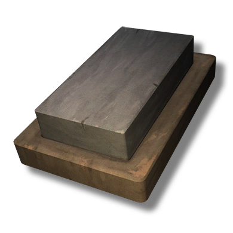
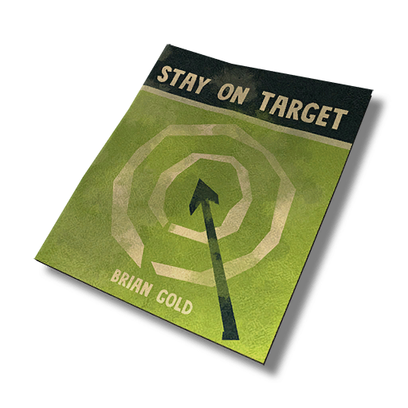
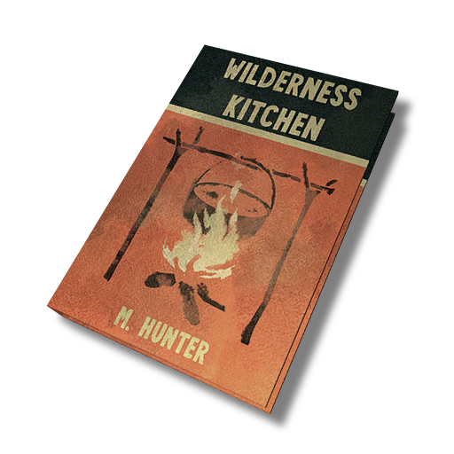
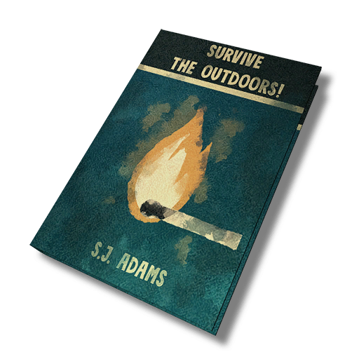
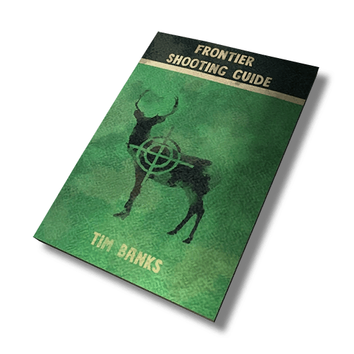
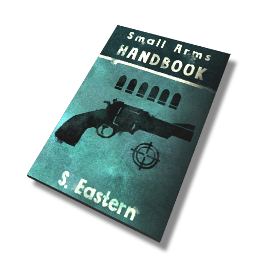
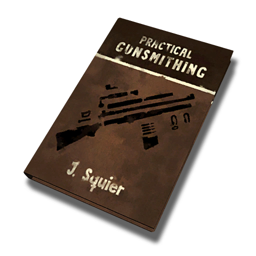

# Skills

**Contents**

- [Skills](#Skills)
- [Secondary skills](#Secondary_skills)
- [Increasing Skill](#Increasing_Skill)
- [Skill flavor text](#Skill_flavor_text)
- [Archery](#Archery)
- [Carcass Harvesting](#Carcass_Harvesting)
- [Cooking](#Cooking)
- [Fire Starting](#Fire_Starting)
- [Gunsmithing](#Gunsmithing)
- [Ice Fishing](#Ice_Fishing)
- [Mending](#Mending)
- [Revolver Firearm](#Revolver_Firearm)
- [Rifle Firearm](#Rifle_Firearm)
- [History of release](#History_of_release)
- [Achievements](#Achievements)

The current Skills display menu. **Skills** are a survivor's trainable abilities that may be improved throughout their <a href="./Survival%20Mode.md" class="wikilink" title="Survival Mode">Survival Mode</a> gameplay. Any given skill can be trained by specific actions that relate to the skill. Performing any of these actions grants the player skill points in that skill. Skills can also be increased by researching the <a href="./Research%20Book.md" class="wikilink" title="Research Book">Research Book</a> that corresponds with the skill.

Achieving higher levels in skills can give players various advantages, such as preventing <a href="./Food%20Poisoning.md" class="wikilink" title="Food Poisoning">Food Poisoning</a> from eating any cooked food or preventing failures while <a href="./Mending.md" class="wikilink" title="Mending">Mending</a> clothing.

There are 9 skills that can be improved in *<a href="./The%20Long%20Dark.md" class="wikilink" title="The Long Dark">The Long Dark</a>*. All skills start out at level 1. Survivors can improve their skills up to level 5; after that, they get no further benefits from continuing to train the skill.

Skills do not carry over between Survival Mode games or <a href="./Challenge.md" class="wikilink" title="Challenge">Challenges</a>, unlike <a href="./Feats.md" class="wikilink" title="Feats">Feats</a>. When the player dies, they lose their survival skill progress.

## Skills

Survivors have access to nine core survival skills:

<table>
<colgroup>
<col style="width: 33%" />
<col style="width: 33%" />
<col style="width: 33%" />
</colgroup>
<thead>
<tr>
<th colspan="2" style="text-align: center;">
Skill
</th>
<th style="text-align: center;">
Description
</th>
</tr>
</thead>
<tbody>
<tr>
<td><figure>

<figcaption>Archery.png</figcaption>
</figure></td>
<td>
<a href="./Archery.md" class="wikilink" title="Archery">Archery</a>
</td>
<td>
Archery is used to <a href="./Hunting.md" class="wikilink" title="hunt">hunt</a> <a href="./Wildlife.md" class="wikilink" title="animals">animals</a> with the use of a <a href="./Survival%20Bow.md" class="wikilink" title="Survival Bow">Survival Bow</a>.
</td>
</tr>
<tr>
<td><figure>

<figcaption>Carcass_Harvesting.png</figcaption>
</figure></td>
<td>
<a href="./Carcass%20Harvesting.md" class="wikilink" title="Carcass Harvesting">Carcass Harvesting</a>
</td>
<td>
Carcass harvesting is used to harvest meat, hides, and guts from wildlife.
</td>
</tr>
<tr>
<td><figure>

<figcaption>Cooking.png</figcaption>
</figure></td>
<td>
<a href="./Cooking.md" class="wikilink" title="Cooking">Cooking</a>
</td>
<td>
Cooking is used to cook raw food for a number of reasons, including increasing the condition of raw food and preventing <a href="./Food%20Poisoning.md" class="wikilink" title="Food Poisoning">Food Poisoning</a> prior to consuming food.
</td>
</tr>
<tr>
<td><figure>

<figcaption>Fire_Starting.png</figcaption>
</figure></td>
<td>
<a href="./Fire%20Starting.md" class="wikilink" title="Fire Starting">Fire Starting</a>
</td>
<td>
Fire starting is used to start <a href="./Fire.md" class="wikilink" title="fire">fires</a>, which are used to generate heat, dry clothing, cook food, melt snow, and purify water.
</td>
</tr>
<tr>
<td><figure>

<figcaption>Ice_Fishing.png</figcaption>
</figure></td>
<td>
<a href="./Ice%20Fishing.md" class="wikilink" title="Ice Fishing">Ice Fishing</a>
</td>
<td>
Ice fishing is used to catch raw fish, which are used for <a href="./Cooking.md" class="wikilink" title="Cooking">Cooking</a> and for creating <a href="./Lantern%20Fuel.md" class="wikilink" title="Lantern Fuel">Lantern Fuel</a>.
</td>
</tr>
<tr>
<td><figure>

<figcaption>Mending.png</figcaption>
</figure></td>
<td>
<a href="./Mending.md" class="wikilink" title="Mending">Mending</a>
</td>
<td>
Mending is used to repair damaged cloth or leather clothing.
</td>
</tr>
<tr>
<td><figure>

<figcaption>Rifle_Firearm.png</figcaption>
</figure></td>
<td>
<a href="./Rifle%20Firearm.md" class="wikilink" title="Rifle Firearm">Rifle Firearm</a>
</td>
<td>
Rifle Firearm is used offensively to <a href="./Hunting.md" class="wikilink" title="hunt">hunt</a> animals with the use of a <a href="./Hunting%20Rifle.md" class="wikilink" title="Hunting Rifle">Hunting Rifle</a>.
</td>
</tr>
<tr>
<td><figure>
[Missing image: Revolver_Firearm.png]
<figcaption>Revolver_Firearm.png</figcaption>
</figure></td>
<td>
<a href="./Revolver%20Firearm.md" class="wikilink" title="Revolver Firearm">Revolver Firearm</a>
</td>
<td>
Revolver Firearm is used to defensively scare away animals with the use of a <a href="./Revolver.md" class="wikilink" title="Revolver">Revolver</a>. Can be used during a <a href="./Struggle.md" class="wikilink" title="Struggle">Struggle</a>.
</td>
</tr>
<tr>
<td><figure>
[Missing image: Gunsmithing.png]
<figcaption>Gunsmithing.png</figcaption>
</figure></td>
<td>
<a href="./Gunsmithing.md" class="wikilink" title="Gunsmithing">Gunsmithing</a>
</td>
<td>
Gunsmithing is used to craft <a href="./Bullet.md" class="wikilink" title="bullets">bullets</a>, <a href="./Can%20of%20Gunpowder.md" class="wikilink" title="gunpowder">gunpowder</a>, and ammunition cartridges for the revolver and rifle. It also determines the quality of cartridges produced.
</td>
</tr>
</tbody>
</table>

### Secondary skills

Players also have access to three secondary survival skills, which are not tracked by the <a href="./Journal.md" class="wikilink" title="Journal">Journal</a> in the game menu. The skill status can only be viewed while attempting to perform an action related to that skill within the <a href="./Survival%20Menu.md" class="wikilink" title="Survival Menu">Survival Menu</a>.

<table>
<colgroup>
<col style="width: 33%" />
<col style="width: 33%" />
<col style="width: 33%" />
</colgroup>
<thead>
<tr>
<th colspan="2">
Skill
</th>
<th>
Description
</th>
</tr>
</thead>
<tbody>
<tr>
<td><figure>

<figcaption>Firearm_Cleaning_Kit_icon.png</figcaption>
</figure></td>
<td>
<a href="./Cleaning.md" class="wikilink" title="Cleaning">Cleaning</a>
</td>
<td>
Cleaning is used to repair hunting rifles and revolvers. Keeping firearms in optimal condition reduces the likelihood of weapon <a href="./Hunting%20Rifle.md#Jamming" class="wikilink" title="jamming">jamming</a>.
</td>
</tr>
<tr>
<td>

</td>
<td>
<a href="./Repair.md" class="wikilink" title="Repair">Repair</a>
</td>
<td>
Repair is used to repair a variety of metal tools, such as <a href="./Hacksaw.md" class="wikilink" title="hacksaw">hacksaws</a> and <a href="./Heavy%20Hammer.md" class="wikilink" title="heavy hammer">heavy hammers</a>.
</td>
</tr>
<tr>
<td><figure>

<figcaption>Whetstone_icon.png</figcaption>
</figure></td>
<td>
<a href="./Sharpening.md" class="wikilink" title="Sharpening">Sharpening</a>
</td>
<td>
Sharpening is used to repair <a href="./Sharpening.md#Bladed_tools" class="wikilink" title="bladed tools">bladed tools</a>. Higher levels in the sharpening skill reduce the amount of time required to sharpen, and additionally increase the amount of condition restored to a tool by sharpening.
</td>
</tr>
</tbody>
</table>

## Increasing Skill

Each skill can be increased by performing its corresponding action(s), or by reading <a href="./Research%20Book.md" class="wikilink" title="Research Books">Research Books</a> associated with it. Duplicates of the same research book can each be read, each granting independent skill bonuses (e.g. two "*Wilderness Kitchen*", each for 10 Cooking Skill Points), but books cannot be read at skill 5 giving the error *"Your skills are too advanced for this book"*.

<table>
<colgroup>
<col style="width: 33%" />
<col style="width: 33%" />
<col style="width: 33%" />
</colgroup>
<thead>
<tr>
<th colspan="2">
Skill
</th>
<th>
Skill Increase
</th>
</tr>
</thead>
<tbody>
<tr>
<td><figure>

<figcaption>Archery.png</figcaption>
</figure></td>
<td>
<a href="./Archery.md" class="wikilink" title="Archery">Archery</a>
</td>
<td>
<strong>Archery</strong> can be increased by:

<ul>
<li>1 point per crafted  <a href="./Simple%20Arrow.md" class="wikilink" title="Simple Arrow">Simple Arrow</a></li>
<li>1 point per hit with any arrow type on living Wildlife (<a href="./Fire%20Hardened%20Arrow.md" class="wikilink" title="Fire Hardened Arrow">Fire Hardened Arrow</a> do not yield experience when hitting larger animals)</li>
<li>10 points by reading  <a href="./Stay%20on%20Target.md" class="wikilink" title="Stay on Target">Stay on Target</a></li>
</ul></td>
</tr>
<tr>
<td><figure>

<figcaption>Carcass_Harvesting.png</figcaption>
</figure></td>
<td>
<a href="./Carcass%20Harvesting.md" class="wikilink" title="Carcass Harvesting">Carcass Harvesting</a>
</td>
<td>
<strong>Carcass Harvesting</strong> is increased at a rate of:

<ul>
<li>1 point hour spent harvesting wildlife carcasses</li>
<li>It can also be increased for 10 points by reading <em> <a href="./Field%20Dressing%20Your%20Kill%2C%20Vol.%20I.md" class="wikilink" title="Field Dressing Your Kill, Vol. I">Field Dressing Your Kill, Vol. I</a></em></li>
</ul>

Slower harvesting times (e.g. with bare hands) increases Carcass Harvesting Skill faster than with tools (e.g. a <a href="./Hunting%20Knife.md" class="wikilink" title="Hunting Knife">Hunting Knife</a>).
</td>
</tr>
<tr>
<td><figure>

<figcaption>Cooking.png</figcaption>
</figure></td>
<td>
<a href="./Cooking.md" class="wikilink" title="Cooking">Cooking</a>
</td>
<td>
<strong>Cooking</strong> is increased by:

<ul>
<li>1 point per Cooked <a href="./Food%20And%20Drink.md" class="wikilink" title="Food And Drink">Food And Drink</a> item at an active fire (raw meat, canned food, brewable drinks)</li>
<li>1 point per successfully Preparing a Recipe</li>
<li>10 points by reading <em> <a href="./Wilderness%20Kitchen.md" class="wikilink" title="Wilderness Kitchen">Wilderness Kitchen</a></em></li>
</ul>

Cooking Skill points are gained upon picking up an item that has finished cooking. Items which burn into "inedible burned stuff" do not grant Cooking Skill.

<ul>
<li>Cooking Skill can be quickly increased by cutting carcass' meat into 0.1KG pieces (via aborting the harvest with the 'ESC' key), and cooking these small pieces. Cooking <a href="./Tin%20of%20Coffee.md" class="wikilink" title="Tin of Coffee">Tin of Coffee</a>/<a href="./Herbal%20Tea.md" class="wikilink" title="Herbal Tea">Herbal Tea</a>/Prepared Plants are also a fast way to increase skill.</li>
<li>Melting/boiling water does not increase Cooking Skill.</li>
<li>Reheating canned food and beverages does not increase Cooking.</li>
</ul></td>
</tr>
<tr>
<td><figure>

<figcaption>Fire_Starting.png</figcaption>
</figure></td>
<td>
<a href="./Fire%20Starting.md" class="wikilink" title="Fire Starting">Fire Starting</a>
</td>
<td>
<strong>Fire Starting</strong> is increased by:

<ul>
<li>1 point per succcefully started fire</li>
<li>10 points by reading <em> <a href="./Survive%20the%20Outdoors!.md" class="wikilink" title="Survive the Outdoors!">Survive the Outdoors!</a></em></li>
</ul>

Failing to start fires, as well as lighting <a href="./Matches%20%28disambiguation%29.md" class="wikilink" title="matches">matches</a>, <a href="./Torch.md" class="wikilink" title="torch">torches</a>, <a href="./Flare.md" class="wikilink" title="flare">flares</a>, <a href="./Marine%20Flare.md" class="wikilink" title="marine flare">marine flares</a>, and storm lanterns does not increase Fire Starting Skill. Fire Starting skill can be rapidly increased by starting or re-lighting Campfires, using a lit <a href="./Torch.md" class="wikilink" title="Torch">Torch</a> and supply of <a href="./Stick.md" class="wikilink" title="stick">sticks</a>.
</td>
</tr>
<tr>
<td><figure>

<figcaption>Ice_Fishing.png</figcaption>
</figure></td>
<td>
<a href="./Ice%20Fishing.md" class="wikilink" title="Ice Fishing">Ice Fishing</a>
</td>
<td>
<strong>Ice Fishing</strong> is increased by:

<ul>
<li>1 point per fish caught</li>
<li>10 points by reading <em> <a href="./The%20Frozen%20Angler.md" class="wikilink" title="The Frozen Angler">The Frozen Angler</a></em></li>
</ul></td>
</tr>
<tr>
<td><figure>

<figcaption>Mending.png</figcaption>
</figure></td>
<td>
<a href="./Mending.md" class="wikilink" title="Mending">Mending</a>
</td>
<td>
<strong>Mending</strong> is increased by:

<ul>
<li>1 point per Clothing/Bedroll item successfully repaired</li>
<li>10 points by reading <em> <a href="./A%20Sewing%20Primer.md" class="wikilink" title="A Sewing Primer">A Sewing Primer</a></em></li>
</ul>

The Fast ways to gain Mending skill are to repair extra pieces of clothing or by repairing clothing as soon as it drops below 100% condition.

<ul>
<li>Failing to mend a clothing item yields no mending Skill.</li>
<li>Crafting clothing does not increase Mending skill.</li>
</ul></td>
</tr>
<tr>
<td><figure>

<figcaption>Rifle_Firearm.png</figcaption>
</figure></td>
<td>
<a href="./Rifle%20Firearm.md" class="wikilink" title="Rifle Firearm">Rifle Firearm</a>
</td>
<td>
<strong>Rifle Firearm</strong> is increased by:

<ul>
<li>1 point per hit with the Hunting Rifle on living wildlife.</li>
<li>5 by reading <em> <a href="./Frontier%20Shooting%20Guide.md" class="wikilink" title="Frontier Shooting Guide">Frontier Shooting Guide</a></em> (this book cannot be read at Skill level 4)</li>
<li>10 by reading <em> <a href="./Advanced%20Guns%20Guns%20Guns!.md" class="wikilink" title="Advanced Guns Guns Guns!">Advanced Guns Guns Guns!</a>.</em></li>
</ul></td>
</tr>
<tr>
<td><figure>
[Missing image: Revolver_Firearm.png]
<figcaption>Revolver_Firearm.png</figcaption>
</figure></td>
<td>
<a href="./Revolver%20Firearm.md" class="wikilink" title="Revolver Firearm">Revolver Firearm</a>
</td>
<td>
<strong>Revolver Firearm</strong> is increased by:

<ul>
<li>1 point per hit with the Revolver on living Wildlife</li>
<li>10 by reading <em> <a href="./Small%20Arms%20Handbook.md" class="wikilink" title="Small Arms Handbook">Small Arms Handbook</a></em></li>
</ul></td>
</tr>
<tr>
<td><figure>
[Missing image: Gunsmithing.png]
<figcaption>Gunsmithing.png</figcaption>
</figure></td>
<td>
<a href="./Gunsmithing.md" class="wikilink" title="Gunsmithing">Gunsmithing</a>
</td>
<td>
<strong>Gunsmithing</strong> is increased by:

<ul>
<li>1 point per <a href="./Rifle%20Ammunition.md" class="wikilink" title="Rifle Ammunition">Rifle Ammunition</a> or <a href="./Revolver%20Ammunition.md" class="wikilink" title="Revolver Ammunition">Revolver Ammunition</a> crafted</li>
<li>1 point per set of 6 <a href="./Bullet.md" class="wikilink" title="Bullet">Bullet</a> crafted</li>
<li>1 point per <a href="./Can%20of%20Gunpowder.md" class="wikilink" title="Can of Gunpowder">Can of Gunpowder</a> crafted</li>
<li>1 point per Firearm repaired at a <a href="./Milling%20Machine.md" class="wikilink" title="Milling Machine">Milling Machine</a></li>
<li>10 by reading <em> <a href="./Practical%20Gunsmithing.md" class="wikilink" title="Practical Gunsmithing">Practical Gunsmithing</a></em></li>
</ul>

Harvesting ammunition/Car Batteries does not raise Gunsmithing
</td>
</tr>
<tr>
<td><figure>

<figcaption>Firearm_Cleaning_Kit_icon.png</figcaption>
</figure></td>
<td>
<a href="./Cleaning.md" class="wikilink" title="Cleaning">Cleaning</a>
</td>
<td>
<strong>Cleaning</strong> is increased by:

<ul>
<li>1 point per cleaning action with <a href="./Firearm%20Cleaning%20Kit.md" class="wikilink" title="Firearm Cleaning Kit">Firearm Cleaning Kit</a> on a hunting rifle or revolver.</li>
</ul>
<ul>
<li>Attempting to clean a firearm cannot fail.</li>
<li>Higher Hunting Rifle Skill and Revolver Skill increases the amount of condition repaired with the cleaning action.</li>
<li>Maximum Cleaning Skill is 100.</li>
</ul></td>
</tr>
<tr>
<td>

</td>
<td>
<a href="./Repair.md" class="wikilink" title="Repair">Repair</a>
</td>
<td>
<strong>Repair</strong> is increased by:

<ul>
<li>1 point per repair action with <a href="./Simple%20Tools.md" class="wikilink" title="Simple Tools">Simple Tools</a>/<a href="./Quality%20Tools.md" class="wikilink" title="Quality Tools">Quality Tools</a> and <a href="./Scrap%20Metal.md" class="wikilink" title="Scrap Metal">Scrap Metal</a> on metal tools</li>
<li>1 point per repair action on certain objects via <a href="./Safehouse%20Customization.md" class="wikilink" title="Safehouse Customization">Safehouse Customization</a></li>
</ul>

Higher Repair skills allows for more condition repair when using a <a href="./Milling%20Machine.md" class="wikilink" title="Milling Machine">Milling Machine</a>.

<ul>
<li>Failing to repair yields no Repair Skill.</li>
<li>Maximum Repair Skill is 100.</li>
</ul></td>
</tr>
<tr>
<td><figure>

<figcaption>Whetstone_icon.png</figcaption>
</figure></td>
<td>
<a href="./Sharpening.md" class="wikilink" title="Sharpening">Sharpening</a>
</td>
<td>
<strong>Sharpening</strong> is increased by:

<ul>
<li>1 point per <a href="./Whetstone.md" class="wikilink" title="Whetstone">Whetstone</a> action on a bladed tool.</li>
</ul>
<ul>
<li>Attempting to sharpen a tool cannot fail.</li>
<li>Maximum Sharpening Skill is 100.</li>
</ul></td>
</tr>
</tbody>
</table>

## Skill flavor text

As you level up, the skills displaying your level will have an accompanying and changing flavor text.

### Archery

<table>
<colgroup>
<col style="width: 20%" />
<col style="width: 20%" />
<col style="width: 20%" />
<col style="width: 20%" />
<col style="width: 20%" />
</colgroup>
<tbody>
<tr>
<td>
<strong>Beginner: (Level 1)</strong>

You are new to archery and have no special skills or knowledge. Although you can successfully fire an arrow from the bow, it feels awkward in your untrained hands.
</td>
<td>
<strong>Novice: (Level 2)</strong>

As your use of the bow increases it feels less awkward in your hands. Your aim is a little more steady and your shots deal more damage.
</td>
<td>
<strong>Skilled: (Level 3)</strong> You're turning into a decent archer. Your aim is increasingly more precise and with this you have a greater chance of inflicting critical damage.
</td>
<td>
<strong>Expert: (Level 4)</strong>

You have become a skilled archer. You have a steady, accurate aim and a powerful shot. Your improved efficiency helps keep your bow in good condition for longer.
</td>
<td>
<strong>Master: (Level 5)</strong>

You are one with your bow - it feels like an extension of your body and you are able to use your bow while crouched. Your eagle-eyed aim is deadly accurate. You are the hunter.
</td>
</tr>
</tbody>
</table>

### Carcass Harvesting

<table>
<colgroup>
<col style="width: 20%" />
<col style="width: 20%" />
<col style="width: 20%" />
<col style="width: 20%" />
<col style="width: 20%" />
</colgroup>
<tbody>
<tr>
<td>
<strong>Beginner: (Level 1)</strong>

You have a lay-person's understanding of harvesting a dead animal. Meaning, you are clumsy and unskilled. Don't cut yourself!
</td>
<td>
<strong>Novice: (Level 2)</strong>

You're a bit more comfortable with how to handle a carcass. You can tell which parts provide the best meat, but you still destroy a lot of it while harvesting.
</td>
<td>
<strong>Skilled: (Level 3)</strong>

You know your way around a carcass. You're quick and can get the best parts without wrecking them. You don't waste time or meat.
</td>
<td>
<strong>Expert: (Level 4)</strong>

You're an artist when it comes to cutting up a carcass. You can get all the best parts and you know what to do with them. You waste very little.
</td>
<td>
<strong>Master: (Level 5)</strong>

Your skills are legendary. Carcasses pray you'll be the one to harvest them. You don't waste a movement, and can practically strip a carcass with your eyes closed.
</td>
</tr>
</tbody>
</table>

### Cooking

<table>
<colgroup>
<col style="width: 20%" />
<col style="width: 20%" />
<col style="width: 20%" />
<col style="width: 20%" />
<col style="width: 20%" />
</colgroup>
<tbody>
<tr>
<td>
<strong>Beginner: (Level 1)</strong>

If you were still enjoying civilization's warm embrace, you might be able to cook a hotdog over a fire without burning it.
</td>
<td>
<strong>Novice: (Level 2)</strong>

You're getting better at cooking with camp tools. You don't burn things so much, including yourself.
</td>
<td>
<strong>Skilled: (Level 3)</strong>

You're a pretty good cook. You've figured out some good ways to improvise around the lack of modern utensils and appliances.
</td>
<td>
<strong>Expert: (Level 4)</strong>

You can make anything feel like a meal. You have perfect timing and you don't waste anything.
</td>
<td>
<strong>Master: (Level 5)</strong>

You're an amazing cook. If people still had dinner parties, you'd be the talk of them. You know how to prepare anything, and your food never makes you sick.
</td>
</tr>
</tbody>
</table>

### Fire Starting

<table>
<colgroup>
<col style="width: 20%" />
<col style="width: 20%" />
<col style="width: 20%" />
<col style="width: 20%" />
<col style="width: 20%" />
</colgroup>
<tbody>
<tr>
<td>
<strong>Beginner: (Level 1)</strong>

You have no special knowledge or skill at starting fires, yet.
</td>
<td>
<strong>Novice: (Level 2)</strong>

You're quite good at starting fires now. Your fires start better and they last longer
</td>
<td>
<strong>Skilled: (Level 3)</strong>

You have well above-average experience in starting fires now. You're becoming very capable.
</td>
<td>
<strong>Expert: (Level 4)</strong>

Very few can match your skill. Your fires burn faster and for longer. You have woodsmoke in your veins.
</td>
<td>
<strong>Master: (Level 5)</strong>

You have a spark at your fingertips. Your skills are legendary. You're the fire whisperer.
</td>
</tr>
</tbody>
</table>

### Gunsmithing

<table>
<colgroup>
<col style="width: 20%" />
<col style="width: 20%" />
<col style="width: 20%" />
<col style="width: 20%" />
<col style="width: 20%" />
</colgroup>
<tbody>
<tr>
<td>
<strong>Beginner: (Level 1)</strong>

You're new to Gunsmithing. You Craft poor-quality Ammunition that is likely to Misfire. When Harvesting Ammunition, you have an average chance to recover Bullets, Gunpowder and Shell Casings.
</td>
<td>
<strong>Novice: (Level 2)</strong>

You have rudimentary Gunsmithing skills. You Craft mediocre Ammunition that tends to Misfire. When Harvesting existing Ammunition, you have a better-than average chance to recover Bullets, Gunpowder and Shell Casings.
</td>
<td>
<strong>Skilled: (Level 3)</strong>

You have well-developed Gunsmithing skills. You Craft good-quality Ammunition that is unlikely to Misfire. When Harvesting existing Ammunition, you have a good chance to recover Bullets, Gunpowder and Shell Casings.
</td>
<td>
<strong>Expert: (Level 4)</strong>

You very experinced at Gunsmithing. You Craft great Ammunition that almost never Misfires. When Harvesting existing Ammunition, you have a high chance to recover Bullets, Gunpowder and Shell Casings.
</td>
<td>
<strong>Master: (Level 5)</strong>

You're an expert Gunsmith. You Craft exquisite Ammunition that will never Misfire. When Harvesting existing Ammunition, you will always successfully recover Bullets, Gunpowder and Shell Casings.
</td>
</tr>
</tbody>
</table>

### Ice Fishing

<table>
<colgroup>
<col style="width: 20%" />
<col style="width: 20%" />
<col style="width: 20%" />
<col style="width: 20%" />
<col style="width: 20%" />
</colgroup>
<tbody>
<tr>
<td>
<strong>Beginner: (Level 1)</strong>

You don't really know what you're doing yet. You know which end of the line the hook goes on.
</td>
<td>
<strong>Novice: (Level 2)</strong>

You're getting more comfortable with fishing in the Winter. You're better with your fishing gear, and you're developing a feel for when a fish is on the line.
</td>
<td>
<strong>Skilled: (Level 3)</strong>

You're quite good at ice fishing. You rarely break your lines now, and you catch more fish per hour.
</td>
<td>
<strong>Expert: (Level 4)</strong>

You are fantastic at ice fishing. You seem to catch fish more often, more quickly, and somehow you get the bigger ones too!
</td>
<td>
<strong>Master: (Level 5)</strong>

You are the Pied Piper of ice fishers. You barely have to clear the ice hole for fish to nearly jump out of the water. You catch bigger fish, more often, and in less time.
</td>
</tr>
</tbody>
</table>

### Mending

<table>
<colgroup>
<col style="width: 20%" />
<col style="width: 20%" />
<col style="width: 20%" />
<col style="width: 20%" />
<col style="width: 20%" />
</colgroup>
<tbody>
<tr>
<td>
<strong>Beginner: (Level 1)</strong>

You have little knowledge or skill with mending cloth items. Although you can make basic repairs, your use of a sewing kit is clumsy and slow
</td>
<td>
<strong>Novice: (Level 2)</strong>

Your sewing skills are improving. You are now making fewer mistakes and making your repairs a little more speedily.
</td>
<td>
<strong>Skilled: (Level 3)</strong>

You're getting good at mending cloth items. Your repairs are faster than before and more efficient. Mistakes are rare.
</td>
<td>
<strong>Expert: (Level 4)</strong>

An expert with a needle and thread. Your sewing skills allow you to keep your clothing in top condition using less time and less resources than before.
</td>
<td>
<strong>Master: (Level 5)</strong>

You have mastered the use of a needle and thread. You are fast, efficient and repair cloth items with ease.
</td>
</tr>
</tbody>
</table>

### Revolver Firearm

<table>
<colgroup>
<col style="width: 20%" />
<col style="width: 20%" />
<col style="width: 20%" />
<col style="width: 20%" />
<col style="width: 20%" />
</colgroup>
<tbody>
<tr>
<td>
<strong>Beginner: (Level 1)</strong>

You're very new to handguns, and the Revolver remains an awkward tool. You know how to load it, find a target, and fire, but no much else.
</td>
<td>
<strong>Novice: (Level 2)</strong>

You have a little more shooting experience under your belt. You can pick your targets and you know how to keep your Revolver clean enough to fire.
</td>
<td>
<strong>Skilled: (Level 3)</strong>

You've become skilled with the Revolver. your steady hand finds targets reliably and you know how to keep your Revolver in good condition.
</td>
<td>
<strong>Expert: (Level 4)</strong>

You're efficient and deadly with the Revolver. Your shots are clean and effective, especially in defensive situations.
</td>
<td>
<strong>Master: (Level 5)</strong>

There's little stopping you with a Revolver in your hands. Your stance is strong, your eyes sharp, and your targets always in sight. More than a tool, it's become an extension of your will to survive.
</td>
</tr>
</tbody>
</table>

### Rifle Firearm

<table>
<colgroup>
<col style="width: 20%" />
<col style="width: 20%" />
<col style="width: 20%" />
<col style="width: 20%" />
<col style="width: 20%" />
</colgroup>
<tbody>
<tr>
<td>
<strong>Beginner: (Level 1)</strong>

You're very new to firearms, and aren't yet comfortable with using the Rifle. You know how to load it and how to fire it, and you know what end to point at the target, and that's about it.
</td>
<td>
<strong>Novice: (Level 2)</strong>

You have a little more shooting experience under your belt. You're more accurate and you know how to keep your Rifle in working order.
</td>
<td>
<strong>Skilled: (Level 3)</strong>

You've become skilled with the Rifle. You're able to hit things further away, and you've developed a better feel for how your shots can be most effective. You know how to keep your Rifle in good condition.
</td>
<td>
<strong>Expert: (Level 4)</strong>

You've developed a strong feeling for the Rifle. You shots hit more often and you take down your targets more reliably. It is your constant companion.
</td>
<td>
<strong>Master: (Level 5)</strong>

When you aim down those sights the world melts away and there's only you, the Rifle, the bullet, and your target. The trigger is death. The trigger is life.
</td>
</tr>
</tbody>
</table>

## History of release

<table>
<colgroup>
<col style="width: 25%" />
<col style="width: 25%" />
<col style="width: 25%" />
<col style="width: 25%" />
</colgroup>
<thead>
<tr>
<th colspan="2" width="150px">
Skill
</th>
<th width="140px">
Release
</th>
<th width="120px">
Release date
</th>
</tr>
</thead>
<tbody>
<tr>
<td><figure>
[Missing image: Gunsmithing.png]
<figcaption>Gunsmithing.png</figcaption>
</figure></td>
<td>
<a href="./Gunsmithing.md" class="wikilink" title="Gunsmithing">Gunsmithing</a>
</td>
<td>
<a href="./The%20Long%20Dark%20%E2%80%94%20Changelog.md#1.64" class="wikilink" title="Errant Pilgrim (v1.64)">Errant Pilgrim (v1.64)</a>
</td>
<td>
10 December 2019
</td>
</tr>
<tr>
<td><figure>
[Missing image: Revolver_Firearm.png]
<figcaption>Revolver_Firearm.png</figcaption>
</figure></td>
<td>
<a href="./Revolver%20Firearm.md" class="wikilink" title="Revolver Firearm">Revolver Firearm</a>
</td>
<td>
<a href="./The%20Long%20Dark%20%E2%80%94%20Changelog.md#1.48" class="wikilink" title="Steadfast Ranger (v1.48)">Steadfast Ranger (v1.48)</a>
</td>
<td>
6 May 2019
</td>
</tr>
<tr>
<td><figure>

<figcaption>Archery.png</figcaption>
</figure></td>
<td>
<a href="./Archery.md" class="wikilink" title="Archery">Archery</a>
</td>
<td rowspan="2">
<a href="./The%20Long%20Dark%20%E2%80%94%20Early%20Access%20Changelog.md#0.364" class="wikilink" title="Vigilant Trespass (v0.364)">Vigilant Trespass (v0.364)</a>
</td>
<td rowspan="2">
23 September 2016
</td>
</tr>
<tr>
<td><figure>

<figcaption>Mending.png</figcaption>
</figure></td>
<td>
<a href="./Mending.md" class="wikilink" title="Mending">Mending</a>
</td>
</tr>
<tr>
<td><figure>

<figcaption>Carcass_Harvesting.png</figcaption>
</figure></td>
<td>
<a href="./Carcass%20Harvesting.md" class="wikilink" title="Carcass Harvesting">Carcass Harvesting</a>
</td>
<td rowspan="5">
<a href="./The%20Long%20Dark%20%E2%80%94%20Early%20Access%20Changelog.md#0.346" class="wikilink" title="Penitent Scholar (v0.346)">Penitent Scholar (v0.346)</a>
</td>
<td rowspan="5">
23 June 2016
</td>
</tr>
<tr>
<td><figure>

<figcaption>Cooking.png</figcaption>
</figure></td>
<td>
<a href="./Cooking.md" class="wikilink" title="Cooking">Cooking</a>
</td>
</tr>
<tr>
<td><figure>

<figcaption>Fire_Starting.png</figcaption>
</figure></td>
<td>
<a href="./Fire%20Starting.md" class="wikilink" title="Fire Starting">Fire Starting</a>
</td>
</tr>
<tr>
<td><figure>

<figcaption>Ice_Fishing.png</figcaption>
</figure></td>
<td>
<a href="./Ice%20Fishing.md" class="wikilink" title="Ice Fishing">Ice Fishing</a>
</td>
</tr>
<tr>
<td><figure>

<figcaption>Rifle_Firearm.png</figcaption>
</figure></td>
<td>
<a href="./Rifle%20Firearm.md" class="wikilink" title="Rifle Firearm">Rifle Firearm</a>
</td>
</tr>
</tbody>
</table>

## Achievements

- \[Missing image: Skilled_survivor.jpg\] **<a href="./The%20Long%20Dark%20%E2%80%94%20Achievements.md" class="wikilink" title="Skilled Survivor">Skilled Survivor</a>** - Get all skills to level 5 in a single Survival Mode game.

**Lua execution error in Module:Navbox function navboxLua execution error in Module:Navbox function navbox** <a href="ru:%D0%9D%D0%B0%D0%B2%D1%8B%D0%BA%D0%B8" class="wikilink" title="ru:Навыки">ru:Навыки</a> <a href="es:Habilidades_de_supervivencia" class="wikilink" title="es:Habilidades de supervivencia">es:Habilidades de supervivencia</a>

