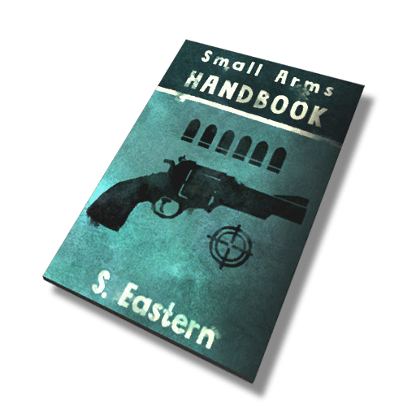

# Small Arms Handbook

**Contents**

- [Research info](#research-info)
- [Fire Starting info](#fire-starting-info)
- [Trivia](#trivia)
- [Update history](#update-history)

**Small Arms Handbook**

| Property | Details |
| --- | --- |
|  |  / *Small\_Arms\_Handbook\_icon.png* |
| Release | [6 May 2019](./The%20Long%20Dark%20%E2%80%94%20Changelog.md#1.48) |
| Wintermute | No |
| **Properties** |  |
| Item type | [Fire Starting](./Fire%20Starting.md)[Tools](./Tools.md)\|- |
| Stackable | No |
| Examine | A manual with details on effective handgun shooting and maintenance. Researching this will improve your Revolver Firearm Skill. |
| **Values** |  |
| Weight | 0.50 kg (1.1 lbs) |
| **Actions** |  |
| Backpack | Research, Drop |

**A Sewing Primer** is a [Research Book](./Research%20Book.md) used to improve the [Revolver Firearm](./Revolver%20Firearm.md) skill. It can also be used as Fuel when starting a [Fire](./Fire.md).

## Research info

*Small Arms Handbook* can be researched for 5 hours, which can be broken into multiple research sessions. 10 [Revolver Firearm skill points](./Revolver%20Firearm.md#Skill_levels) are awarded on completing the research.

Research can only be performed under the following conditions:

- There is light present to read
- [Warmth](./Warmth.md), [Fatigue](./Fatigue.md), [Thirst](./Thirst.md), and [Hunger](./Hunger.md) exceed 0%
- No negative [Afflictions](./Afflictions.md)

## Fire Starting info

**Small Arms Handbook**

| Property | Details |
| --- | --- |
| Type | Fuel |
| **Statistics** |  |
| Duration |  18 minutes |
| Start Chance |  +35% |
| Heat |  +2°C (+3.6°F) |
| Burn Density | 0.6 hr/kg (0.27 hr/lb) |

## Trivia

- Reaching 0% in any Needs while researching will immediately end the research session and negate any progress for that research attempt.
- Attempting to burn a copy of *Small Arms Handbook* when it has not been fully read will give a confirmation warning before it can be burned.
- Once a copy of *Small Arms Handbook* is fully researched, it will no longer appear in the Tools section of the Backpack.

## Update history

- UPDATE **6 May 2019 ([Update](./The%20Long%20Dark%20%E2%80%94%20Changelog.md#1.48)):**
  - Added to game.

**Lua execution error in Module:Navbox function navbox** **Lua execution error in Module:Navbox function navbox**
