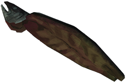

# Smallmouth Bass \(Cooked\)

**Categories:** Food And Drink, Pages with update history · **Source:** [Fandom](https://thelongdark.fandom.com/wiki/Smallmouth_Bass_%28Cooked%29)

**Contents**

- [Recipe](#recipe)
- [Recipe](#recipe-1)
- [Gallery](#gallery)
- [Update history](#update-history)

**Smallmouth Bass (Cooked)**

_Smallmouth\_Bass\_(Cooked)\_icon.png_

**Release:** [27 November 2014](./The%20Long%20Dark%20%E2%80%94%20Changelog.md#0.163)

**Wintermute:** No

**Properties**

**Item type:** [Food And Drink](./Food%20And%20Drink.md)\|-

**Stackable:** No

**Examine:** A feast as good for the soul as for the stomach.

**Values**

**Calories:** 1500 kcal

**Hydration:** -5%

**[Vitamin C](./Scurvy.md):** Minor (8%)

**Weight:** 3.3 kg (7.26 lbs)

**Advanced data**

**Item key:** GAMEPLAY\_CookedSmallmouthBass

_For the raw version, see [Smallmouth Bass (Raw)](./Smallmouth%20Bass%20%28Raw%29.md)._

_For the unique bass found in the [Episode 3](./Episode%203%20-%20Crossroads%20Elegy.md) mission [Tall Tales](./Tall%20Tales.md), see [Big Bass (Cooked)](./Big%20Bass%20%28Cooked%29.md)._

**Smallmouth Bass (Cooked)** is a cooked [food](./Food%20And%20Drink.md) item in _The Long Dark_.

## Recipe

**Smallmouth Bass (Cooked)**

| Property | Details |
| --- | --- |
| **Template:pic link plain**[Cooking](./Cooking.md)** |  |
|  | - |
|  | 74 minutes (1 hour 14 minutes) |
| **Requirements** |  |
| Facility | **Template:iconlink** |
| **Materials** |  |
| **Template:iconlink plain** |  |
| Item | [Smallmouth Bass (Raw)](./Smallmouth%20Bass%20%28Raw%29.md) |
| Quantity | 1.00 kg |

## Recipe

Cooking bass takes 30 minutes and is be obtained by using a lit [fire](./Fire.md). Cooking increases it's condition by 50%, decays 4 times slower than raw meat, and has a reduces chance of [food poisoning](./Afflictions.md) over raw meat, but decreasing it's weigh by 35%. Cooked bass' energy density is 455 calories-per-kilogram. Cooking fish also yields a small amount of [Lantern Fuel](./Lantern%20Fuel.md).

Cooking bass improves the [cooking skill](./Skills.md#Cooking). Using a [Cooking Pot](./Cooking%20Pot.md) reduces cooking time by 25%. Cooked food on an active fire for too long will burn (twice it's 'Ready' cooking time), destroying the item and damaging a Cooking Pot if used.

## Gallery

_Fresh_

_Gamey_

_Mouldy_

_Rancid_

_Ruined_

_Old model._

## Update history

- UPDATE **27 November 2014 ([Update](./The%20Long%20Dark%20%E2%80%94%20Early%20Access%20Changelog.md#0.163)):**
  - Added to game.
