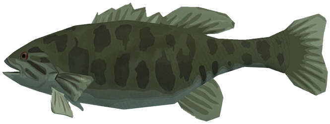

# Smallmouth Bass \(Raw\)

**Categories:** Fish, Food And Drink, Pages with update history · **Source:** [Fandom](https://thelongdark.fandom.com/wiki/Smallmouth_Bass_%28Raw%29)

**Contents**

- [Overview](#overview)
- [Products](#products)
- [Gallery](#gallery)
- [Update history](#update-history)

**Smallmouth Bass (Raw)**

\[\[File: /  / _Raw_ /  / _Opened_

250px\]\]

_Raw_

_Opened_

**Release:** [27 November 2014](./The%20Long%20Dark%20%E2%80%94%20Changelog.md#0.163)

**Wintermute:** No

**Renewable:** Yes

**Properties**

Item type

[Food And Drink](./Food%20And%20Drink.md)

Equipable

**Stackable:** No

**Examine:** A feast as good for the soul as for the stomach.

**Values**

**Calories:** 1500 kcal

**Hydration:** 0.0%

**[Vitamin C](./Scurvy.md):** Minor (11%)

**Weight:** 5.0 kg (11 lbs)

**Oil/Weight:** 0,025

**Advanced data**

**Item key:** GAMEPLAY\_RawSmallmouthBass

_For the cooked version, see [Smallmouth Bass (Cooked)](./Smallmouth%20Bass%20%28Cooked%29.md)._

_For the unique bass found in the [Episode 3](./Episode%203%20-%20Crossroads%20Elegy.md) mission [Tall Tales](./Tall%20Tales.md), see [Big Bass (Raw)](./Big%20Bass%20%28Raw%29.md)._

**Smallmouth Bass (Raw)** is a raw [food](./Food%20And%20Drink.md) item in _The Long Dark_.

## Overview

Smallmouth Bass are large freshwater fish sparsely found in lakes and ponds. They can be caught by [Ice Fishing](./Ice%20Fishing.md) using [Fishing Tackle](./Fishing%20Tackle.md) or found by [Beachcombing](./Beachcombing.md), though the reason for their rare presence in saltwater environments is unknown. Bass can be between 1.8 and 5.0 kg raw.

At 0% condition food disappears if inside of a container, but not outside of containers or in the player's inventory.

## Products

## Gallery

_Old model._

## Update history

- UPDATE **27 November 2014 ([Update](./The%20Long%20Dark%20%E2%80%94%20Early%20Access%20Changelog.md#0.163)):**
  - Added to game.
