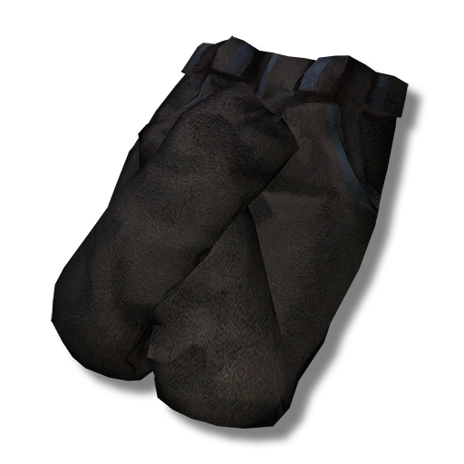
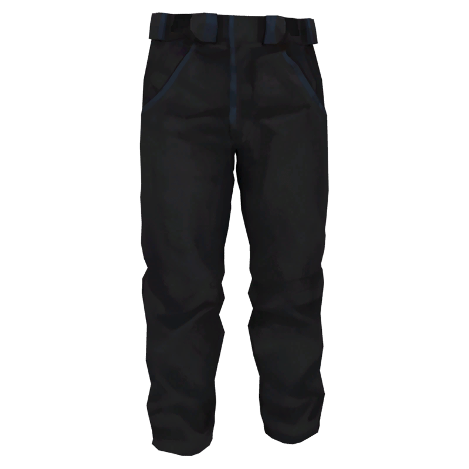
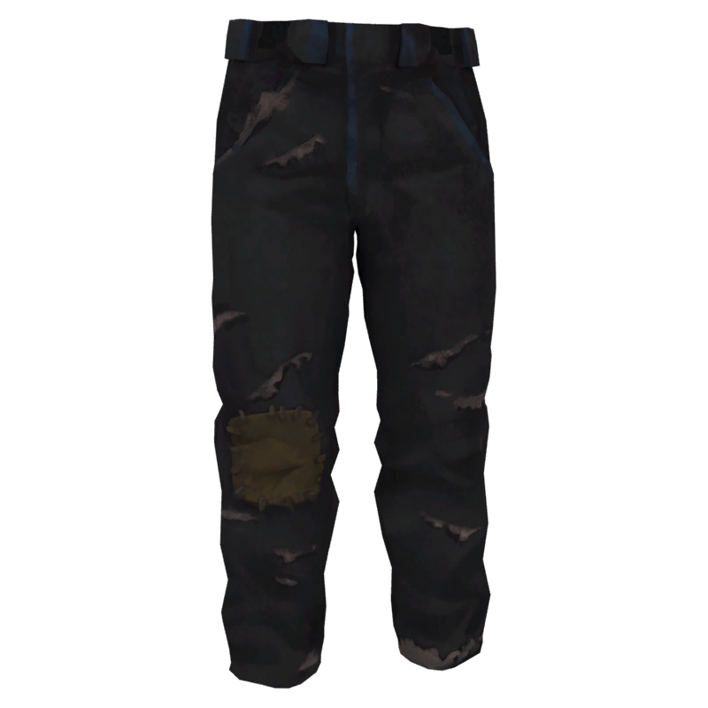

# Snow Pants

<table class="infobox">
<caption>Snow Pants</caption>
<colgroup>
<col style="width: 50%" />
<col style="width: 50%" />
</colgroup>
<tbody>
<tr>
<td colspan="2"><figure>

<figcaption>Snow_Pants_icon.png</figcaption>
</figure></td>
</tr>
<tr>
<td colspan="2" class="section">
<strong>General</strong>
</td>
</tr>
<tr>
<td>
Item Type
</td>
<td>
Clothing|-
</td>
</tr>
<tr>
<td colspan="2" class="section">
<strong>Statistics</strong>
</td>
</tr>
<tr>
<td>
Weight
</td>
<td>
1.00 kg(2.2 lbs)
</td>
</tr>
<tr>
<td>
Warmth bonus
</td>
<td>
2.5 °C(4.5 °F)
</td>
</tr>
<tr>
<td>
Windproof bonus
</td>
<td>
2.0 °C(3.6 °F)
</td>
</tr>
<tr>
<td>
Waterproof bonus
</td>
<td>
50%
</td>
</tr>
<tr>
<td>
Protection
</td>
<td>
5%
</td>
</tr>
<tr>
<td>
Mobility
</td>
<td>
-5%
</td>
</tr>
<tr>
<td>
Harvest
</td>
<td>
1 × <a href="./Cloth.md" class="wikilink" title="Cloth">Cloth</a> 
30 minutes
</td>
</tr>
<tr>
<td>
Repair
</td>
<td>
1 × <a href="./Cloth.md" class="wikilink" title="Cloth">Cloth</a> 
30 minutes 
30% condition
</td>
</tr>
</tbody>
</table>

<table>
<colgroup>
<col style="width: 33%" />
<col style="width: 33%" />
<col style="width: 33%" />
</colgroup>
<tbody>
<tr>
<td style="vertical-align: top; font-size: 3em; color: #5d5980; padding-right: 10px">
“
</td>
<td>
Insulated pants with a nylon windproof layer. Designed for spending a day in the snow without getting too wet!

&#10;

In-game description

</td>
<td style="vertical-align: bottom; font-size: 3em; color: #5d5980; padding-left: 10px">
”
</td>
</tr>
</tbody>
</table>

**Snow Pants** are a type of <a href="./Clothing.md" class="wikilink" title="Clothing">Clothing</a> in *<a href="./The%20Long%20Dark.md" class="wikilink" title="The Long Dark">The Long Dark</a>*.

Snow Pants have the second highest warmth bonus in the game for pants, second only to <a href="./Wolfskin%20Pants.md" class="wikilink" title="Wolfskin Pants">Wolfskin Pants</a>, and are tied with <a href="./Deerskin%20Pants.md" class="wikilink" title="Deerskin Pants">Deerskin Pants</a> for the highest windproof bonus in the game.

Snow Pants have the same total Warmth+Windproof bonus as Wolfskin Pants, while weighing significantly less, but offering half the protection bonus. Deerskin Pants similarly have higher protection and weight, but less warmth bonus.

Because of their excellent weight to warmth ratio compared to both crafted pants, a player may want to wear one set of snow pants along with a set of crafted pants. When doing so, a player should make certain to wear Deerskin Pants on the outside layer (to benefit from their higher protection and waterproof values), or Wolfskin Pants on the inside (when not in danger of wildlife struggles) to benefit from their higher warmth value.

Even if wolfskin pants are available, a player may still find it more convenient to wear two pairs of Snow Pants, or one pair of Snow Pants with a pair of <a href="./Combat%20Pants.md" class="wikilink" title="Combat Pants">Combat Pants</a> on their inside layer, to conserve their carry weight.

Repaired with <a href="./Cloth.md" class="wikilink" title="cloth">cloth</a>.

Not available on <a href="./Interloper.md" class="wikilink" title="Interloper">Interloper</a>.

<table class="gallery">
<colgroup>
<col style="width: 50%" />
<col style="width: 50%" />
</colgroup>
<tbody>
<tr>
<td><figure>

<figcaption>Clothing model icon</figcaption>
</figure></td>
<td><figure>

<figcaption>Clothing model icon damaged</figcaption>
</figure></td>
</tr>
</tbody>
</table>

## Update history

- UPDATE **19 December 2016 (<a href="./The%20Long%20Dark%20%E2%80%94%20Early%20Access%20Changelog.md#0.386" class="wikilink" title="Update">Update</a>):**
  - Added to game

**Lua execution error in Module:Navbox function navbox** <a href="ru:%D0%97%D0%B8%D0%BC%D0%BD%D0%B8%D0%B5_%D1%88%D1%82%D0%B0%D0%BD%D1%8B" class="wikilink" title="ru:Зимние_штаны">ru:Зимние_штаны</a>

