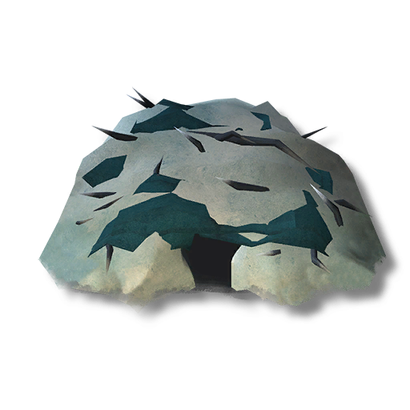
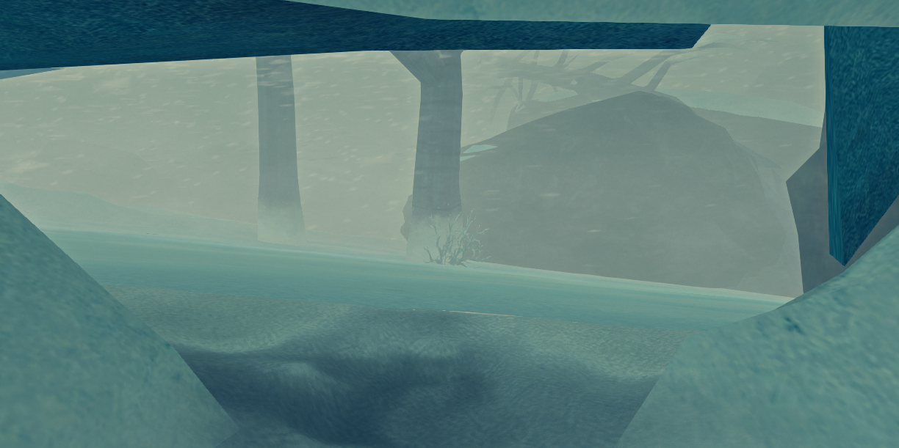
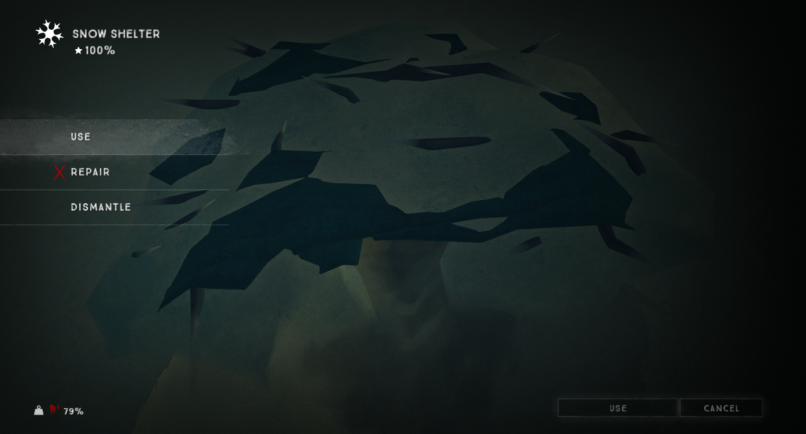

# Snow Shelter

**Contents**

- [Mechanics](#Mechanics)
- [Crafting](#Crafting)
- [Repairing a snow shelter](#Repairing_a_snow_shelter)
- [Dismantling a snow shelter](#Dismantling_a_snow_shelter)
- [Gallery](#Gallery)
- [Game history](#Game_history)

<table class="infobox">
<caption>Snow Shelter</caption>
<colgroup>
<col style="width: 50%" />
<col style="width: 50%" />
</colgroup>
<tbody>
<tr>
<td colspan="2"><figure>

<figcaption>Snow_shelter_icon.png</figcaption>
</figure></td>
</tr>
<tr>
<td colspan="2" class="section">
<strong>General</strong>
</td>
</tr>
<tr>
<td>
Item Type
</td>
<td>
Item
</td>
</tr>
<tr>
<td>
Wintermute
</td>
<td>
No
</td>
</tr>
<tr>
<td colspan="2" class="section">
<strong>Statistics</strong>
</td>
</tr>
<tr>
<td>
Warmth bonus
</td>
<td>
15 °C(27 °F)
</td>
</tr>
<tr>
<td>
Harvest
</td>
<td>
10 <a href="./Stick.md" class="wikilink" title="Stick">Sticks</a> 
2 <a href="./Cloth.md" class="wikilink" title="Cloth">Cloth</a>
</td>
</tr>
<tr>
<td>
Repair
</td>
<td>
up to 10 <a href="./Stick.md" class="wikilink" title="Stick">Sticks</a> 
up to 3 <a href="./Cloth.md" class="wikilink" title="Cloth">Cloth</a>
</td>
</tr>
</tbody>
</table>

**Snow Shelters** are temporary shelters which can be constructed outdoors in *The Long Dark*.

They provide wind protection and temperature bonus while inside of them, but degrade over time and eventually become ruined unless repaired.

## Mechanics

Air temperature inside the snow shelter will always be +15°C higher than air temperature outside the shelter, even if the shelter condition degrades. Additionally shelter provides +3°C bonus when passing time or sleeping (see below). The shelter will provide the bonus even when ruined, until the player leaves it. The warmth bonus from clothing is also used when calculating <a href="./Feels%20Like.md" class="wikilink" title="Feels Like">Feels Like</a> (the windshield warmth bonus from clothing doesn't apply). The view from inside a snow shelter When inside a Snow Shelter the player can still light <a href="./Fire.md" class="wikilink" title="campfires">campfires</a>, use <a href="./Hunting%20Rifle.md" class="wikilink" title="weapons">weapons</a>, as well other tasks such as harvesting, repairing clothes, eating or drinking. The player can rest or pass time inside Snow Shelters (similar to cars), even without a <a href="./Bedroll.md" class="wikilink" title="Bedroll">Bedroll</a>. If a bedroll is selected, the shelter will provide an additional +3°C warmth bonus. This bonus does not decay together with the shelter, and a 3% shelter will still provide full +3°C bonus.

Once constructed, a snow shelter will degrade from 100% to 0% condition over roughly 188 in-game hours (on Stalker mode) or almost 8 in-game days, after which it will become ruined and can no longer be used or repaired. The decay is not completely linear and is likely influenced by local weather. If dismantled before reaching 0% condition, some of the <a href="./Stick.md" class="wikilink" title="Sticks">Sticks</a> and <a href="./Cloth.md" class="wikilink" title="Cloth">Cloth</a> used to create it can be reclaimed. Once ruined, dismantling a Snow Shelter will not yield any materials.

## Crafting

<table class="infobox">
<caption>Snow Shelter</caption>
<tbody>
<tr>
<td colspan="2">
-
</td>
</tr>
<tr>
<td colspan="2">
-
</td>
</tr>
<tr>
<td colspan="2">
45 minutes
</td>
</tr>
<tr>
<td colspan="2" class="section">
<strong>Requirements</strong>
</td>
</tr>
<tr>
<td>
Facility
</td>
<td>
[[File:Anywhere icon.png
</td>
</tr>
<tr>
<td colspan="2" class="section">
<strong>Materials</strong>
</td>
</tr>
<tr>
<td colspan="2" class="section">
<strong>Template:iconlink plain</strong>
</td>
</tr>
<tr>
<td>
Item
</td>
<td>
<a href="./Stick.md" class="wikilink" title="Stick">Stick</a>
</td>
</tr>
<tr>
<td>
Quantity
</td>
<td>
15
</td>
</tr>
<tr>
<td colspan="2" class="section">
<strong>Template:iconlink plain</strong>
</td>
</tr>
<tr>
<td colspan="2">
<a href="./Cloth.md" class="wikilink" title="Cloth">Cloth</a>
</td>
</tr>
<tr>
<td colspan="2">
5
</td>
</tr>
</tbody>
</table>

The snow shelter can be crafted using the <a href="./Radial%20Menu.md" class="wikilink" title="Radial Menu">Radial Menu</a>:

1.  Open the Radial Menu
2.  Select Camp Craft (left side)
3.  Select Snow Shelter (right side)

After selecting, the player will have to find somewhere to place it. The shelter will turn green when a valid location has been found, if the shelter is unable to be placed it will be red, moving to a leveled plane or bringing the shelter closer should allow it to be placed.

Amount of calories used varies, testing revealed an estimated range of 112 to 263 calories. The value seems to also depend on the character's condition and the weather.

## Repairing a snow shelter

Snow Shelter's usage menu To repair a snow shelter, the player can access the Snow Shelter Menu by clicking on the snow shelter and selecting Repair.

Depending on the condition of the snow shelter, repairing it may require sticks and cloth. The more degraded the shelter is, the more time and materials necessary to repair it. Up until 74%, the shelter will not require cloth. When at 75%, 3 sticks are required to bring it back to 100%. It takes approximately 1 day and 17.5 hours (~42 hours) for shelter to degrade to 75% condition. The shelter will require 1 cloth around 74%, 2 cloth around 48%, and 3 under 30%. The maximum cost of repairing a shelter (when it is 3%) is 10 sticks and 3 cloth.

## Dismantling a snow shelter

Snow shelters can be dismantled, and a portion of the items used for building it can be reclaimed (if they are not ruined). This takes 20 in-game minutes.

The amount of calories used varies, with testing showing an estimated range of 38 to 88 calories used while dismantling. It seems to depend on the character's condition and the weather.

Dismantling a snow shelters above 0% condition yields:

- 10 Sticks
- 2 Cloth

## Gallery

<table class="gallery">
<colgroup>
<col style="width: 100%" />
</colgroup>
<tbody>
<tr>
<td><figure>

<figcaption>A Snow Shelter placed in the world</figcaption>
</figure></td>
</tr>
</tbody>
</table>

## Game history

- The snow shelter was introduced in <a href="./The%20Long%20Dark%20%E2%80%94%20Changelog.md#0.346" class="wikilink" title="version 0.346">version 0.346</a>, "Penitent Scholar", on 23 June 2016.
- The option to breakdown ruined snow shelter was introduced in <a href="./The%20Long%20Dark%20%E2%80%94%20Changelog.md#1.64" class="wikilink" title="version 1.64">version 1.64</a> , "ERRANT PILGRIM", on 10 December 2019.

**Lua execution error in Module:Navbox function navbox** <a href="ru:%D0%A1%D0%BD%D0%B5%D0%B6%D0%BD%D0%BE%D0%B5_%D1%83%D0%BA%D1%80%D1%8B%D1%82%D0%B8%D0%B5" class="wikilink" title="ru:Снежное укрытие">ru:Снежное укрытие</a>

