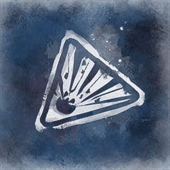

# Something Stinks

<table class="infobox">
<caption>Something Stinks</caption>
<colgroup>
<col style="width: 50%" />
<col style="width: 50%" />
</colgroup>
<tbody>
<tr>
<td colspan="2"><figure>

<figcaption>Something_Stinks_icon.png</figcaption>
</figure></td>
</tr>
<tr>
<td>
Description
</td>
<td>
Locate the Detonators.
</td>
</tr>
</tbody>
</table>

**Something Stinks** is a <a href="./Wintermute.md" class="wikilink" title="Wintermute">Wintermute</a> <a href="./The%20Long%20Dark%20%E2%80%94%20Achievements.md" class="wikilink" title="achievement">achievement</a> in <a href="./Episode%204%20-%20Fury%2C%20Then%20Silence.md" class="wikilink" title="Episode 4: Fury, then Silence">Episode 4: Fury, then Silence</a> of *<a href="./The%20Long%20Dark.md" class="wikilink" title="The Long Dark">The Long Dark</a>*.

## Guide

This is an unmissable story achievement achieved during the mission <a href="./The%20Detonators.md" class="wikilink" title="The Detonators">The Detonators</a>. Navigate the <a href="./Last%20Prospect.md" class="wikilink" title="Last Prospect">Last Prospect</a> mine and find the <a href="./Detonators.md" class="wikilink" title="Detonators">Detonators</a> and the achievement will unlock.

## Game History

- UPDATE **6 October 2021 (<a href="./The%20Long%20Dark%20%E2%80%94%20Changelog.md#1.95" class="wikilink" title="Update">Update</a>):**
  - Added to game.

**Lua execution error in Module:Navbox function navbox**

