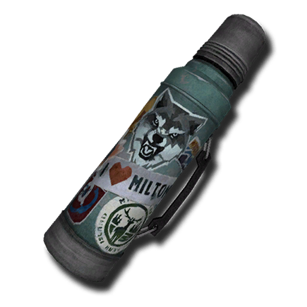

# Something Warm to Drink

**Categories:** Achievements · **Source:** [Fandom](https://thelongdark.fandom.com/wiki/Something_Warm_to_Drink)

**Something Warm to Drink**

[Something Warm to Drink icon](../assets/Something_Warm_to_Drink_icon.png)

**Description:** Collect 7 Insulated Flask Variants (single game)

**Something Warm to Drink** is an [achievement](./The%20Long%20Dark%20%E2%80%94%20Achievements.md) in _[The Long Dark](./The%20Long%20Dark.md)_.

<!-- #Guide -->
​

<!-- #guide -->
## Guide

This achievement is easiest to unlock when playing on [Pilgrim](./Pilgrim.md). The player must collect the 7 different unique variants of an [Insulated Flask](./Insulated%20Flask.md) in a single [Survival Mode](./Survival%20Mode.md) game.

- 1 (rarely 2) can be found per Region all across the Island, but the "Sticker" variant can only be acquired from a random trade from the [Trader](./Trader.md).

Collecting all 7 at least once on one save file unlocks the achievement.

