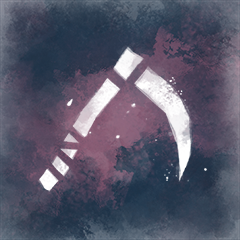

# Something Wicked

<table class="infobox">
<caption>Something Wicked</caption>
<colgroup>
<col style="width: 50%" />
<col style="width: 50%" />
</colgroup>
<tbody>
<tr>
<td colspan="2"><figure>

<figcaption>Something_Wicked_icon.png</figcaption>
</figure></td>
</tr>
<tr>
<td colspan="2"></td>
</tr>
<tr>
<td>
Description
</td>
<td>
Survive 1000 days in a single Survival Mode game without Cheating Death.
</td>
</tr>
</tbody>
</table>

**Something Wicked** is an <a href="./The%20Long%20Dark%20%E2%80%94%20Achievements.md" class="wikilink" title="achievement">achievement</a> in *<a href="./The%20Long%20Dark.md" class="wikilink" title="The Long Dark">The Long Dark</a>*.

## Guide

Simply surviving for 1000 days in <a href="./Survival%20Mode.md" class="wikilink" title="Survival Mode">Survival Mode</a> without using <a href="./Cheat%20Death.md" class="wikilink" title="Cheat Death">Cheat Death</a> at all in the save will unlock this. Surviving 1000 days after using Cheat Death will not grant the achievement.

- This achievement is easiest to achieve on <a href="./Pilgrim.md" class="wikilink" title="Pilgrim">Pilgrim</a>.
- Consider disabling <a href="./Cougar.md" class="wikilink" title="Cougar">Cougar</a> and <a href="./Scurvy.md" class="wikilink" title="Scurvy">Scurvy</a> if playing on <a href="./Voyageur.md" class="wikilink" title="Voyageur">Voyageur</a> or above to make survival easier.
- <a href="./Sleep.md" class="wikilink" title="Sleep">Sleep</a> often and ensure your <a href="./Condition.md" class="wikilink" title="Condition">Condition</a> is high at all times. Always check yourself for negative <a href="./Afflictions.md" class="wikilink" title="Afflictions">Afflictions</a> before sleeping.
- Practice <a href="./Hibernation.md" class="wikilink" title="Hibernation">Hibernation</a> in order to increase the passage of time in the game world (eating only when sleeping, then resting to make time pass).
- Simply closing the game should you be attacked and you know you will die in the ensuing <a href="./Struggle.md" class="wikilink" title="Struggle">Struggle</a> is a method to avoid death (though this will send you back to your last save upon reloading). This method does not work should the game save for any reason during the attack (ex, <a href="./Timberwolf.md" class="wikilink" title="Timberwolf">Timberwolf</a>/Cougar bites)
  - Making a manual backup of your save files every so often can be a good (albeit dishonorable) method to restore a save should you fade into The Long Dark.
- 

## Trivia

The achievement name is an <a href="./Easter%20Eggs.md" class="wikilink" title="Easter Egg">Easter Egg</a> reference to a quote from one of the three witches in Shakespeare's [Macbeth](https://nosweatshakespeare.com/quotes/famous/something-wicked-this-way-comes/):

- **Second Witch**: "By the pricking of my thumbs, Something wicked this way comes."
- Its meaning is that a monster of a man approaches.
  - The monster in this case being what the player character most likely becomes after doing what they must to survive, eventually conquering Great Bear Island across a 1000 day campaign without dying, after a civilizational ending apocalyptical event no less.
  - The icon for the achievement is that of a Reaper, a tool often associated with the personification of Death, also known as the Grim Reaper.

**Lua execution error in Module:Navbox function navbox**

