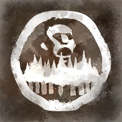

# Sounds Like Some Kind of Indie Band

**Contents**

- [Guide](#Guide)
- [Tasks](#Tasks)
- [Trivia](#Trivia)
- [Game History](#Game_History)

<table class="infobox">
<caption>Sounds Like Some Kind of Indie Band</caption>
<colgroup>
<col style="width: 50%" />
<col style="width: 50%" />
</colgroup>
<tbody>
<tr>
<td colspan="2"><figure>

<figcaption>Sounds_Like_Some_Kind_of_Indie_Band_icon.png</figcaption>
</figure></td>
</tr>
<tr>
<td>
Description
</td>
<td>
Find all Forest Talker caches.
</td>
</tr>
</tbody>
</table>

**Sounds Like Some Kind of Indie Band** is a <a href="./Wintermute.md" class="wikilink" title="Wintermute">Wintermute</a> <a href="./The%20Long%20Dark%20%E2%80%94%20Achievements.md" class="wikilink" title="achievement">achievement</a> in <a href="./Episode%202%20-%20Luminance%20Fugue.md" class="wikilink" title="Episode 2: Luminance Fugue">Episode 2: Luminance Fugue</a> of *<a href="./The%20Long%20Dark.md" class="wikilink" title="The Long Dark">The Long Dark</a>*.

## Guide

This is a side mission achievement achieved after finding all <a href="./Forest%20Talkers.md" class="wikilink" title="Forest Talker">Forest Talker</a> caches as part of the mission <a href="./Forest%20Talker%20Supply%20Caches.md" class="wikilink" title="Forest Talker Supply Caches">Forest Talker Supply Caches</a>. You must first find the note <a href="./Forest%20Talker%20Map%20Note.md" class="wikilink" title="Forest Talker Map Note">Forest Talker Map Note</a> in the <a href="./Hunting%20Lodge.md" class="wikilink" title="Hunting Lodge">Hunting Lodge</a> in <a href="./Broken%20Railroad.md" class="wikilink" title="Broken Railroad">Broken Railroad</a>.

## Tasks

- Forest Talker Cache: Mystery Lake
  - The cache is located near the trailers by the logging camp.
  - The content is: <a href="./Firearm%20Cleaning%20Kit.md" class="wikilink" title="Firearm Cleaning Kit">Firearm Cleaning Kit</a>, a <a href="./Military-Grade%20MRE.md" class="wikilink" title="Military-Grade MRE">Military-Grade MRE</a> and decent <a href="./Ski%20Gloves.md" class="wikilink" title="Ski Gloves">Ski Gloves</a>.
- Forest Talker Cache: Forlorn Muskeg
  - The cache is located at the base of a cliff south of Muskeg Overlook
  - The content is: <a href="./Antiseptic.md" class="wikilink" title="Antiseptic">Antiseptic</a>, <a href="./Long%20Wool%20Scarf.md" class="wikilink" title="Long Wool Scarf">Long Wool Scarf</a>, <a href="./Light%20Shell.md" class="wikilink" title="Light Shell">Light Shell</a>
- Forest Talker Cache: Maintenance Yard
  - To unlock the quest, the player must find a letter in the basement of the hunting lodge.
  - The cache is located in the western part of the maintenance yard area.
  - The content is: 12 <a href="./Wood%20Matches.md" class="wikilink" title="Wood Matches">Wood Matches</a>, a <a href="./Can%20Opener.md" class="wikilink" title="Can Opener">Can Opener</a>, 2 <a href="./Firelog.md" class="wikilink" title="Firelogs">Firelogs</a> and 1 <a href="./Accelerant.md" class="wikilink" title="Accelerant">Accelerant</a>.

## Trivia

The achievement's name is a reference to the quote from <a href="./Will%20Mackenzie.md" class="wikilink" title="Will Mackenzie">Will Mackenzie</a> in You Fix My Rifle?: "Forest Talkers? Sounds like some kind of indie band. Maybe this guy was one of them. I guess I should check out this Lodge."

## Game History

- UPDATE **1 August 2017 (<a href="./The%20Long%20Dark%20%E2%80%94%20Changelog.md#1.00" class="wikilink" title="Update">Update</a>):**
  - Added to game.

**Lua execution error in Module:Navbox function navbox**

