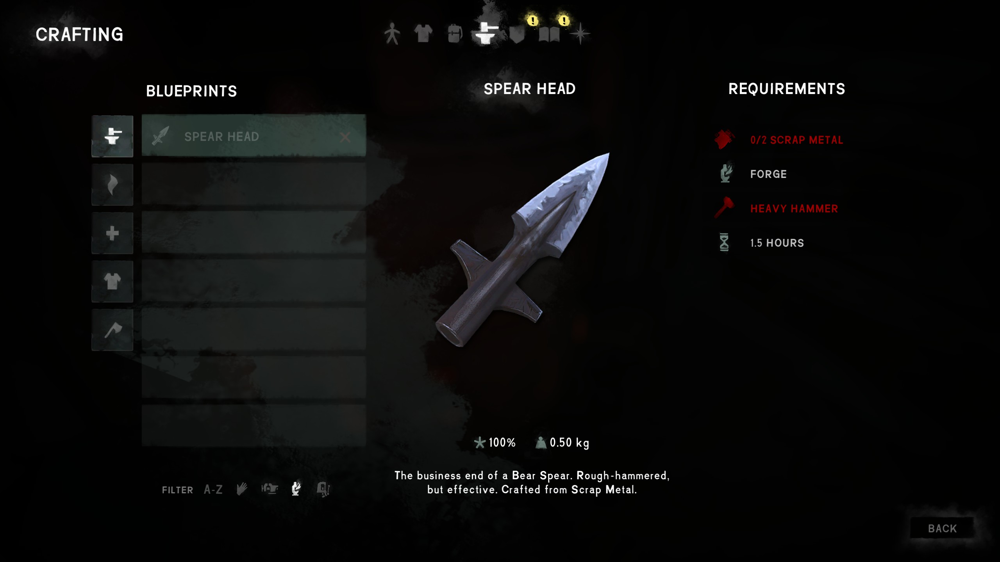
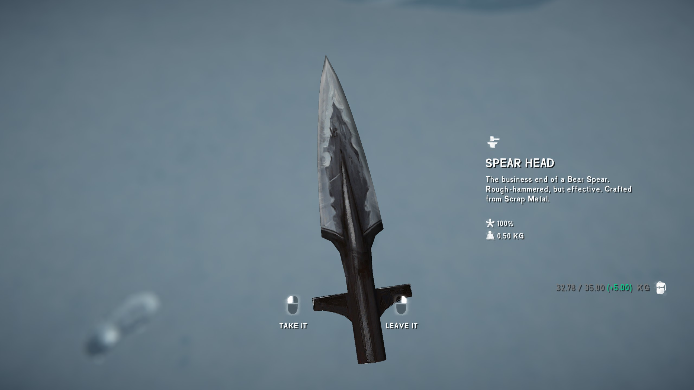

# Spear Head

**Categories:** Pages with update history, Tools · **Source:** [Fandom](https://thelongdark.fandom.com/wiki/Spear_Head)

**Spear Head**

| Property | Details |
| --- | --- |
|  | [Spear Head icon](../assets/Spear_Head_icon.png) |
| Release | [17 December 2018](./The%20Long%20Dark%20%E2%80%94%20Changelog%20%E2%80%94%20Archive%201.md#1.00) |
| Wintermute | [Episode 2](./Episode%202%20-%20Luminance%20Fugue.md) - [The Best Defense](./The%20Best%20Defense.md) |
| **Properties** |  |
| Item type | [Tools](./Tools.md)\|- |
| Stackable | No |
| Examine | The business end of a Bear Spear. Rough-hammered, but effective. Crafted from Scrap Metal. |
| **Values** |  |
| Weight | 0.50 kg (1.1 lbs) |
| **Actions** |  |
| Backpack | Examine |
| On ground | Take It, Leave It |

**Spear Head** is a [Tool](./Tools.md) found in [Episode 2](./Episode%202%20-%20Luminance%20Fugue.md) of the [Wintermute](./Wintermute.md) story mode. It is created in a [Forge](./Forge.md) in order to repair the [Broken Bear Spear](./Broken%20Bear%20Spear.md) in the mission [The Best Defense](./The%20Best%20Defense.md). Once forged, it is instantly combined with the Broken Bear Spear to create the [Bear Spear](./Bear%20Spear.md).

More Spear Heads can be crafted in the forge after the first one. They can be carried around, have a world model, and inventory model, but serve no other purpose.

## Crafting

**Spear Head**

90 minutes (1 hour 30 minutes)

**Requirements**

**Story:** [The Best Defense](./The%20Best%20Defense.md)

**Item:** [Scrap Metal](./Scrap%20Metal.md)

**Quantity:** 2

## Gallery

## Update history

\* UPDATE **17 December 2018 ([Update](./The%20Long%20Dark%20%E2%80%94%20Changelog%20%E2%80%94%20Archive%201.md#1.41)):**

- Added to game.
