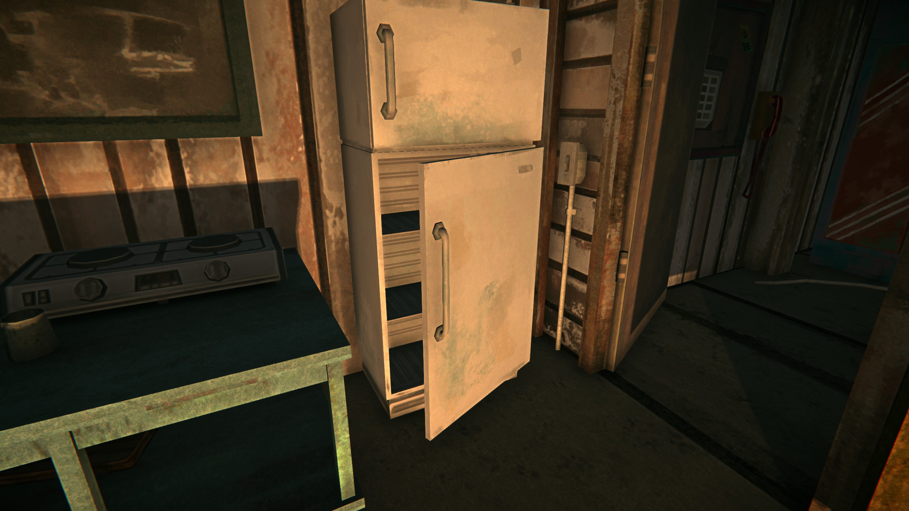
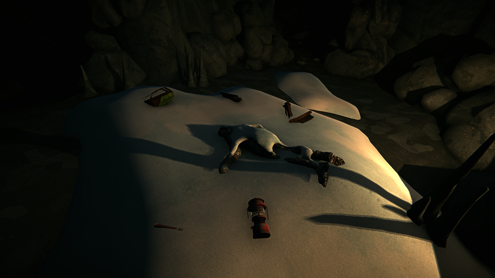

# Spelunker's Lantern

**Categories:** DLC Content, Pages with update history, Tools · **Source:** [Fandom](https://thelongdark.fandom.com/wiki/Spelunker's_Lantern)

**Contents**

- [Overview](#overview)
- [Differences](#differences)
- [Locations](#locations)
- [Trivia](#trivia)
- [Gallery](#gallery)
- [Update history](#update-history)

**DLC-Exclusive content.**

This content requires the [Tales from the Far Territory](./Tales%20from%20the%20Far%20Territory.md) addon to be installed before it can be seen or used in regular gameplay.

**Spelunker's Lantern**

[Spelunker's Lantern icon](../assets/Spelunker%27s_Lantern_icon.png)

**Release:** [5 December 2022](./The%20Long%20Dark%20%E2%80%94%20Changelog.md#2.03)

**Wintermute:** No

**Renewable:** No (unique item)

**Properties**

**Item type:** [Tools](./Tools.md)

**Stackable:** No

**Examine:** Rigged for fuel efficiency. A light for deep, dark places, when other lights go out.

**Values**

**Weight:** 1.00 kg (2.2 lbs)

**Actions**

**On ground:** Take It, Equip It, Leave It

**Advanced data**

**Item key:** GAMEPLAY\_KeroseneLamp\_Spelunkers

**Spelunker's Lantern** is a unique variant of the [Storm Lantern](./Storm%20Lantern.md) in _The Long Dark_, added by the _[Tales from the Far Territory](./Tales%20from%20the%20Far%20Territory.md)_ expansion.

## Overview

Spelunker's Lantern is a mobile source of light and [Warmth](./Warmth.md) which does not require Matches or other firestarters to ignite. The lantern's flame is also windproof, but unlike [Flares](./Flare.md) it will not deter [wolves](./Wolf.md). The lantern requires no external ignition source due to the internal auto-igniter, unlike [Torches](./Torch.md). This allows the Spelunker's Lantern to be quickly extinguished and ignited at any point, so long as there is a sufficient internal fuel store. Lanterns can be placed ("RMB") on any flat surface, even when lit, such as to provide light while crafting or reading at night. Lanterns can be refueled with [Lantern Fuel](./Lantern%20Fuel.md) or a [Jerry Can](./Jerry%20Can.md).

The Spelunker's Lantern does not degrade condition when used or over time, but may suffer damage during a [Bear Struggle](./Struggle.md). It can be repaired with [Scrap Metal](./Scrap%20Metal.md) and [Tools](./Simple%20Tools.md). If harvested, any fuel left inside will be added to the survivor's inventory.

- A lit lantern adds 3*C to the survivor's "Warmth" when ignited and equipped.
- Weighs 1.00kg when empty
- Can hold up to 1 liter (0.26 gallons) of Lantern Fuel which is enough to use continuously for 5 in-game hours and 36 minutes (weighing 1.8 kg when fully fueled)
- The higher the amount of fuel stored inside a lantern, the brighter the light it produces
- When below 10% (0.10kg) fuel and ignited, the Spelunker's Lantern flame will flicker and sputter, and extinguishing itself at 0% fuel

The Spelunker's Lantern can be quickly extinguished without needing to stop the survivor by pressing any hotkey (e.g. "2" to switch to a Weapon), while manually extinguishing it ("LMB") will cause the survivor to stop while extinguishing.

Since version 2.17 the Spelunker's Lantern will spawn in [Interloper](./Interloper.md). It will also spawn on [Misery](./Misery.md).

## Differences

- 40% more fuel efficient than Storm Lanterns (5 hour 36 minutes of fuel from a full tank VS 4 hours from Storm Lantern)
- 40% less light radius and brightness than Storm Lanterns due to lower fuel consumption (even at full capacity)

## Locations

Only one Spelunker's Lantern will appear per game world, and its location is randomized between multiple locations in north-eastern Great Bear Island:

- [Ash Canyon](./Ash%20Canyon.md)/Timberwolf Mountain: transition cave (Not on Interloper/Misery)
- [Blackrock](./Blackrock.md)/Timberwolf Mountain: transition cave ([Loot Table](./Loot%20Table.md) 2 on Interloper)
- Keeper's Pass: Inside the ice cave connecting [Keeper's Pass North](./Keeper%27s%20Pass%20North.md) and [Keeper's Path South](./Keeper%27s%20Pass%20South.md), in the large chamber near the southern exit. ([Loot Table](./Loot%20Table.md) 1 on Interloper)
- [Pleasant Valley](./Pleasant%20Valley.md): behind the waterfall in [Misty Falls Cave](./Misty%20Falls%20Cave.md) (Not on Interloper/Misery)
- [Timberwolf Mountain](./Timberwolf%20Mountain.md)
  - inside [Chasm Cave](./Chasm%20Cave.md) within [Echo Ravine](./Echo%20Ravine.md) near [Engine](./Engine%20%28East%29.md) (Not on Interloper/Misery)
  - inside [Waterfall Cave](./Waterfall%20Cave.md) ([Loot Table](./Loot%20Table.md) 3 on Interloper)
  - [Echo Peak East](./Echo%20Peak%20East.md) at the top of the peak behind rocks at the cave ([Loot Table](./Loot%20Table.md) 4 on Interloper)
  - [Cave](./Cave%20%28Timberwolf%20Mountain%20location%201%29.md) between [Secluded Shelf](./Secluded%20Shelf.md) and the area below [Summit](./Summit.md) (Not on Interloper/Misery)

## Trivia

You can skip the Extinguish animation (which forces you to stop) by simply holstering the Lantern outright.

The lantern's description is an [Easter Egg](./Easter%20Eggs.md), being a reference to The Lord of the Rings.

## Gallery

## Update history

- UPDATE **5 December 2022 ([Update](./The%20Long%20Dark%20%E2%80%94%20Changelog.md#2.03)):**
  - Added to game.
