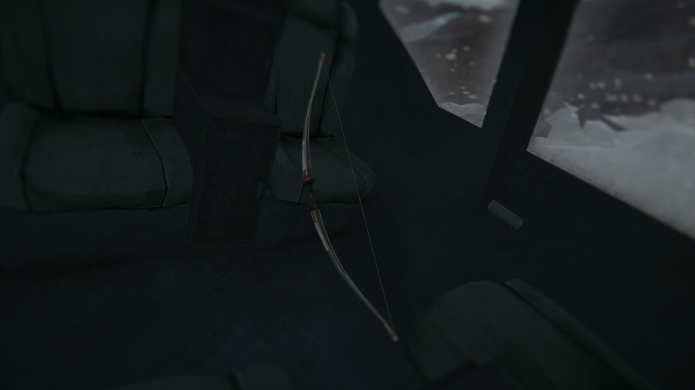

# Sport Bow

**Categories:** DLC Content, Pages with update history, Tools · **Source:** [Fandom](https://thelongdark.fandom.com/wiki/Sport_Bow)

**Contents**

- [Overview](#overview)
- [Differences from Survival Bow](#differences-from-survival-bow)
- [Locations](#locations)
- [Tips](#tips)
- [Gallery](#gallery)
- [Update history](#update-history)

**DLC-Exclusive content.**

This content requires the [Tales from the Far Territory](./Tales%20from%20the%20Far%20Territory.md) addon to be installed before it can be seen or used in regular gameplay.

**Sport Bow**

| Property | Details |
| --- | --- |
|  | [Sport Bow icon](../assets/Sport_Bow_icon.png) |
| Release | [21 June 2023](./The%20Long%20Dark%20%E2%80%94%20Changelog.md#2-17-tftft-part-three-frontier-comforts-update) |
| Wintermute | No |
| **Properties** |  |
| Item type | [Tools](./Tools.md) |
| Equipable | Yes |
| Stackable | No |
| Examine | A light and durable manufactured Bow. A trusty companion on or off the archery range. |
| **Values** |  |
| Weight | 0.35 kg (0.77 lbs) |
| **Actions** |  |
| Backpack | Use, Actions, Drop |
| On ground | Take It, Equip It, Leave It |
| **Advanced data** |  |
| Item key | GEAR\_Bow\_Manufactured |

**Sport Bow** is a unique variant of the [Survival Bow](./Survival%20Bow.md) in _The Long Dark_, added by the _[Tales from the Far Territory](./Tales%20from%20the%20Far%20Territory.md)_ expansion.

## Overview

The sport bow is a commercially manufactured fiberglass bow with a black handle, red and white paint highlights on its limbs, and an overall dark gray appearance. It is the lightest bow variant in the game while also boasting the second highest durability, just behind the heavy [Woodwright's Bow](./Woodwright%27s%20Bow.md). It is a direct upgrade to the survival bow, however only 2 sport bows can be found per save with no way to obtain more.

Like other bows, the Sport Bow cannot be repaired.

## Differences from Survival Bow

- Base weight is 0.15kg less than the Survival Bow
- Total durability is 60% more than Survival Bow (uses 1.25%-0.625% condition per shot based on [archery skill](./Archery.md))

## Locations

There are two sports bows available per game with one located in [Forsaken Airfield](./Forsaken%20Airfield.md) and the other in the [Langston Mine](./Langston%20Mine.md). Both spawn at 100% condition. The bow's location may differ between saves.

**Forsaken airfield**

- By a corpse at the crashed plane on [Shoulder Lake](./Shoulder%20Lake.md)
- In the back of the crashed helicopter to the east of [Shoulder Lake](./Shoulder%20Lake.md)
- On the front porch of the [Island Cottage](./Island%20Cottage.md) standing against the wall.
- Inside Island Cottage next to the kitchen counter

**Zone of Contamination** (As of the December 5th 2023 update: [Tales from the Far Territories](./Tales%20from%20the%20Far%20Territory.md): "[Buried Echoes](./Buried%20Echoes.md)")

- By a corpse inside of the [Langston Mine](./Langston%20Mine.md), alongside intact and broken arrows on the ground. The corpse also has various bow-related items on it like arrowheads and crow feathers. There is also a spawn of the [Stay on Target!](./Research%20Book.md) archery research book on the picnic table right next to the corpse. The easiest way to find the room with the corpse is to enter the mine via the map's west-side entrance instead of via the [Conveyor](./Conveyor%20Room.md) entrance. At the intersection where the player can either keep going down or walk up a plank onto a wooden platform, choose the plank. You'll enter an open, high ceiling room with scaffolding at the end of which is a mess hall area for the mine workers. The corpse is laying in the puddle of water at the other end of the mess hall.

## Tips

- The sport bow will not spawn on [Interloper](./Interloper.md) or [Misery](./Misery.md) difficulty.
- At base archery skill the sport bow can fire a total of 68 times before the risk of breaking starts at the 15% condition threshold.
- At Archery skill level 4 and above, the survivor can fire the Sport bow a total of 136 times before reaching the 15% condition breaking threshold at which the bow will have the chance to break with each shot; starting at a 4% break chance at 12% condition, and increasing to 16% break chance at 9% condition, then to 64% break chance at 3% condition. Because only two sport bows spawn per world, it may be wise to attain archery skill level 4 or above before using them to get the most potential shots per bow.

## Gallery

## Update history

- UPDATE **21 June 2023 ([Update](./The%20Long%20Dark%20%E2%80%94%20Changelog.md#2-17-tftft-part-three-frontier-comforts-update)):**
  - Added to game.
