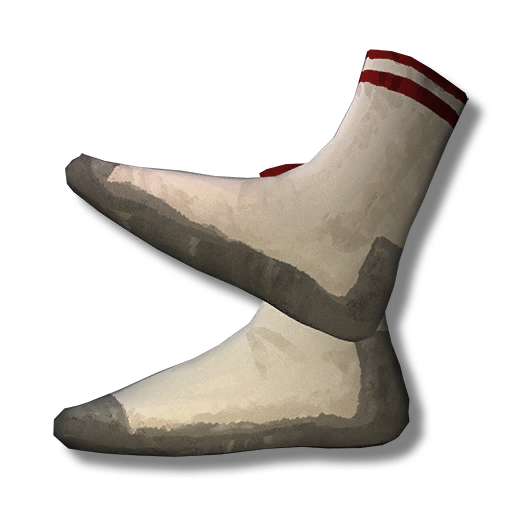
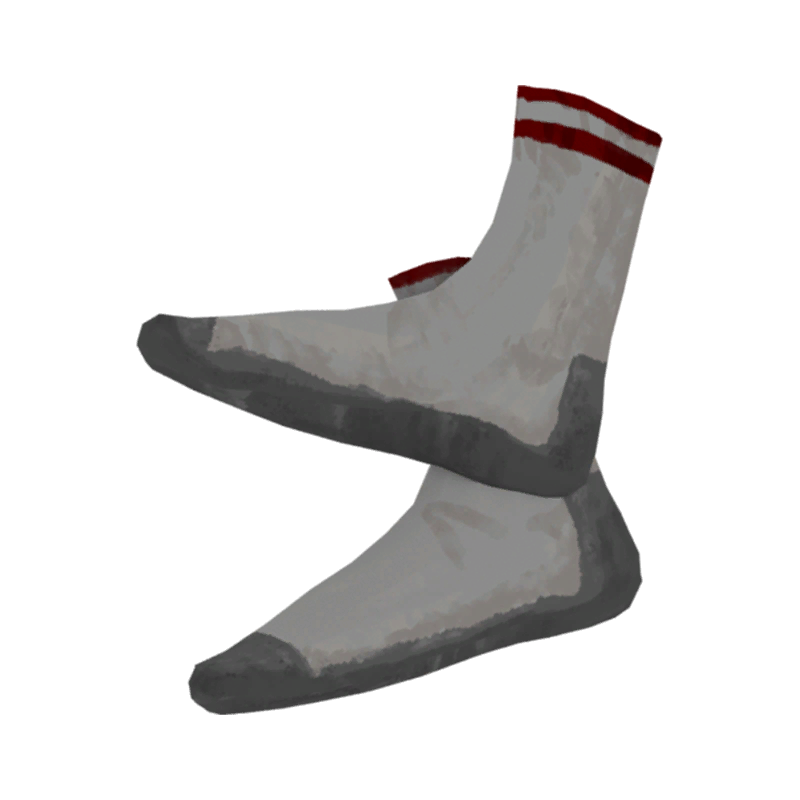

# Sports Socks

**Sports Socks**

| Property | Details |
| --- | --- |
|  |  / *Sports\_Socks\_icon.png* |
| **General** |  |
| Item Type | Clothing\|- |
| Renewable | Yes ([Beachcombing](./Beachcombing.md)) |
| Clothing Slot | Inner feet |
| **Statistics** |  |
| Weight | 0.10 kg(0.22 lbs) |
| Warmth bonus | 0.25 °C(0.5 °F) |
| Windproof bonus | 0.0 °C(0 °F) |
| Waterproof bonus | 0% |
| Protection | 0% |
| Mobility | 0% |
| Harvest | 1 × [Cloth](./Cloth.md) / 10 minutes |
| Repair | 1 × [Cloth](./Cloth.md) / 15 minutes / 75% condition |

> “**Thin cotton socks. Not very warm and useless when wet.**”
>
> — In-game description

**Sports Socks** are a type of Clothing in *The Long Dark*.

## Overview

Sports Socks are a common starting item and are the worst type of socks; they also have the highest rate of decay of all socks (requiring them to be repaired more often). They should be replaced at the first opportunity. Their warmth bonus is so low that it makes little difference even wearing them, and they do not offer any other protection (e.g., from wind) since they are an inner layer clothing item (unless the player has no shoes).

Despite this, they may still be worth picking up, especially in higher difficulty levels, as they can be harvested for one piece of [Cloth](./Cloth.md), which can be used for fixing warmer clothing.

## Gallery

| Column 1 | Column 2 | Column 3 |
| --- | --- | --- |
|  / *Old model.* |  / *Clothing model icon.* |  / *Clothing model icon damaged.* |

## Update history

- UPDATE **19 December 2016 ([Update](./The%20Long%20Dark%20%E2%80%94%20Early%20Access%20Changelog.md#0.386)):**
  - Renamed from *Cotton Socks* to *Sports Socks*

**Lua execution error in Module:Navbox function navbox** [ru:Спортивные носки](ru:%D0%A1%D0%BF%D0%BE%D1%80%D1%82%D0%B8%D0%B2%D0%BD%D1%8B%D0%B5_%D0%BD%D0%BE%D1%81%D0%BA%D0%B8)
