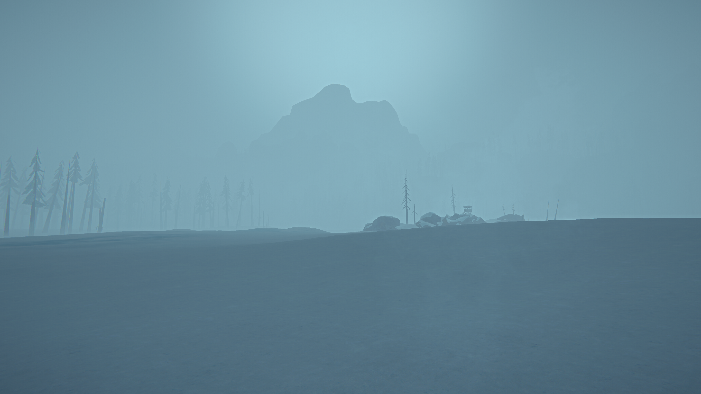

# Spotter's Blind

**Categories:** Locations, Locations in Forsaken Airfield, Outdoor locations, Sheltered locations · **Source:** [Fandom](https://thelongdark.fandom.com/wiki/Spotter's_Blind)

**Spotter's Blind**

| Property | Details |
| --- | --- |
|  | [Spotterblind](../assets/Spotterblind.png) |
| **Location** |  |
|  | [Spotter's Blind Location](../assets/Spotter%27s_Blind_Location.png) |
| Region | [Forsaken Airfield](./Forsaken%20Airfield.md)\|- |
| **General** |  |
| Type | Outdoors\|- |
|  | Provides some shelter / **Spotter's Blind** is a small blind just east of the airfield. Medium-level loot can be found here such as [revolver ammunition](./Revolver%20Ammunition.md), [research books](./Research%20Book.md), or [maple syrup](./Maple%20Syrup.md). A [hacksaw](./Hacksaw.md) may also be found with the blade part way into one of the blind's supports, as though someone had been attempting to sabotage the structure. |

## Gallery

