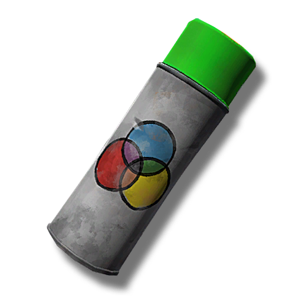
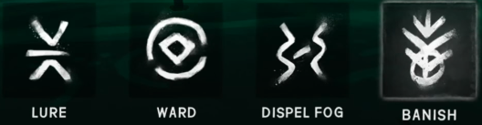

# Spray Paint \- Glyph

**Contents**

- [Overview](#Overview)
- [Glyphs](#Glyphs)
- [Lure](#Lure)
- [Ward](#Ward)
- [Dispel](#Dispel)
- [Banish](#Banish)
- [Gallery](#Gallery)

<table class="infobox">
<caption>Spray Paint - Glyph</caption>
<colgroup>
<col style="width: 50%" />
<col style="width: 50%" />
</colgroup>
<tbody>
<tr>
<td colspan="2"><figure>

<figcaption>Spray_Paint_-_Glyph_icon.png</figcaption>
</figure></td>
</tr>
<tr>
<td colspan="2" class="section">
<strong>General</strong>
</td>
</tr>
<tr>
<td>
Item Type
</td>
<td>
Tool|-
</td>
</tr>
<tr>
<td colspan="2" class="section">
<strong>Statistics</strong>
</td>
</tr>
<tr>
<td>
Weight
</td>
<td>
0.54 kg(1.19 lbs)
</td>
</tr>
</tbody>
</table>

<table>
<colgroup>
<col style="width: 33%" />
<col style="width: 33%" />
<col style="width: 33%" />
</colgroup>
<tbody>
<tr>
<td style="vertical-align: top; font-size: 3em; color: #5d5980; padding-right: 10px">
“
</td>
<td>
A can of Spray Paint. Can be used to Create Glyphs to protect against the Darkwalker. 

&#10;

In-game description

</td>
<td style="vertical-align: bottom; font-size: 3em; color: #5d5980; padding-left: 10px">
”
</td>
</tr>
</tbody>
</table>

**Spray Paint - Glygh** is the name given to a unique type of <a href="./Spray%20Paint.md" class="wikilink" title="Spray Paint">Spray Paint</a> found in the <a href="./Escape%20the%20Darkwalker.md" class="wikilink" title="Escape the Darkwalker">Escape the Darkwalker</a> <a href="./Challenge.md" class="wikilink" title="Challenge">Challenge</a>. They are vital to surviving and ultimately escaping The Darkwalker.

## Overview

Spray Paint - Glygh is found in various locations throughout Challenge Escape the Darkwalker, and are primarily used to either dispel the effects of the creature or to halt its progress. Unlike regular spray paint, Glyph Spray cans produce only 4 symbols that have active effects against The Darkwalker.

Spraying a Glyph will always use 0.08 kg of the can's item weight, however it is important to note that a can of spray paint can only paint four glyphs before going empty.

Glyph Spray Paint cans are always found near the green campfires throughout the challenge, though they can occasionally be found inside buildings.

## Glyphs

### Lure

The Lure Glyph creates a mark on the ground that immediately shifts The Darkwalker's focus to that symbol. This lasts 1 hour in-game, or until reached by The Darkwalker. If The Darkwalker reaches a Lure Glyph, it is immediately broken, and a shattering sound can be heard anywhere in the game world. At this point, The Darkwalker will resume chasing after the player.

Only one active Lure can be placed per region at one time, and the timer icon will only appear if it is currently in a space where the player is (ex, timer will disappear if placed indoors and then the player walks outdoors or vice versa), but the game will notify you if the Glyph is still active if you attempt to place another Lure Glyph.

### Ward

The Ward Glyph creates a symbol on the ground that fortifies a small area (200m), preventing The Darkwalker from approaching for up to 2 hours (in-game). Wards are only active if the player is inside, and the Darkwalker will cease walking and stand in place in the game world until the Glyph is broken or the player leaves its effects. Green Campfires always produce an extended Ward Glyph when approached (up to 12 hours). Only one active Ward can be placed in a region at one time.

### Dispel

The Dispel Glyph immediately reduces the progress of the current region's <a href="./Toxic%20Fog.md" class="wikilink" title="Toxic Fog">Toxic Fog</a> by 50% of the current buildup (most effective just before Toxic Fog appears). **Useable only o*nce per playthrough.***

### Banish

The Banish Glyph only unlocks once all 10 <a href="./On%20the%20Nature%20of%20Darkwalkers.md" class="wikilink" title="On the Nature of Darkwalkers">On the Nature of Darkwalkers</a> Notes are found during the Challenge and the player makes their way to the Banishing Circle located in <a href="./Ash%20Canyon.md" class="wikilink" title="Ash Canyon">Ash Canyon</a>. Using this Glyph inside the Circle causes the Darkwalker to rapidly approach the player. Once the player is grabbed by the creature within the cirlcle, the Challenge will be completed after it is banished from the Island.

## Gallery

<table class="gallery">
<colgroup>
<col style="width: 100%" />
</colgroup>
<tbody>
<tr>
<td><figure>

<figcaption>The 4 Glyphs</figcaption>
</figure></td>
</tr>
</tbody>
</table>

**Lua execution error in Module:Navbox function navbox**

<a href="ru:%D0%9A%D1%80%D0%B0%D1%81%D0%BA%D0%B0_%D0%B4%D0%BB%D1%8F_%D1%81%D0%B8%D0%BC%D0%B2%D0%BE%D0%BB%D0%BE%D0%B2" class="wikilink" title="ru:Краска для символов">ru:Краска для символов</a>

