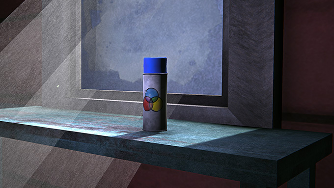
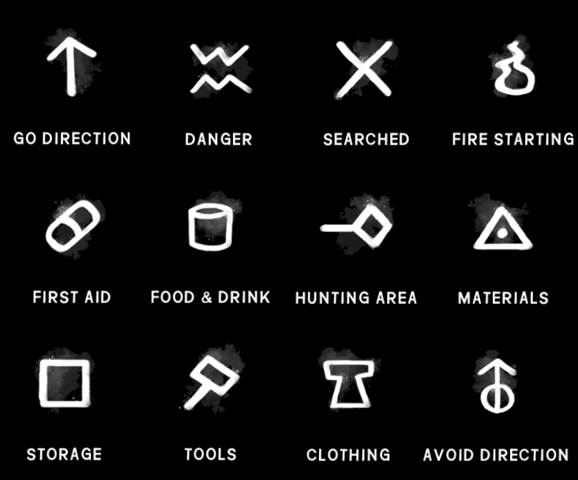

# Spray Paint

<table class="infobox">
<caption>Spray Paint</caption>
<colgroup>
<col style="width: 50%" />
<col style="width: 50%" />
</colgroup>
<tbody>
<tr>
<td colspan="2"><figure>

<figcaption>Spray_Paint_icon.png</figcaption>
</figure></td>
</tr>
<tr>
<td colspan="2" class="section">
<strong>General</strong>
</td>
</tr>
<tr>
<td>
Item Type
</td>
<td>
Tool|-
</td>
</tr>
<tr>
<td>
Renewable
</td>
<td>
Yes (<a href="./Beachcombing.md" class="wikilink" title="Beachcombing">Beachcombing</a>)
</td>
</tr>
<tr>
<td colspan="2" class="section">
<strong>Statistics</strong>
</td>
</tr>
<tr>
<td>
Weight
</td>
<td>
0.54 kg(1.19 lbs)
</td>
</tr>
</tbody>
</table>

<table>
<colgroup>
<col style="width: 33%" />
<col style="width: 33%" />
<col style="width: 33%" />
</colgroup>
<tbody>
<tr>
<td style="vertical-align: top; font-size: 3em; color: #5d5980; padding-right: 10px">
“
</td>
<td>
A can of Spray Paint. Can be used to leave signs and markers in the environment. 

&#10;

In-game description

</td>
<td style="vertical-align: bottom; font-size: 3em; color: #5d5980; padding-left: 10px">
”
</td>
</tr>
</tbody>
</table>

  
*For the version found in <a href="./Escape%20the%20Darkwalker.md" class="wikilink" title="Escape the Darkwalker">Escape the Darkwalker</a>, see <a href="./Spray%20Paint%20-%20Glyph.md" class="wikilink" title="Spray Paint - Glyph">Spray Paint - Glyph</a>.*

**Spray Paint** is a mapping and information tool in *The Long Dark*.

## Overview

Spray Paint is an item which can be used to mark the environment with symbols that aid in navigation, relocating supplies, avoiding danger, etc. Its markings are bright, colored orange images on the painted surface, and on the <a href="./Map.md" class="wikilink" title="map">map</a>.

Spraying a tag will always use 0.08 kg of the can's item weight. A full can has the capacity for 10 tags.

Cans of Spray Paint can be found in numerous locations, usually inside structures, vehicles, or in towns or industrial areas locations such as the <a href="./Camp%20Office.md" class="wikilink" title="Camp Office">Camp Office</a> or the <a href="./Last%20Resort%20Cannery.md" class="wikilink" title="Last Resort Cannery">Last Resort Cannery</a>.

Most but not all markers will display on the map (e.g. "avoid direction" will not). If a marker is painted during low-visibility conditions (blizzards, fog or night) it will not display on the map, but may be added to it by mapping nearby during better visibility later. If multiple symbols are close together, individual markers may not display but rather "multiple markers" on the map; hovering over this icon will display a list of nearby symbols and <a href="./Rock%20Cache.md" class="wikilink" title="rock caches">rock caches</a>.

There is a limit of 249 markers one can have in a region (approximately 25 spray cans), though most casual players will not reach this limit. If this limit is reached and the player tries to place down another marker, a warning message of "TOO MANY SPRAY PAINT MARKERS IN THIS REGION. ERASE OTHER MARKERS TO CONTINUE SPRAY PAINTING" will appear and prevent them from doing so.

## Tips

- Spray Paint is visible even in low-light conditions and poor weather, making it useful for navigating indoors at night, or during <a href="./Weather.md" class="wikilink" title="Blizzards or Fog outside">Blizzards or Fog outside</a>.
- There are twelve different marker symbols and most surfaces can accept a marker. Most, but not all markers will appear on the Map (if made during good visibility, or are mapped later).
- Spray Paint may be used directly from the inventory, or via the Radial Menu (Navigation\>Spray Paint).
- Markings may be removed by right-clicking with "Spray Paint" selected.
- Spray Paint are always found full (100%)to create a marker costs 10% of it's condition (and reduces the can's weight slightly). Empty cans weight 0.2kg, cannot be refilled and serve no purpose.
- Common uses of Spray Paint include marking looted locations (structures, vehicles, etc.), designating safehouses, aiding navigation in difficult areas, and for decoration.
- This is the only item with a relative high spawn frequency in Interloper.

## Gallery

<table class="gallery">
<colgroup>
<col style="width: 25%" />
<col style="width: 25%" />
<col style="width: 25%" />
<col style="width: 25%" />
</colgroup>
<tbody>
<tr>
<td><figure>

<figcaption>Pre release Spray Paint with a Blue cap</figcaption>
</figure></td>
<td><figure>

<figcaption>Spray Paint Markers</figcaption>
</figure></td>
<td><figure>

<figcaption>Avoid marker</figcaption>
</figure></td>
<td><figure>

<figcaption>Clothing marker</figcaption>
</figure></td>
</tr>
<tr>
<td><figure>

<figcaption>Danger marker</figcaption>
</figure></td>
<td><figure>

<figcaption>Searched marker</figcaption>
</figure></td>
<td><figure>
[Missing image: Direction-icon-comp.png]
<figcaption>Direction marker</figcaption>
</figure></td>
<td><figure>

<figcaption>Fire starting marker</figcaption>
</figure></td>
</tr>
<tr>
<td><figure>

<figcaption>First aid marker</figcaption>
</figure></td>
<td><figure>

<figcaption>Food and/or drink marker</figcaption>
</figure></td>
<td><figure>

<figcaption>Hunting area marker</figcaption>
</figure></td>
<td><figure>

<figcaption>Materials marker</figcaption>
</figure></td>
</tr>
<tr>
<td><figure>

<figcaption>Storage marker</figcaption>
</figure></td>
<td><figure>

<figcaption>Tools marker</figcaption>
</figure></td>
<td></td>
<td></td>
</tr>
</tbody>
</table>

**Lua execution error in Module:Navbox function navbox** <a href="ru:%D0%91%D0%B0%D0%BB%D0%BB%D0%BE%D0%BD%D1%87%D0%B8%D0%BA_%D1%81_%D0%BA%D1%80%D0%B0%D1%81%D0%BA%D0%BE%D0%B9" class="wikilink" title="ru:Баллончик с краской">ru:Баллончик с краской</a>

