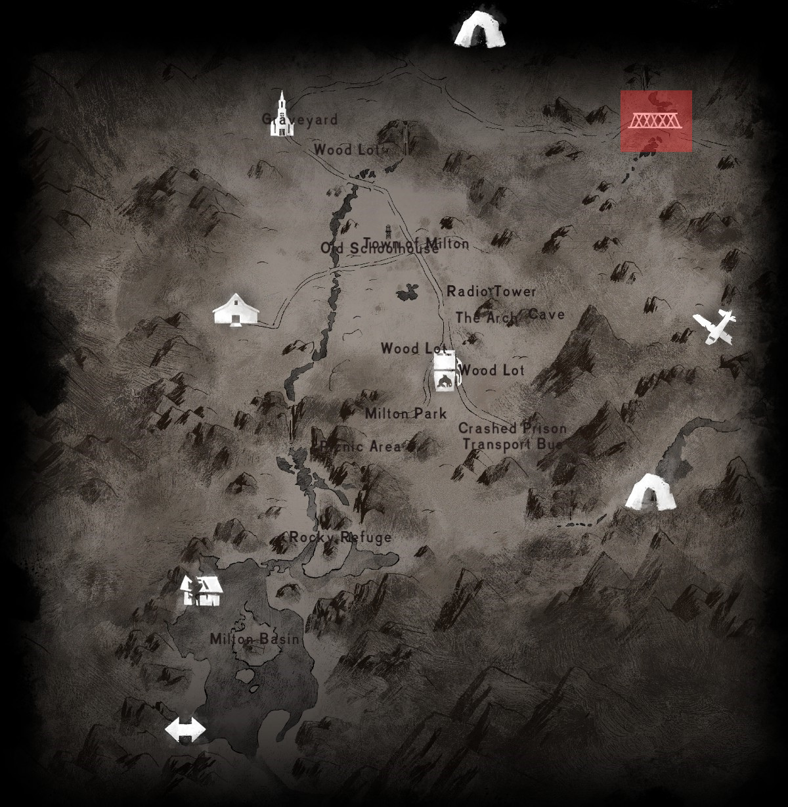

# Spruce Falls Bridge

**Categories:** Landmarks, Locations, Locations in Mountain Town, Outdoor locations, Sheltered locations, Waterfalls · **Source:** [Fandom](https://thelongdark.fandom.com/wiki/Spruce_Falls_Bridge)

**Spruce Falls Bridge**

_Spruce Falls Bridge with a sign to [Milton](./Milton.md)_

**Location**

_Spruce\_Falls\_Bridge\_Location.png_

**Region:** [Mountain Town](./Mountain%20Town.md)\|-

**Description:** A bridge

**General**

**Type:** Landmark\|-
