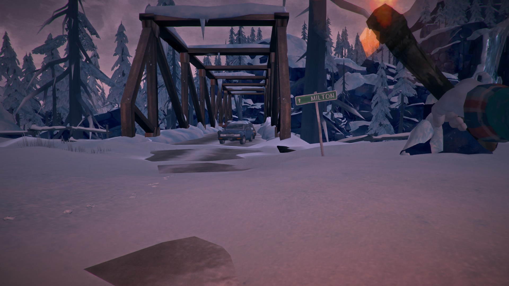

# Spruce Falls Bridge

**Spruce Falls Bridge**

| Property | Details |
| --- | --- |
|  |  / *Spruce Falls Bridge with a sign to [Milton](./Milton.md)* |
| **Location** |  |
|  |  / *Spruce\_Falls\_Bridge\_Location.png* |
| Region | [Mountain Town](./Mountain%20Town.md)\|- |
| Description | A bridge |
| **General** |  |
| Type | Landmark\|- |
