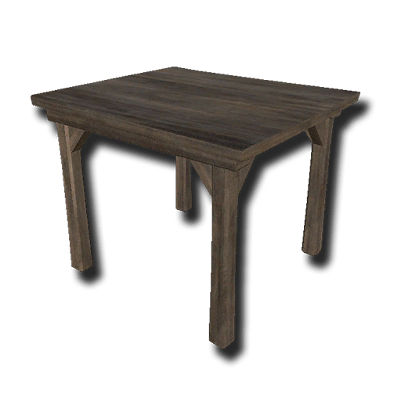

# Square Table

**Categories:** Interactable Objects · **Source:** [Fandom](https://thelongdark.fandom.com/wiki/Square_Table)

**Contents**

- [Overview](#overview)
- [Harvesting](#harvesting)
- [Crafting](#crafting)
- [Update History](#update-history)

**Square Table**

**Release:** [TFTFT Part 6 Broken Silence](./The%20Long%20Dark%20%E2%80%94%20Changelog.md#2.33)

**Values**

**Weight:** 5.00 kg (11 lbs)

**Actions**

**Backpack:** Drop, Place

The **Square Table** is a [Decorations](./Decorations.md) item that can be [Crafted](./Crafting.md) as part of the [Safehouse Customization](./Safehouse%20Customization.md) feature.

## Overview

A makeshift wooden table, a Square Table can be crafted at a [Furniture Workbench](./Furniture%20Workbench.md), but requires [Woodworking Tools](./Woodworking%20Tools.md).

Progress for Crafting this item will be stored in the Furniture Workbench's container inventory, rather than the player's inventory. Once crafted, the item can be automatically placed in the Safehouse. Canceling this prompt will force the item back into the Furniture Workbench's container inventory. The table can only be placed on a wide, clear space on the floor or a flat surface when in Customization Mode.

Despite having a Backpack carry weight value, the table cannot be picked up and placed back into the player's inventory once crafted, and so it cannot be carried from one base to another. The only option is to move or destroy it (destroying the table will yield no resources, so consider the material cost/time investment before creating this item).

## Harvesting

The Square Table can be harvested with a [Hatchet](./Hatchet.md) in 1 hour 30 minutes for 6 [Fir Firewood](./Fir%20Firewood.md).

## Crafting

**Square Table**

420 minutes (7 hour 0 minutes)

**Requirements**

**Item:** [Fir Firewood](./Fir%20Firewood.md)

**Quantity:** 8

## Update History
