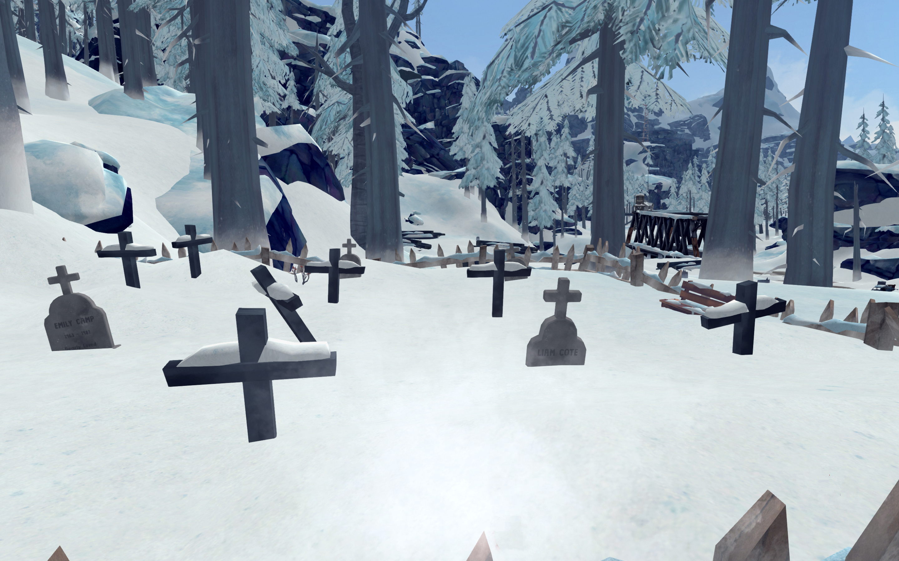

# St\. Christopher's Church

**Categories:** Indoor locations, Locations, Locations in Mountain Town, Residential locations · **Source:** [Fandom](https://thelongdark.fandom.com/wiki/St._Christopher's_Church)

**St. Christopher's Church**

_St.\_Christopher's\_Church.png_

**Location**

_St.\_Christopher's\_Church\_Location.png_

Region

**Location:** A short walk up the road from [Milton](./Milton.md)

**Description:** A church and graveyard

**General**

**Type:** Residential\|-

_Graveyard in front of St. Christopher's Church_

_From Milton to the Church through the Wood Lot_
