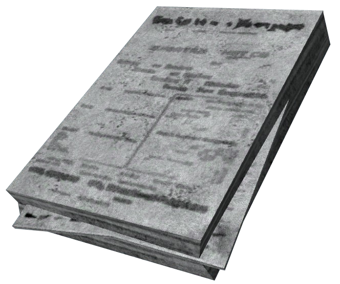

# Stack of Papers

**Categories:** Fire Starting · **Source:** [Fandom](https://thelongdark.fandom.com/wiki/Stack_of_Papers)

**Stack of Papers**

| Property | Details |
| --- | --- |
| | [Stack of Papers icon](../assets/Stack_of_Papers_icon.png) |
| **General** | |
| Item Type | Fire Starting |
| Wintermute | No |
| **Statistics** | |
| Weight | [Weight icon](../assets/Weight_icon.png)0.10 kg(0.22 lbs) |

> “**Stack of now-useless papers. Makes for good Tinder, and that's about it.**”
>
> — In-game description

A **Stack of Papers** is a material item used as tinder.

## Overview

Stacks of papers fill the role of tinder, which is used for [Fire Starting](./Fire%20Starting.md). Stacks of papers are among the heaviest types of tinder, and weigh 0.10 kg per unit. Stacks of papers can be harvested to receive two [Tinder Plugs](./Tinder%20Plug.md), doubling the number of uses while maintaining the same weight. Like all other types of tinder, it does not increase the chance to successfully light a fire.

## Products

| Item | Skills | Materials |
| --- | --- | --- |
| [Tinder Plug](./Tinder%20Plug.md) | None | - 1 × [Stack of Papers](./Stack%20of%20Papers.md) |

## Gallery

