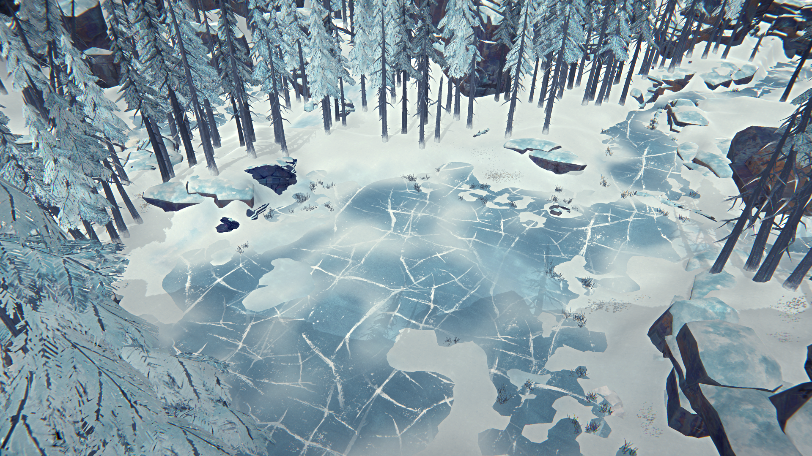

# Stairsteps Lake

<table class="infobox">
<caption>Stairsteps Lake</caption>
<colgroup>
<col style="width: 50%" />
<col style="width: 50%" />
</colgroup>
<tbody>
<tr>
<td colspan="2"><figure>

<figcaption>Hushed_river_valley_stairsteps_lake_20201031.png</figcaption>
</figure></td>
</tr>
<tr>
<td colspan="2" class="section">
<strong>Location</strong>
</td>
</tr>
<tr>
<td colspan="2"><figure>
[Missing image: Stairsteps_Lake_Location.png]
<figcaption>Stairsteps_Lake_Location.png</figcaption>
</figure></td>
</tr>
<tr>
<td>
Region
</td>
<td>
<a href="./Hushed%20River%20Valley.md" class="wikilink" title="Hushed River Valley">Hushed River Valley</a>|-
</td>
</tr>
<tr>
<td>
Description
</td>
<td>
A moderate sized lake.
</td>
</tr>
<tr>
<td colspan="2" class="section">
<strong>General</strong>
</td>
</tr>
<tr>
<td>
Type
</td>
<td>
Landmark|-
</td>
</tr>
</tbody>
</table>

