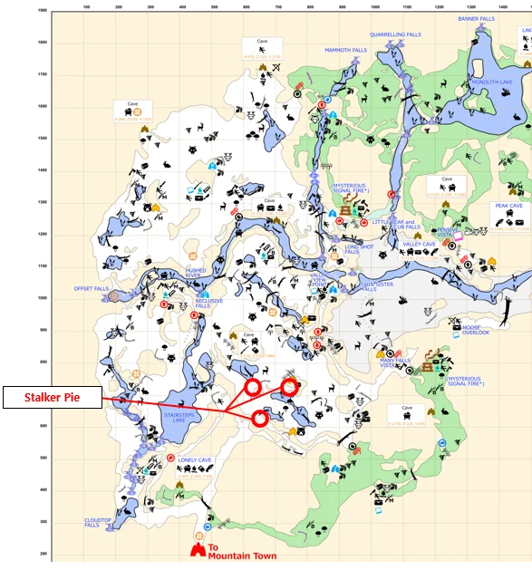

# Stalker's Pie

**Contents**

- [Overview](#Overview)
- [Effects](#Effects)
- [Recipe](#Recipe)
- [Location](#Location)
- [Update history](#Update_history)

<table>
<colgroup>
<col style="width: 33%" />
<col style="width: 33%" />
<col style="width: 33%" />
</colgroup>
<tbody>
<tr>
<td width="40px"><figure>
[Missing image: Ptarmigan_icon.png]
<figcaption>Ptarmigan_icon.png</figcaption>
</figure></td>
<td>
<strong>DLC-Exclusive content.</strong> 

This content requires the <a href="./Tales%20from%20the%20Far%20Territory.md" class="wikilink" title="Tales from the Far Territory">Tales from the Far Territory</a> addon to be installed before it can be seen or used in regular gameplay.

</td>
<td>
|}

<table class="infobox">
<caption>Stalker's Pie</caption>
<colgroup>
<col style="width: 50%" />
<col style="width: 50%" />
</colgroup>
<tbody>
<tr>
<td colspan="2"><figure>

<figcaption>Stalker's_Pie_icon.png</figcaption>
</figure></td>
</tr>
<tr>
<td>
Release
</td>
<td>
<a href="./The%20Long%20Dark%20%E2%80%94%20Changelog.md#2.17" class="wikilink" title="21 June 2023">21 June 2023</a>
</td>
</tr>
<tr>
<td>
Wintermute
</td>
<td>
No
</td>
</tr>
<tr>
<td>
Renewable
</td>
<td>
No (<a href="./Acorn%20Grounds.md" class="wikilink" title="Acorn Grounds">Acorn Grounds</a>)
</td>
</tr>
<tr>
<td colspan="2" class="section">
<strong>Properties</strong>
</td>
</tr>
<tr>
<td>
Item type
</td>
<td>
<a href="./Food%20And%20Drink.md" class="wikilink" title="Food And Drink">Food And Drink</a>|-
</td>
</tr>
<tr>
<td colspan="2" class="section">
<strong>Values</strong>
</td>
</tr>
<tr>
<td>
Calories
</td>
<td>
1600 (2000) kcal
</td>
</tr>
<tr>
<td>
Hydration
</td>
<td>
-3.0%
</td>
</tr>
<tr>
<td>
Weight
</td>
<td>
0.30 kg (0.66 lbs)
</td>
</tr>
<tr>
<td colspan="2" class="section">
<strong>Decay Rate</strong>
</td>
</tr>
<tr>
<td>
Inside
</td>
<td>
20.000% per day
</td>
</tr>
<tr>
<td>
Outside
</td>
<td>
5.000% per day
</td>
</tr>
<tr>
<td colspan="2" class="section">
<strong>Advanced data</strong>
</td>
</tr>
<tr>
<td>
Item key
</td>
<td>
GAMEPLAY_PredatorPie
</td>
</tr>
</tbody>
</table>

<strong>Stalker's Pie</strong> is a food item in <em>The Long Dark</em>, it is learned from a unique <a href="./Recipe%20Cards.md" class="wikilink" title="Recipe Card">Recipe Card</a> and is made with a <a href="./Cooking%20Skillet.md" class="wikilink" title="Cooking Skillet">Cooking Skillet</a>.

<h2 id="Overview">Overview</h2>

Stalker's Pie is a relatively complex recipe, requiring meat from multiple <a href="./Bear.md" class="wikilink" title="predatory wildlife">predatory wildlife</a>, and with a recipe card found in the wilderness region of <a href="./Hushed%20River%20Valley.md" class="wikilink" title="Hushed River Valley">Hushed River Valley</a>. It boasts a number of small positive effects and extremely high calorie density at ~6,667 kcal/kg (beating the MRE at 3,500 kcal/kg although losing to Breyerhouse pie with 7,083 kcal/kg) and it has several positive effects. It requires a maximized <a href="./Cooking.md" class="wikilink" title="Cooking skill">Cooking skill</a> and reduces carry weight when consumed, and its ingredients are either limited or difficult to obtain.

While the ingredients of Stalker's Pie are relatively easy to source (though <a href="./Acorn%20Grounds.md" class="wikilink" title="Acorn Grounds">Acorn Grounds</a> require a <a href="./Heavy%20Hammer.md" class="wikilink" title="Heavy Hammer">Heavy Hammer</a> to be produced), it requires raw meat from two different predatory species: <a href="./Wolf.md" class="wikilink" title="Wolves">Wolves</a> and <a href="./Bear.md" class="wikilink" title="Black Bear">Black Bear</a>. Any species of wolf meat will work for Stalker's Pie (except <a href="./Poisoned%20Wolf.md" class="wikilink" title="Poisoned Wolves">Poisoned Wolves</a>), either from wolf carcasses scattered across <a href="./Great%20Bear%20Island.md" class="wikilink" title="Great Bear Island">Great Bear Island</a>, or by hunting live wolves with a <a href="./Hunting%20Rifle.md" class="wikilink" title="weapon">weapon</a> or surviving a <a href="./Struggle.md" class="wikilink" title="struggle">struggle</a>. Black Bear can only be killed with ranged weapons, making hunting them a necessity to crafting Stalker's Pie.

The recipe for Stalker's Pie is found on a <a href="./Frozen%20Corpse.md" class="wikilink" title="Frozen Corpse">Frozen Corpse</a>, which may appear in three different outdoors locations near along the black bear's patrol route near <a href="./Stairsteps%20Lake.md" class="wikilink" title="Stairsteps Lake">Stairsteps Lake</a> in <a href="./Hushed%20River%20Valley.md" class="wikilink" title="Hushed River Valley">Hushed River Valley</a>.

Stalker's Pie produces a <a href="./Scent.md" class="wikilink" title="Scent">Scent</a> which attracts <a href="./Wolf.md" class="wikilink" title="predators">predators</a>, and may be dropped as a <a href="./Scent.md#Baiting%2FDecoys" class="wikilink" title="decoy">decoy</a>.

<h2 id="Effects">Effects</h2>
<ul>
<li>+15% <a href="./Stamina.md" class="wikilink" title="Stamina">Stamina</a> (instantly)</li>
<li>+15% Maximum Stamina (<a href="./Nourished.md" class="wikilink" title="Nourished">Nourished</a> for 3 hours)</li>
<li>6 hours of <a href="./Improved%20Rest.md" class="wikilink" title="Improved Rest">Improved Rest</a> (+1% <a href="./Condition.md" class="wikilink" title="Condition">Condition</a> restored per hour of sleep, or 18 hours)</li>
<li><a href="./Cabin%20Fever.md" class="wikilink" title="Cabin Fever">Cabin Fever</a> outside time increase (minimal)</li>
<li>-3.00kg Decreased Carry Weight (<a href="./Burdened.md" class="wikilink" title="Burdened">Burdened</a> for 1 hour)</li>
</ul>
<h2 id="Recipe">Recipe</h2>

The ingredients of this pie are the similar to <a href="./Breyerhouse%20Pie.md" class="wikilink" title="Breyerhouse Pie">Breyerhouse Pie</a>, requiring predator <a href="./Wildlife.md" class="wikilink" title="Wildlife">Wildlife</a> meat and <a href="./Acorn%20Grounds.md" class="wikilink" title="Acorn Grounds">Acorn Grounds</a> instead of prey meat and <a href="./Old%20Mill%20Flour.md" class="wikilink" title="flour">flour</a>.

<table class="infobox">
<caption>Stalker's Pie</caption>
<tbody>
<tr>
<td colspan="2">
<strong>Template:pic link plain</strong><a href="./Cooking.md" class="wikilink" title="Cooking">Cooking</a>
</td>
</tr>
<tr>
<td colspan="2">
-
</td>
</tr>
<tr>
<td colspan="2">
80.0 minutes (1 hour 20 minutes)
</td>
</tr>
<tr>
<td colspan="2" class="section">
<strong>Requirements</strong>
</td>
</tr>
<tr>
<td>
Required level
</td>
<td>
<strong>Template:pic link plain</strong> 5
</td>
</tr>
<tr>
<td>
Facility
</td>
<td>
<strong>Template:iconlink</strong>
</td>
</tr>
<tr>
<td>
Tool
</td>
<td>
<strong>Template:iconlink</strong>
</td>
</tr>
<tr>
<td colspan="2" class="section">
<strong>Materials</strong>
</td>
</tr>
<tr>
<td colspan="2" class="section">
<strong>Template:iconlink plain</strong>
</td>
</tr>
<tr>
<td>
Item
</td>
<td>
<a href="./Bear%20Meat%20%28Raw%29.md" class="wikilink" title="Bear Meat (Raw)">Bear Meat (Raw)</a>
</td>
</tr>
<tr>
<td>
Quantity
</td>
<td>
0.50 kg
</td>
</tr>
<tr>
<td colspan="2" class="section">
<strong>Template:iconlink plain</strong>
</td>
</tr>
<tr>
<td colspan="2">
<a href="./Wolf%20Meat%20%28Raw%29.md" class="wikilink" title="Wolf Meat (Raw)">Wolf Meat (Raw)</a>
</td>
</tr>
<tr>
<td colspan="2">
0.50 kg
</td>
</tr>
<tr>
<td colspan="2" class="section">
<strong>Template:iconlink plain</strong>
</td>
</tr>
<tr>
<td colspan="2">
<a href="./Acorn%20Grounds.md" class="wikilink" title="Acorn Grounds">Acorn Grounds</a>
</td>
</tr>
<tr>
<td colspan="2">
1
</td>
</tr>
<tr>
<td colspan="2" class="section">
<strong>Template:iconlink plain</strong>
</td>
</tr>
<tr>
<td colspan="2">
<a href="./Water%20%28Potable%29.md" class="wikilink" title="Water (Potable)">Water (Potable)</a>
</td>
</tr>
<tr>
<td colspan="2">
0.15 L
</td>
</tr>
<tr>
<td colspan="2" class="section">
<strong>Template:iconlink plain</strong>
</td>
</tr>
<tr>
<td colspan="2">
<a href="./Cooking%20Oil.md" class="wikilink" title="Cooking Oil">Cooking Oil</a>
</td>
</tr>
<tr>
<td colspan="2">
0.05 L
</td>
</tr>
<tr>
<td colspan="2" class="section">
<strong>Template:iconlink plain</strong>
</td>
</tr>
<tr>
<td colspan="2">
<a href="./Salt.md" class="wikilink" title="Salt">Salt</a>
</td>
</tr>
<tr>
<td colspan="2">
0.01 kg
</td>
</tr>
</tbody>
</table>
<h3 id="Location">Location</h3>
<figure>

<figcaption>The locations of the Recipe Card for Stalker's Pie.</figcaption>
</figure>

The recipe can be found on a corpse in <a href="./Hushed%20River%20Valley.md" class="wikilink" title="Hushed River Valley">Hushed River Valley</a>. All three locations are located southeast of <a href="./Stairsteps%20Lake.md" class="wikilink" title="Stairsteps Lake">Stairsteps Lake</a>. Refer to the map below for details.

<h2 id="Update_history">Update history</h2>

<ul>
<li>UPDATE <strong>21 June 2023 (<a href="./The%20Long%20Dark%20%E2%80%94%20Changelog.md#2.17" class="wikilink" title="Update">Update</a>):</strong>
<ul>
<li>Added to game.</li>
</ul></li>
</ul>

<strong>Lua execution error in Module:Navbox function navbox</strong> <a href="ru:%D0%9F%D0%B8%D1%80%D0%BE%D0%B3_%D0%BB%D0%BE%D0%B2%D1%87%D0%B5%D0%B3%D0%BE" class="wikilink" title="ru:Пирог ловчего">ru:Пирог ловчего</a>
</td>
</tr>
</tbody>
</table>

