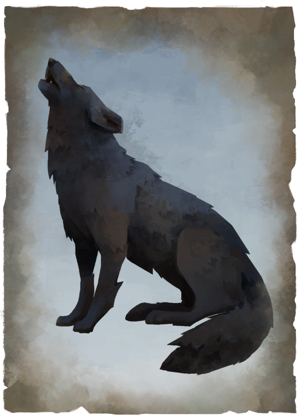

# Stalker

{\| style="margin:auto" \| style="vertical-align:top; font-size:3em; color:#5d5980; padding-right:10px" \|“ \| Your demise awaits behind every hilltop, shelter, and tree. Only the strong survive. \| style="vertical-align:bottom; font-size:3em; color:#5d5980; padding-left:10px" \|” \|} **Stalker** is the 3rd <a href="./Survival%20Mode.md" class="wikilink" title="Survival Mode">Survival Mode</a> Experience in *<a href="./The%20Long%20Dark.md" class="wikilink" title="The Long Dark">The Long Dark</a>*. It is the standard "hard" difficulty setting.

## Overview

Stalker features a more unforgiving Experience compared to <a href="./Pilgrim.md" class="wikilink" title="Pilgrim">Pilgrim</a> or <a href="./Voyageur.md" class="wikilink" title="Voyageur">Voyageur</a>, featuring a harder world, <a href="./Needs.md" class="wikilink" title="Needs">Needs</a> that drain very quickly, and harsher <a href="./Struggle.md" class="wikilink" title="Struggle">Struggle</a> mechanics. Stalker is the hardest standard game mode in the game, with <a href="./Interloper.md" class="wikilink" title="Interloper">Interloper</a> and <a href="./Misery.md" class="wikilink" title="Misery">Misery</a> being their own special level of difficulty.

Stalker introduces a new <a href="./Afflictions.md" class="wikilink" title="Affliction">Affliction</a> that makes it harder to survive in the game world: <a href="./Intestinal%20Parasites.md" class="wikilink" title="Intestinal Parasites">Intestinal Parasites</a>.

## Stalker Settings

- <a href="./Great%20Bear%20Island.md" class="wikilink" title="Great Bear Island">Great Bear Island</a> is sparse with items.
  - Limited and/or low quality starting supplies.
  - Incomplete starting clothes; head will be exposed.
  - High-quality items may spawn, but are rare.
  - Firearms and ammunition may spawn infrequently.
- <a href="./Needs.md" class="wikilink" title="Needs">Needs</a> erode quickly.
- Hostile <a href="./Wildlife.md" class="wikilink" title="Wildlife">Wildlife</a> may spawn immediately, are more numerous, and are found in more locations.
- Detection radius for hostile wildlife is extremely large.
- Eating cooked or uncooked meat from predator animals has a chance to give the player <a href="./Intestinal%20Parasites.md" class="wikilink" title="Intestinal Parasites">Intestinal Parasites</a>.
- Start will be outdoors: chance to start during night, poor weather, or in an inhospitable <a href="./Region.md" class="wikilink" title="Region">Region</a>.
- Fast <a href="./Decay.md" class="wikilink" title="Decay">Decay</a> of items.
- <a href="./Fire.md" class="wikilink" title="Fires">Fires</a> do not automatically prevent <a href="./Hypothermia.md" class="wikilink" title="freezing">freezing</a> ("Feels Like" Temperature must be raised above 0° C).
- No automatic waking from <a href="./Sleep.md" class="wikilink" title="Sleep">Sleep</a> when <a href="./Hypothermia.md" class="wikilink" title="freezing">freezing</a>.
- The player will automatically wake up once their <a href="./Fatigue.md" class="wikilink" title="Fatigue">Fatigue</a> meter is fully rested, and they cannot go back to sleep until sufficiently tired.
- <a href="./Scurvy.md" class="wikilink" title="Scurvy">Scurvy</a> is present and is much more harsh than Voyager difficulty.
- Sheltering indoors for too long will result in the <a href="./Cabin%20Fever.md" class="wikilink" title="Cabin Fever">Cabin Fever</a> <a href="./Afflictions.md" class="wikilink" title="Affliction">Affliction</a>, with a quicker Risk buildup compared to Voyageur.
- The option to enable the <a href="./Trader.md" class="wikilink" title="Trader">Trader</a>, <a href="./Cougar.md" class="wikilink" title="Cougar">Cougar</a>, and <a href="./Scurvy.md" class="wikilink" title="Scurvy">Scurvy</a> on or off is present.
- Allows 3 active <a href="./Feats.md" class="wikilink" title="Feats">Feats</a>.

<table>
<thead>
<tr>
<th scope="col">
DIFFICULTY
</th>
<th scope="col">
STALKER
</th>
</tr>
</thead>
<tbody>
<tr>
<td colspan="2" style="background-color: rgb(50,50,50)">
GAME START
</td>
</tr>
<tr>
<td>
Baseline resource availability
</td>
<td>
Medium
</td>
</tr>
<tr>
<td>
Starting time of day
</td>
<td>
Random
</td>
</tr>
<tr>
<td>
Starting weather
</td>
<td>
Heavy Fog
</td>
</tr>
<tr>
<td>
Indoor spawns permitted
</td>
<td>
No
</td>
</tr>
<tr>
<td>
Survivor monologue
</td>
<td>
Yes
</td>
</tr>
<tr>
<td colspan="2" style="background-color: rgb(50,50,50)">
ENVIRONMENT
</td>
</tr>
<tr>
<td>
Length of day multiplier
</td>
<td>
1x
</td>
</tr>
<tr>
<td>
Weather variability
</td>
<td>
High
</td>
</tr>
<tr>
<td>
Blizzard frequency
</td>
<td>
High
</td>
</tr>
<tr>
<td>
World gets colder over time
</td>
<td>
Medium
</td>
</tr>
<tr>
<td>
Wind variability
</td>
<td>
Medium
</td>
</tr>
<tr>
<td>
Aurora frequency
</td>
<td>
Medium
</td>
</tr>
<tr>
<td>
Fire overcomes ambient air temp
</td>
<td>
No
</td>
</tr>
<tr>
<td>
Endless night (v1.83)
</td>
<td>
No
</td>
</tr>
<tr>
<td colspan="2" style="background-color: rgb(50,50,50)">
HEALTH
</td>
</tr>
<tr>
<td>
Calorie burn rate
</td>
<td>
High
</td>
</tr>
<tr>
<td>
Thirst rate
</td>
<td>
Medium
</td>
</tr>
<tr>
<td>
Fatigue rate
</td>
<td>
High
</td>
</tr>
<tr>
<td>
Freezing rate
</td>
<td>
High
</td>
</tr>
<tr>
<td>
At-rest condition recovery rate
</td>
<td>
High
</td>
</tr>
<tr>
<td>
Condition recovery rate
</td>
<td>
High
</td>
</tr>
<tr>
<td>
Hypothermia recovery time
</td>
<td>
High
</td>
</tr>
<tr>
<td>
Frostbite rate
</td>
<td>
High
</td>
</tr>
<tr>
<td>
Cabin fever
</td>
<td>
Yes
</td>
</tr>
<tr>
<td>
Intestinal parasites
</td>
<td>
Yes
</td>
</tr>
<tr>
<td>
Dysentery
</td>
<td>
Yes
</td>
</tr>
<tr>
<td>
Sprains
</td>
<td>
Yes
</td>
</tr>
<tr>
<td>
Food poisoning
</td>
<td>
Yes
</td>
</tr>
<tr>
<td>
Broken ribs
</td>
<td>
Yes
</td>
</tr>
<tr>
<td>
Rest as a resource
</td>
<td>
Yes
</td>
</tr>
<tr>
<td>
Scurvy - Vitamin-C drain rate
</td>
<td>
High
</td>
</tr>
<tr>
<td>
Fires prevent freezing
</td>
<td>
No
</td>
</tr>
<tr>
<td>
Wake up player when freezing near a fire
</td>
<td>
No
</td>
</tr>
<tr>
<td>
Birch bark tea crafting <strong>(v.1.64)</strong>
</td>
<td>
Yes
</td>
</tr>
<tr>
<td colspan="2" style="background-color: rgb(50,50,50)">
GEAR
</td>
</tr>
<tr>
<td>
Item decay rate
</td>
<td>
High
</td>
</tr>
<tr>
<td>
Loose item availability
</td>
<td>
Medium
</td>
</tr>
<tr>
<td>
Empty container chance modifier
</td>
<td>
Medium
</td>
</tr>
<tr>
<td>
Stick, branch, and stone respawn frequency
</td>
<td>
Medium
</td>
</tr>
<tr>
<td>
Starting gear allocation
</td>
<td>
Medium
</td>
</tr>
<tr>
<td>
Rifle availability
</td>
<td>
Yes
</td>
</tr>
<tr>
<td>
Revolver availability <strong>(v.1.64)</strong>
</td>
<td>
Yes
</td>
</tr>
<tr>
<td>
Harvestable plant availability
</td>
<td>
High
</td>
</tr>
<tr>
<td>
Reduce container item density
</td>
<td>
Low
</td>
</tr>
<tr>
<td colspan="2" style="background-color: rgb(50,50,50)">
WILDLIFE SPAWNS
</td>
</tr>
<tr>
<td>
Cougar spawn chance
</td>
<td>
Medium
</td>
</tr>
<tr>
<td>
Wolf spawn chance
</td>
<td>
Very High
</td>
</tr>
<tr>
<td>
Timberwolf spawn chance
</td>
<td>
Very High
</td>
</tr>
<tr>
<td>
Deer spawn chance
</td>
<td>
Medium
</td>
</tr>
<tr>
<td>
Rabbit spawn chance
</td>
<td>
Medium
</td>
</tr>
<tr>
<td>
Bear spawn chance
</td>
<td>
Very High
</td>
</tr>
<tr>
<td>
Moose spawn chance
</td>
<td>
Very High
</td>
</tr>
<tr>
<td>
Time to wildlife respawn
</td>
<td>
Medium
</td>
</tr>
<tr>
<td>
Reduce wildlife population over time
</td>
<td>
Medium
</td>
</tr>
<tr>
<td>
Wolf spawn distance
</td>
<td>
Close
</td>
</tr>
<tr>
<td>
Predator grace period
</td>
<td>
No
</td>
</tr>
<tr>
<td colspan="2" style="background-color: rgb(50,50,50)">
WILDLIFE BEHAVIOUR
</td>
</tr>
<tr>
<td>
Wildlife smell range
</td>
<td>
High
</td>
</tr>
<tr>
<td>
Scent increase from Meat/Blood
</td>
<td>
Medium
</td>
</tr>
<tr>
<td>
Passive wildlife
</td>
<td>
No
</td>
</tr>
<tr>
<td>
Wildlife attacks during rest
</td>
<td>
Yes
</td>
</tr>
<tr>
<td>
Wolf fear
</td>
<td>
Medium
</td>
</tr>
<tr>
<td>
Timberwolf morale
</td>
<td>
Low
</td>
</tr>
<tr>
<td>
Wildlife detection range
</td>
<td>
Medium
</td>
</tr>
<tr>
<td colspan="2" style="background-color: rgb(50,50,50)">
WILDLIFE STRUGGLE
</td>
</tr>
<tr>
<td>
Struggle bonus
</td>
<td>
Low
</td>
</tr>
<tr>
<td>
Struggle condition damage modifier
</td>
<td>
None
</td>
</tr>
<tr>
<td>
Struggle clothing damage modifier
</td>
<td>
Low
</td>
</tr>
<tr>
<td>
Struggle damage severity
</td>
<td>
High
</td>
</tr>
</tbody>
</table>

**Lua execution error in Module:Navbox function navbox**

