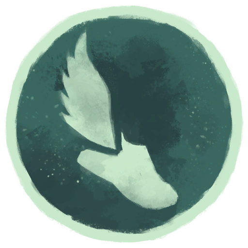
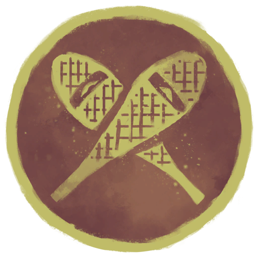
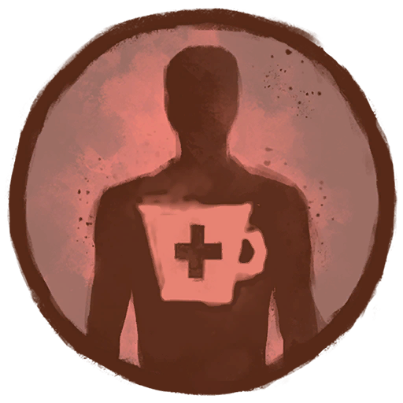
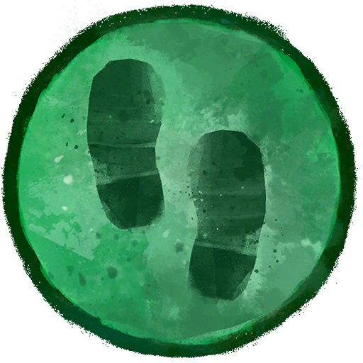

# Stamina

**Contents**

- [Overview](#Overview)
- [Positive modifiers](#Positive_modifiers)
- [Negative modifiers](#Negative_modifiers)
- [Activities](#Activities)
- [Sprinting](#Sprinting)
- [Rope Climbing](#Rope_Climbing)
- [Feats](#Feats)

<figure class="thumb">

</figure>

**Stamina** represents the player's ability to undertake several physically demanding tasks. Sprinting or Rope Climbing both reduce stamina. When the stamina bar is completely drained, rope climbing becomes slower and more dangerous, and the player is unable to sprint. The stamina bar will gradually refill itself when not in active use. <a href="fr:Stamina" class="wikilink" title="fr:Stamina">fr:Stamina</a>

## Overview

The amount of stamina that the player has is set and cannot be increased through leveling skills. The current maximum stamina can be viewed by navigating to the *Clothing* screen within the <a href="./Survival%20Menu.md" class="wikilink" title="Survival Menu">Survival Menu</a>.

<a href="./Fatigue.md" class="wikilink" title="Fatigue">Fatigue</a> affects the replenishment of stamina. When the character reaches **Exhausted** (empty fatigue bar), the stamina bar is completely drained. It will remain drained for as long as the fatigue bar remains empty.

Different types of clothing have a different mobility penalty attached to them. When wearing clothing with a higher mobility penalty, the player's stamina bar will have a lower maximum capacity.

### Positive modifiers

The following items positively impact the player's stamina.

<table>
<colgroup>
<col style="width: 25%" />
<col style="width: 25%" />
<col style="width: 25%" />
<col style="width: 25%" />
</colgroup>
<thead>
<tr>
<th>
Image
</th>
<th>
Item
</th>
<th>
Effect
</th>
<th>
Duration
</th>
</tr>
</thead>
<tbody>
<tr>
<td><figure>

<figcaption>Cup_of_Acorn_Coffee_icon.png</figcaption>
</figure></td>
<td>
<a href="./Cup%20of%20Acorn%20Coffee.md" class="wikilink" title="Cup of Acorn Coffee">Cup of Acorn Coffee</a>
</td>
<td><ul>
<li>Fatigue is immediately reduced by approximately 5%</li>
<li>Fatigue decay being slowed</li>
<li>Sprinting will also use approximately 25% of the energy it typically does</li>
</ul></td>
<td>
30 minutes
</td>
</tr>
<tr>
<td><figure>

<figcaption>Cup_of_Coffee_icon.png</figcaption>
</figure></td>
<td>
<a href="./Cup%20of%20Coffee.md" class="wikilink" title="Cup of Coffee">Cup of Coffee</a>
</td>
<td><ul>
<li>Fatigue is immediately reduced by approximately 10%</li>
<li>Fatigue decay being slowed</li>
<li>Sprinting will also use approximately 25% of the energy it typically does</li>
</ul></td>
<td>
1 hour
</td>
</tr>
<tr>
<td><figure>

<figcaption>Emergency_Stim_icon.png</figcaption>
</figure></td>
<td>
<a href="./Emergency%20Stim.md" class="wikilink" title="Emergency Stim">Emergency Stim</a>
</td>
<td><ul>
<li>Allows the player to ignore sprained ankles and sprint.</li>
<li>Gives temporary unlimited Stamina (<a href="./Energy%20Boost.md" class="wikilink" title="Energy Boost">Energy Boost</a>)</li>
<li>After 1 minute the player's fatigue and stamina bars drain completely</li>
</ul></td>
<td>
15 minutes
</td>
</tr>
<tr>
<td><figure>

<figcaption>Go!_Energy_Drink_icon.png</figcaption>
</figure></td>
<td>
<a href="./Go!%20Energy%20Drink.md" class="wikilink" title="Go! Energy Drink">Go! Energy Drink</a>
</td>
<td><ul>
<li>Provides a bonus to fatigue and Stamina despite afflictions for 30 min</li>
<li><a href="./Fatigue%20Reduced.md" class="wikilink" title="Fatigue Reduced">Fatigue Reduced</a> for 45 minutes</li>
<li>Grants <a href="./Energy%20Boost.md" class="wikilink" title="Energy Boost">Energy Boost</a></li>
<li>Instantly recovers 60% of Stamina</li>
<li>Can give <a href="./Headache.md" class="wikilink" title="Headache">Headache</a></li>
</ul></td>
<td>
45 minutes
</td>
</tr>
<tr>
<td><figure>

<figcaption>Crampons_icon.png</figcaption>
</figure></td>
<td>
<a href="./Crampons.md" class="wikilink" title="Crampons">Crampons</a>
</td>
<td><ul>
<li>60% <a href="./Stamina.md" class="wikilink" title="Stamina">Stamina</a> decrease while <a href="./Rope%20Climbing.md" class="wikilink" title="Rope Climbing">Rope Climbing</a> per second</li>
<li><a href="./Sprain%20Risk.md" class="wikilink" title="Sprain Risk">Sprain Risk</a> reduction of 50% on uneven slopes</li>
</ul></td>
<td>
Until unequipped
</td>
</tr>
<tr>
<td><figure>

<figcaption>Improvised_Crampons_icon.png</figcaption>
</figure></td>
<td>
<a href="./Improvised%20Crampons.md" class="wikilink" title="Improvised Crampons">Improvised Crampons</a>
</td>
<td><ul>
<li>40% <a href="./Stamina.md" class="wikilink" title="Stamina">Stamina</a> decrease while <a href="./Rope%20Climbing.md" class="wikilink" title="Rope Climbing">Rope Climbing</a> per second</li>
<li><a href="./Sprain%20Risk.md" class="wikilink" title="Sprain Risk">Sprain Risk</a> reduction of 30% on uneven slopes</li>
</ul></td>
<td>
Until unequipped
</td>
</tr>
<tr>
<td><figure>

<figcaption>Coastal_Fishcakes_icon.png</figcaption>
</figure></td>
<td>
<a href="./Coastal%20Fishcakes.md" class="wikilink" title="Coastal Fishcakes">Coastal Fishcakes</a>
</td>
<td><ul>
<li>Max 15% Stamina</li>
</ul></td>
<td>
3 hours
</td>
</tr>
<tr>
<td><figure>

<figcaption>Thomson_Family_Stew_icon.png</figcaption>
</figure></td>
<td>
<a href="./Thomson%20Family%20Stew.md" class="wikilink" title="Thomson Family Stew">Thomson Family Stew</a>
</td>
<td><ul>
<li>Max 15% Stamina</li>
</ul></td>
<td>
3 hours
</td>
</tr>
<tr>
<td><figure>

<figcaption>Stalker's_Pie_icon.png</figcaption>
</figure></td>
<td>
<a href="./Stalker%27s%20Pie.md" class="wikilink" title="Stalker&#39;s Pie">Stalker's Pie</a>
</td>
<td><ul>
<li>Max 15% Stamina</li>
</ul></td>
<td>
3 hours
</td>
</tr>
<tr>
<td><figure>

<figcaption>Prepper's_Pie_icon.png</figcaption>
</figure></td>
<td>
<a href="./Prepper%27s%20Pie.md" class="wikilink" title="Prepper&#39;s Pie">Prepper's Pie</a>
</td>
<td><ul>
<li>Max 15% Stamina</li>
</ul></td>
<td>
3 hours
</td>
</tr>
</tbody>
</table>

### Negative modifiers

Suffering from the following afflictions affects the player's stamina.

<table>
<colgroup>
<col style="width: 25%" />
<col style="width: 25%" />
<col style="width: 25%" />
<col style="width: 25%" />
</colgroup>
<thead>
<tr>
<th>
Image
</th>
<th>
Affliction
</th>
<th>
Effect
</th>
<th>
Duration
</th>
</tr>
</thead>
<tbody>
<tr>
<td><figure>
[Missing image: Broken_ribs_icon.png]
<figcaption>Broken_ribs_icon.png</figcaption>
</figure></td>
<td>
<a href="./Broken%20Ribs.md" class="wikilink" title="Broken Ribs">Broken Ribs</a>
</td>
<td><ul>
<li>Stamina reduced by 50%</li>
<li>Carrying capacity reduced by 25%</li>
</ul></td>
<td>
Until treatment
</td>
</tr>
<tr>
<td><figure>
[Missing image: Gorged_icon.png]
<figcaption>Gorged_icon.png</figcaption>
</figure></td>
<td>
<a href="./Gorged.md" class="wikilink" title="Gorged">Gorged</a>
</td>
<td><ul>
<li>Temporarily decreases maximum Stamina by 15%</li>
</ul></td>
<td>
1 Hour
</td>
</tr>
<tr>
<td><figure>
[Missing image: Sprained_ankle_icon.png]
<figcaption>Sprained_ankle_icon.png</figcaption>
</figure></td>
<td>
<a href="./Sprained%20Ankle.md" class="wikilink" title="Sprained Ankle">Sprained Ankle</a>
</td>
<td><ul>
<li>Sprinting is not possible</li>
</ul></td>
<td>
4 Hours of rest or until treatment
</td>
</tr>
<tr>
<td><figure>
[Missing image: Hypothermia_icon.png]
<figcaption>Hypothermia_icon.png</figcaption>
</figure></td>
<td>
<a href="./Hypothermia.md" class="wikilink" title="Hypothermia">Hypothermia</a>
</td>
<td><ul>
<li>Fatigue is lost at twice the normal rate</li>
</ul></td>
<td>
Until treated
</td>
</tr>
<tr>
<td><figure>
[Missing image: Infection_icon.png]
<figcaption>Infection_icon.png</figcaption>
</figure></td>
<td>
<a href="./Infection.md" class="wikilink" title="Infection">Infection</a>
</td>
<td><ul>
<li>Increase in fatigue gained while performing actions</li>
</ul></td>
<td>
Until treated
</td>
</tr>
<tr>
<td><figure>
[Missing image: Intestinal_parasites_icon.png]
<figcaption>Intestinal_parasites_icon.png</figcaption>
</figure></td>
<td>
<a href="./Intestinal%20Parasites.md" class="wikilink" title="Intestinal Parasites">Intestinal Parasites</a>
</td>
<td><ul>
<li>Maximum fatigue amd stamina is reduced by 2% per day</li>
</ul></td>
<td>
Until treated
</td>
</tr>
</tbody>
</table>

## Activities

Stamina is used primarily for two activities: sprinting and rope climbing.

### Sprinting

  
"*Walking through the snow with a heavy pack can get tiring, but sometimes you just have to run. Escape wildlife, avoid weak ice, or get to shelter faster by Sprinting. Keep in mind that Sprinting uses up more Calories than Walking, and your Sprint stamina is limited by how restrictive your Clothing is. It takes you a little while to recover Sprint stamina, so use it wisely!*"

— In-game description

Sprint is a gameplay mechanic that enables the player to move faster. When active the player can run much faster than walking speed, at about 10.0 m/s (36 km/h) on level ground, as opposed to around 3.70 m/s (13.30 km/h) when walking. Sprinting can be used for evasion, avoiding <a href="./Weak%20Ice.md" class="wikilink" title="Weak Ice">Weak Ice</a>, or simply moving quickly to another location.

### Rope Climbing

  
*Main article: <a href="./Rope%20Climbing.md" class="wikilink" title="Rope Climbing">Rope Climbing</a>*

Climbing a deployed Climbing Rope is the most strenuous activity in The Long Dark, which drains <a href="./Fatigue.md" class="wikilink" title="Rest">Rest</a>, Calories, and Stamina as one climbs or merely suspends oneself mid-climb. If Stamina reaches zero mid-climb, the climbing rate (up or down) will slow significantly and there is a chance to slip and/or fall, harming <a href="./Condition.md" class="wikilink" title="Condition">Condition</a>, causing a bleeding <a href="./Laceration.md" class="wikilink" title="Laceration">Laceration</a>, <a href="./Torn%20Clothing.md" class="wikilink" title="tearing clothes">tearing clothes</a>, or even killing the player outright.

How fast one climbs is greatly affected by current <a href="./Fatigue.md" class="wikilink" title="Rest">Rest</a> and Weight. Climbing while at high Rest (and/or low Weight) will make for an faster climb and burning less calories; conversely at low Rest (and/or high Weight) makes Climbs take far longer, burning more calories and Rest while also risking slipping from a rope, injury, or death. Because of this, it is possible to become stranded at many climbing locations; so slow that it may be impossible to complete before draining all stamina and then slipping and eventually falling off. <a href="./Crampons.md" class="wikilink" title="Crampons">Crampons</a> and <a href="./Improvised%20Crampons.md" class="wikilink" title="Improvised Crampons">Improvised Crampons</a> decrease stamina drain while Rope Climbing at a respective 60% and 40% per second spent on a climb.

Deployed Climbing Ropes cannot be climbed (up or down) if the player has a <a href="./Sprained%20Wrist.md" class="wikilink" title="Sprained Wrist">Sprained Wrist</a> or <a href="./Sprained%20Ankle.md" class="wikilink" title="Sprained Ankle">Sprained Ankle</a>, or <a href="./Broken%20Ribs.md" class="wikilink" title="Broken Ribs">Broken Ribs</a>. This result in the player becoming stranded at certain locations where climbs are mandatory. <a href="./Bandage.md" class="wikilink" title="Bandages">Bandages</a> used to treat a sprain can be life-saving in such situations, but since Broken Ribs require <a href="./Painkillers.md" class="wikilink" title="Painkillers">Painkillers</a> or <a href="./Rose%20Hip%20Tea.md" class="wikilink" title="Rose Hip Tea">Rose Hip Tea</a> and long amounts of time, this can be harder or even impossible to treat if unprepared (such as in <a href="./Hushed%20River%20Valley.md" class="wikilink" title="Hushed River Valley">Hushed River Valley</a> basin, or <a href="./Timberwolf%20Mountain.md" class="wikilink" title="Timberwolf Mountain">Timberwolf Mountain</a>).

Emergency Stims can be used just prior to a Climb in emergency situations, to perform an otherwise impossible climb (such as if one is too tired).

Stamina for climbing is not affected by the Sprint Penalty statistic of worn clothing.

It can be dangerous to Sprint just prior to a Climb, without allowing Stamina to recover.

## Feats

Several <a href="./Feats.md" class="wikilink" title="Feats">Feats</a> can affect the player's stamina and are listed below, along with the requirements for unlocking and the unique effects.

<table>
<colgroup>
<col style="width: 25%" />
<col style="width: 25%" />
<col style="width: 25%" />
<col style="width: 25%" />
</colgroup>
<thead>
<tr>
<th>
Image
</th>
<th>
Feat
</th>
<th>
Requirement
</th>
<th>
Effect
</th>
</tr>
</thead>
<tbody>
<tr>
<td><figure>

<figcaption>Badge_feat_freeRunner.png</figcaption>
</figure></td>
<td>
Free Runner
</td>
<td>
Sprint 50 kilometers
</td>
<td>
Sprinting burns 25% fewer calories
</td>
</tr>
<tr>
<td><figure>

<figcaption>Badge_feat_snowWalker.png</figcaption>
</figure></td>
<td>
Snow Walker
</td>
<td>
Travel 1000 kilometers
</td>
<td>
Stamina bar recharges 20% faster
</td>
</tr>
<tr>
<td><figure>

<figcaption>Badge_feat_StraightToTheHeart.png</figcaption>
</figure></td>
<td>
Straight to the Heart
</td>
<td>
Use or consume 250 <a href="./Cup%20of%20Coffee.md" class="wikilink" title="Cup of Coffee">Cup of Coffee</a>, <a href="./Cup%20of%20Acorn%20Coffee.md" class="wikilink" title="Cup of Acorn Coffee">Cup of Acorn Coffee</a>, <a href="./Go!%20Energy%20Drink.md" class="wikilink" title="GO! Energy Drinks">GO! Energy Drinks</a> or <a href="./Emergency%20Stim.md" class="wikilink" title="Emergency Stims">Emergency Stims</a>
</td>
<td>
The effects of Cup of Coffee, Cup of Acorn Coffee, GO! Energy Drink, and Emergency Stims last 25% longer
</td>
</tr>
<tr>
<td><figure>

<figcaption>Badge_feat_nightWalker.png</figcaption>
</figure></td>
<td>
Darkwalker
</td>
<td>
Complete the "<a href="./Escape%20the%20Darkwalker.md" class="wikilink" title="Escape the Darkwalker">Escape the Darkwalker</a>" Challenge. (Collect all 10 diary pages and Banish the Darkwalker.)
</td>
<td>
You are less Fatigued at night, but more Fatigued during the day.
</td>
</tr>
</tbody>
</table>

**Lua execution error in Module:Navbox function navbox** <a href="es:aguante" class="wikilink" title="es:aguante">es:aguante</a>

