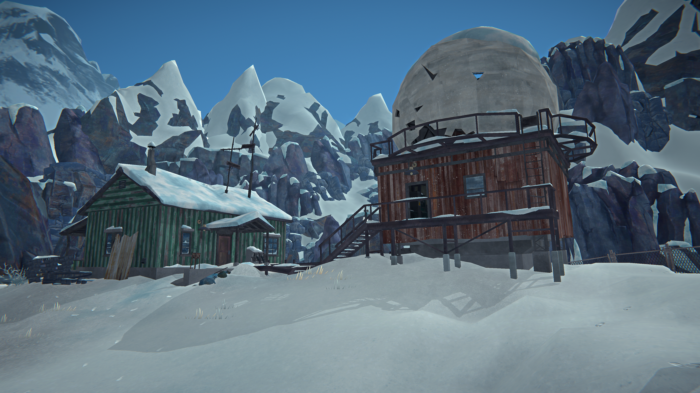

# Station Bunkhouse

<table class="infobox">
<caption>Station Bunkhouse</caption>
<colgroup>
<col style="width: 50%" />
<col style="width: 50%" />
</colgroup>
<tbody>
<tr>
<td colspan="2"><figure>

<figcaption>The Bunkhouse next to the Radar dome</figcaption>
</figure></td>
</tr>
<tr>
<td colspan="2" class="section">
<strong>Location</strong>
</td>
</tr>
<tr>
<td>
Region
</td>
<td>
<a href="./Sundered%20Pass.md" class="wikilink" title="Sundered Pass">Sundered Pass</a>|-
</td>
</tr>
<tr>
<td>
Firebox
</td>
<td>
<a href="./Pot%20Belly%20Stove.md" class="wikilink" title="Pot Belly Stove">Pot Belly Stove</a>
</td>
</tr>
<tr>
<td><figure>

<figcaption>bed_icon.png</figcaption>
</figure></td>
<td>
Has a bed
</td>
</tr>
<tr>
<td></td>
<td>
Has an interior|} <strong>Station Bunkhouse</strong> is an unmarked building in <a href="./Sundered%20Pass.md" class="wikilink" title="Sundered Pass">Sundered Pass</a> at the <a href="./Weather%20Station.md" class="wikilink" title="Weather Station">Weather Station</a>. It is one of 3 buildings located there, along with a storage shed and the radar dome. It contains a Bunk <a href="./Bed.md" class="wikilink" title="Bed">Bed</a>, a <a href="./Pot%20Belly%20Stove.md" class="wikilink" title="Pot Belly Stove">Pot Belly Stove</a>, a <a href="./Medicine%20Shelf.md" class="wikilink" title="Medicine Shelf">Medicine Shelf</a>, and can spawn a <a href="./Prybar.md" class="wikilink" title="Prybar">Prybar</a>.

The building itself is the only real warm location located on top of the mountain, as Sundered Pass gets continuously colder the higher one goes in altitude.

The bunkhouse is also the only location that contains the <a href="./Camera.md" class="wikilink" title="Camera">Camera</a>.

<table class="gallery">
<colgroup>
<col style="width: 100%" />
</colgroup>
<tbody>
<tr>
<td><figure>
[Missing image: Station_Bunkhouse_Interior.jpg]
<figcaption>The inside of the Bunkhouse during an <a href="./Aurora.md" class="wikilink" title="Aurora">Aurora</a></figcaption>
</figure></td>
</tr>
</tbody>
</table>

<strong>Lua execution error in Module:Navbox function navbox</strong> <a href="ru:%D0%9D%D0%BE%D1%87%D0%BB%D0%B5%D0%B6%D0%BA%D0%B0_%D0%BD%D0%B0_%D1%81%D1%82%D0%B0%D0%BD%D1%86%D0%B8%D0%B8" class="wikilink" title="ru:Ночлежка на станции">ru:Ночлежка на станции</a>
</td>
</tr>
</tbody>
</table>

