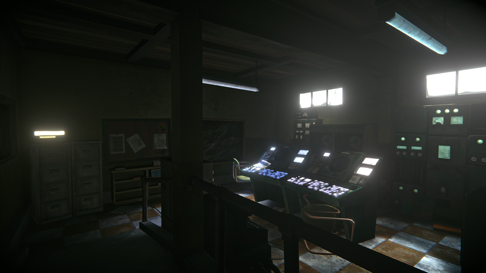

# Station Bunkhouse

**Station Bunkhouse**

| Property | Details |
| --- | --- |
|  |  / *The Bunkhouse next to the Radar dome* |
| **Location** |  |
| Region | [Sundered Pass](./Sundered%20Pass.md)\|- |
| Firebox | [Pot Belly Stove](./Pot%20Belly%20Stove.md) |
|  / *bed\_icon.png* | Has a bed |
|  | Has an interior\|} **Station Bunkhouse** is an unmarked building in [Sundered Pass](./Sundered%20Pass.md) at the [Weather Station](./Weather%20Station.md). It is one of 3 buildings located there, along with a storage shed and the radar dome. It contains a Bunk [Bed](./Bed.md), a [Pot Belly Stove](./Pot%20Belly%20Stove.md), a [Medicine Shelf](./Medicine%20Shelf.md), and can spawn a [Prybar](./Prybar.md). / The building itself is the only real warm location located on top of the mountain, as Sundered Pass gets continuously colder the higher one goes in altitude. / The bunkhouse is also the only location that contains the [Camera](./Camera.md). / \| Column 1 \| / \| --- \| / \|  / *The inside of the Bunkhouse during an [Aurora](./Aurora.md)* \| / **Lua execution error in Module:Navbox function navbox** [ru:Ночлежка на станции](ru:%D0%9D%D0%BE%D1%87%D0%BB%D0%B5%D0%B6%D0%BA%D0%B0_%D0%BD%D0%B0_%D1%81%D1%82%D0%B0%D0%BD%D1%86%D0%B8%D0%B8) |
|  |  / *The inside of the Bunkhouse during an [Aurora](./Aurora.md)* |
