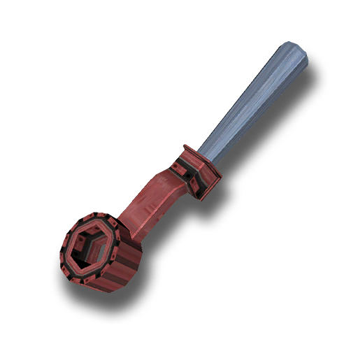

# Steam Train

**Categories:** Articles in need of images, Interactable Objects, Wintermute · **Source:** [Fandom](https://thelongdark.fandom.com/wiki/Steam_Train)

**Contents**

- [Appearance](#appearance)
- [History](#history)
- [Operation and Mechanics](#operation-and-mechanics)
- [Steam Train's Firebox](#steam-trains-firebox)
- [Steam Train Throttle](#steam-train-throttle)
- [Steam Train's Speed](#steam-trains-speed)
- [Notes](#notes)
- [Gallery](#gallery)

| Column 1 | Column 2 | Column 3 |
| --- | --- | --- |

| “ | __Use Coal to get the Steam Train Firebox temperature up to 125 degrees to start building pressure (PSI). The firebox will slowly cool off over time if you don't keep feeding it coal but never below 125 degrees.__ / What I Know description | ” |
| “ | __Move the throttle up through gears 1 and 2 to increase the Steam Train's Speed or into Reverse to change directions. Using the Brake will automatically put the Steam Train into its Neutral Gear. The Throttle can only be adjusted if the Brake is off and the Steam Train can only change directions when it is fully stopped.__ / What I Know description | ” |
| “ | __The Steam Train can move at two speeds "Slow" and "Fast". When the Steam Train is moving fast enough it can break through obstacles that would otherwise block its path. But increasing the Steam Train's speed will consume PSI.__ / What I Know description | ” |
|  / _The [Train Lever](./Train%20Lever.md)_ |  / _Cut Brake Lever_ |  |
