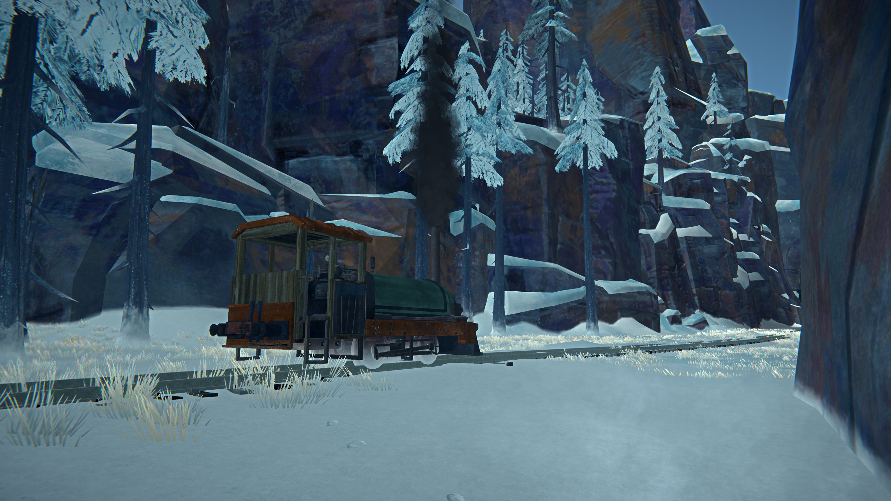
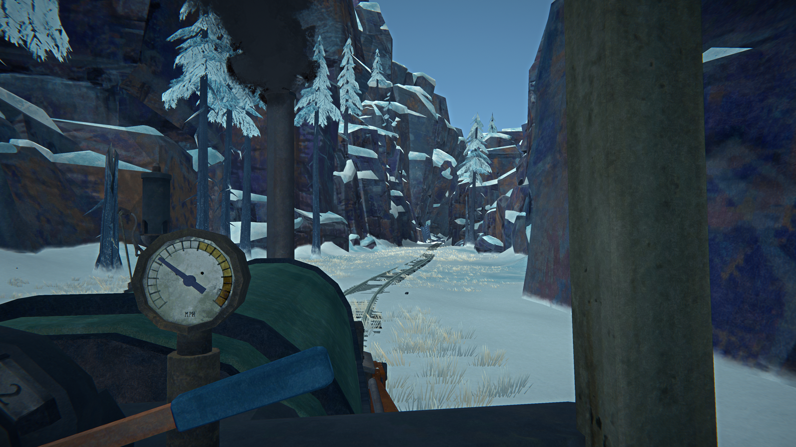

# Steam Train

**Contents**

- [Appearance](#Appearance)
- [History](#History)
- [Operation and Mechanics](#Operation_and_Mechanics)
- [Steam Train's Firebox](#Steam_Train%27s_Firebox)
- [Steam Train Throttle](#Steam_Train_Throttle)
- [Steam Train's Speed](#Steam_Train%27s_Speed)
- [Notes](#Notes)
- [Gallery](#Gallery)

<table>
<colgroup>
<col style="width: 33%" />
<col style="width: 33%" />
<col style="width: 33%" />
</colgroup>
<tbody>
<tr>
<td width="40px"><figure>

<figcaption>2120907963_TLD-Wintermute-v2.png.de8a285930f6a8f5ad9cf5878754cf5b.png</figcaption>
</figure></td>
<td>
<strong>Wintermute-Exclusive content.</strong> 

This content only appears in <a href="./Wintermute.md" class="wikilink" title="Wintermute">Wintermute</a>.

</td>
<td>
|}

<strong>Images Needed:</strong><em>This article is in need of more images and/or higher quality images. You can help by uploading an image and [//dummy.host/index.php?title=Steam+Train&amp;action=edit adding it to the article].</em>

The <strong>Steam Train</strong> is a player driven and controlled <a href="./Vehicle.md" class="wikilink" title="Vehicle">Vehicle</a> found exclusively in <a href="./Episode%205%20-%20The%20Light%20At%20The%20End%20Of%20All%20Things.md" class="wikilink" title="Episode 5">Episode 5</a> of <a href="./Wintermute.md" class="wikilink" title="Wintermute">Wintermute</a>. It is the main method of transportation in the <a href="./Railway.md" class="wikilink" title="Railway">Railway</a> region, during the mission <a href="./To%20SAR%20And%20Back.md" class="wikilink" title="To SAR And Back">To SAR And Back</a>. A successor to the Steam Train appears in <a href="./Survival%20Mode.md" class="wikilink" title="Survival Mode">Survival Mode</a> in the <a href="./Iron%20Road.md" class="wikilink" title="Iron Road">Iron Road</a> Expansion as the Prototype Steam Train.

<h2 id="Appearance">Appearance</h2>

The locomotive takes the shape of a <a href="wikipedia:0-4-0" class="wikilink" title="0-4-0 ST">0-4-0 ST</a> steam locomotive, carrying the number 46, with two electrically-powered headlights on the front (which will come on during the Aurora), along with a snowplow pilot. Being a tank locomotive, it does not have a tender. Curiously, it does not have a fuel bunker, requiring <a href="./Astrid%20Greenwood.md" class="wikilink" title="Astrid">Astrid</a> to regularly add coal to the firebox from her inventory. It also does not require the water tanks to be filled up.

<h2 id="History">History</h2>

According to the <a href="./Piece%20of%20Paper%20%282%29.md" class="wikilink" title="Piece of Paper">Piece of Paper</a> found in the Train Maintenance Shed, the engine was nicknamed "Goose" and was going to be put on display at the Maintenance Shed, with hopes that it could draw people up north towards Perseverance Mills and bring attention to the isolated town. It is unknown whether the locomotive was put on display, or not.

<h2 id="Operation_and_Mechanics">Operation and Mechanics</h2>

View from the cab of the locomotiveBefore operation, the Throttle <a href="./Train%20Lever.md" class="wikilink" title="Train Lever">Train Lever</a> needs to be reinstalled in the locomotive. The lever can be found on the wall near a drill press in the nearby maintenance shed. This will progress the mission to the next stage.

<h3 id="Steam_Train&#39;s_Firebox">Steam Train's Firebox</h3>
<table>
<colgroup>
<col style="width: 33%" />
<col style="width: 33%" />
<col style="width: 33%" />
</colgroup>
<tbody>
<tr>
<td style="vertical-align: top; font-size: 3em; color: #5d5980; padding-right: 10px">
“
</td>
<td>
Use Coal to get the Steam Train Firebox temperature up to 125 degrees to start building pressure (PSI). The firebox will slowly cool off over time if you don't keep feeding it coal but never below 125 degrees.

&#10;

What I Know description

</td>
<td style="vertical-align: bottom; font-size: 3em; color: #5d5980; padding-left: 10px">
”
</td>
</tr>
</tbody>
</table>

A fire can be lit in the firebox in the conventional way. Once lit, the temperature must be brought up to 125°C (225°F). Using wood of any kind will not raise the firebox temperature in order to start generating steam pressure. Instead, <a href="./Coal.md" class="wikilink" title="Coal">Coal</a> must be used to greatly increase the firebox temperature.

As the temperature rises to 125°C (225°F), PSI is built up on a dial that will allow the Steam Train to move forwards or backwards once the Throttle is released. Over time and as the train is used for transportation, the fire's temperature will decrease, requiring periodic additions of coal to continue generating steam PSI.

<h3 id="Steam_Train_Throttle">Steam Train Throttle</h3>
<table>
<colgroup>
<col style="width: 33%" />
<col style="width: 33%" />
<col style="width: 33%" />
</colgroup>
<tbody>
<tr>
<td style="vertical-align: top; font-size: 3em; color: #5d5980; padding-right: 10px">
“
</td>
<td>
Move the throttle up through gears 1 and 2 to increase the Steam Train's Speed or into Reverse to change directions. Using the Brake will automatically put the Steam Train into its Neutral Gear. The Throttle can only be adjusted if the Brake is off and the Steam Train can only change directions when it is fully stopped.

&#10;

What I Know description

</td>
<td style="vertical-align: bottom; font-size: 3em; color: #5d5980; padding-left: 10px">
”
</td>
</tr>
</tbody>
</table>

Once the locomotive has built enough steam PSI, it can be driven by releasing the brakes and engaging the throttle. The locomotive can maintain boiler pressure at half-throttle indefinitely, but full throttle must be used to push away obstacles such as fallen trees, snowdrifts, or fence gates. It is also capable of pushing some road-rail trucks and some railroad cars out of the way. The steam whistle can be used to scare <a href="./Wolf.md" class="wikilink" title="wolves">wolves</a> away. The train can be reversed and can automatically apply the brakes if selected.

<h3 id="Steam_Train&#39;s_Speed">Steam Train's Speed</h3>
<table>
<colgroup>
<col style="width: 33%" />
<col style="width: 33%" />
<col style="width: 33%" />
</colgroup>
<tbody>
<tr>
<td style="vertical-align: top; font-size: 3em; color: #5d5980; padding-right: 10px">
“
</td>
<td>
The Steam Train can move at two speeds "Slow" and "Fast". When the Steam Train is moving fast enough it can break through obstacles that would otherwise block its path. But increasing the Steam Train's speed will consume PSI.

&#10;

What I Know description

</td>
<td style="vertical-align: bottom; font-size: 3em; color: #5d5980; padding-left: 10px">
”
</td>
</tr>
</tbody>
</table>

Various obstacles can be broken when the train reaches the "Fast" speed setting on the speed dial. These obstacles are required to be cleared in order to progress through the mission.

They include:

<ul>
<li>Metal Gates</li>
<li>Snow Piles on the tracks</li>
<li>Fallen Trees</li>
</ul>
<h2 id="Notes">Notes</h2>
<ul>
<li>Despite being equipped with couplers, the locomotive is not able to couple to and pull train cars behind it.</li>
<li>The train's firebox generates a substantial amount of heat, enough to warm the player when inside the controls.</li>
<li>At full speed, the locomotive is the fastest way of moving on Great Bear, easily capable of overtaking a running <a href="./Deer.md" class="wikilink" title="Deer">Deer</a> or <a href="./Wolf.md" class="wikilink" title="Wolf">Wolf</a>.</li>
<li>The locomotive can't be derailed in normal gameplay, nor can it be blown up by over pressuring.</li>
<li>It is not possible to eat, drink, pass time, or sleep while driving the locomotive. Only the map can be brought up in the <a href="./Radial%20Menu.md" class="wikilink" title="Radial Menu">Radial Menu</a>.</li>
<li>Wildlife will not be killed if the steam locomotive runs over them. Wildlife will also be scared of the whistle if they are close by.</li>
<li>A Train Brake Lever icon is found in the game files, but was never actually implemented as an item. The brake lever is already installed once the player finds the train.</li>
</ul>
<h2 id="Gallery">Gallery</h2>
<table class="gallery">
<colgroup>
<col style="width: 50%" />
<col style="width: 50%" />
</colgroup>
<tbody>
<tr>
<td><figure>
[Missing image: Train_Lever_icon.png]
<figcaption>The <a href="./Train%20Lever.md" class="wikilink" title="Train Lever">Train Lever</a></figcaption>
</figure></td>
<td><figure>

<figcaption>Cut Brake Lever</figcaption>
</figure></td>
</tr>
</tbody>
</table>

[Railway] <strong>Lua execution error in Module:Navbox function navbox</strong>
</td>
</tr>
</tbody>
</table>

