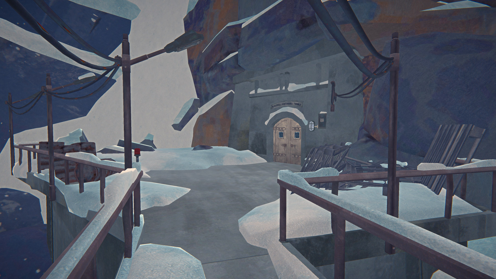
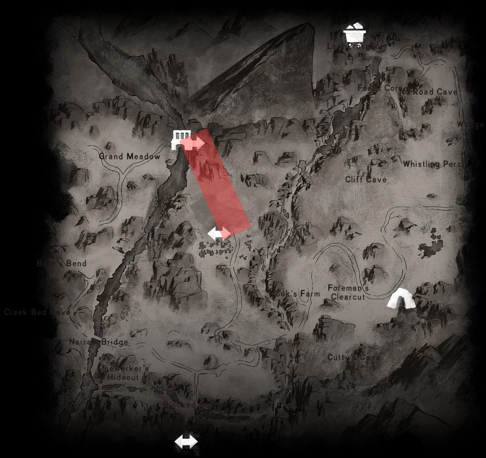

# Steam Tunnels

**Steam Tunnels**

| Property | Details |
| --- | --- |
|  |  / *Steam\_Tunnels\_lower\_entrance.jpg* |
| **Location** |  |
|  |  / *Steam\_Tunnels\_Location.png* |
| Region |  |
| Location | Underneath Blackrock Prison |
| **General** |  |
| Type | Industrial\|- |
|  | Has an interior\|- |
| Missions | [The Power Plant](./The%20Power%20Plant.md) / [Donner](./Donner.md) |

**Spoiler Warning:****This page may contain spoilers from the [story](./Wintermute.md) of The Long Dark.**

The Blackrock Dam **Steam Tunnels** are a sprawling system of Dark tunnels located in the region Blackrock, added in the Perilous Constraint Update on December 8th 2021.

## Overview

The Steam Tunnels can be accessed through an entrance across the bridge from the main Blackrock Electric Dam as well as a small structure alongside the [Blackrock Penitentiary](./Blackrock%20Prison.md).

Despite there being no known hostile life in the Tunnels, it is still a very daunting location to explore, as it is made up entirely of dark, long winding passageways impossible to navigate without a light source. Live wires during the Aurora can also rapidly burn careless players who travel through the tunnels.

Within the tunnels there are several Fire Barrels, with plenty of firewood and other fuel scattered throughout, it is recommended that players without Storm Lanterns use these to provide torches, as there is enough fuel to make a fire last a great many hours.

If entering from the prison, taking the first right turn will lead to the power plant. Vice versa, if entering from the power plant, taking the first left turn will lead to the prison.

## Story Mode

A main task of [Episode 4: Fury, then Silence](./Episode%204%20-%20Fury%2C%20Then%20Silence.md), [The Power Plant](./The%20Power%20Plant.md), [Mathis](./Mathis.md) asks you to restore the electrical system. You talk to [Jace](./Jace.md) at the Dam and your Mission changes to sabotage. In the Steam Tunnels you open and close the valves, melting the ice at the right temperature and pressure, opening the doors and making it difficult to open the solitary cell from the main engine.

[Lanterns](./Lantern.md) can be found through the tunnels and can be lit to provide a light source.**Lua execution error in Module:Navbox function navbox** [ru:Пропарочные тоннели](ru:%D0%9F%D1%80%D0%BE%D0%BF%D0%B0%D1%80%D0%BE%D1%87%D0%BD%D1%8B%D0%B5_%D1%82%D0%BE%D0%BD%D0%BD%D0%B5%D0%BB%D0%B8)
