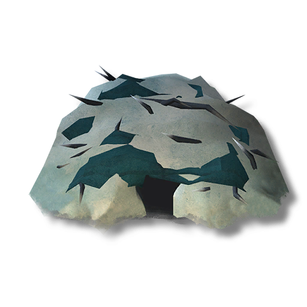
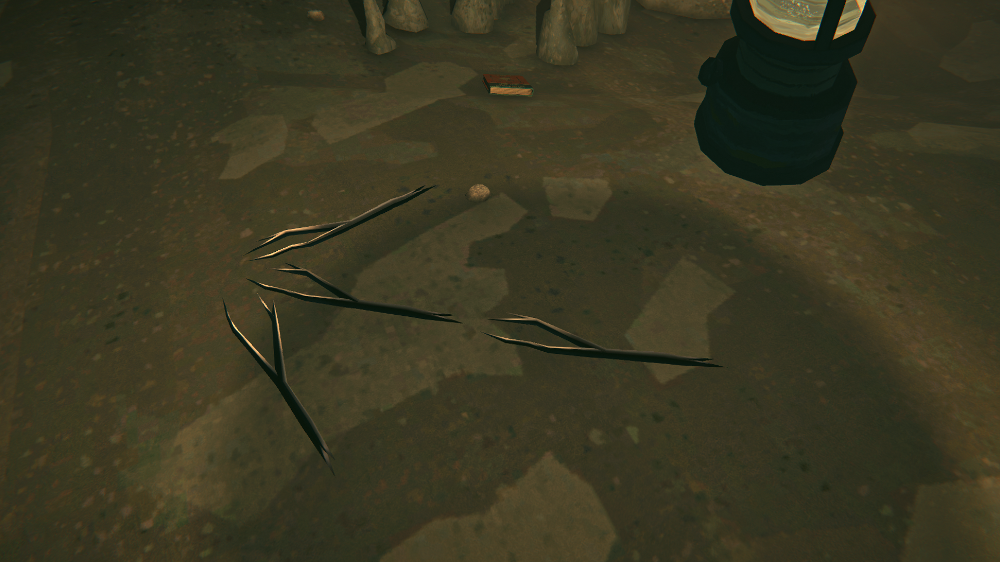

# Stick

**Categories:** Fire Starting, Materials, Pages with update history · **Source:** [Fandom](https://thelongdark.fandom.com/wiki/Stick)

**Contents**

- [Fire Starting info](#fire-starting-info)
- [Products](#products)
- [Tips](#tips)
- [Gallery](#gallery)
- [Update history](#update-history)

**Stick**

_Stick\_icon.png_

**Release:** [1 August 2015](./The%20Long%20Dark%20%E2%80%94%20Changelog.md#0.256)

**Wintermute:** No

**Renewable:** Yes

**Properties**

**Item type:** [Fire Starting](./Fire%20Starting.md)[Materials](./Materials.md)

**Stackable:** Yes

**Examine:** Small stick, will burn, but not for long.

**Values**

**Weight:** 0.15 kg (0.33 lbs)

**Sticks** are a crafting material and fuel material in _The Long Dark_.

## Fire Starting info

**Stick**

**Type:** Fuel

**Statistics**

**Duration:**  7.5 minutes

**Start Chance:**  15%

**Heat:**  +1°C (+1.8°F)

**Burn Density:** 0.83 hr/kg (0.38 hr/lb)

## Products

| Item | Skills | Materials |
| --- | --- | --- |
|  [Fire Hardened Arrow](./Fire%20Hardened%20Arrow.md) | None | - 5 × [Stick](./Stick.md) / - 5 × [Crow Feather](./Crow%20Feather.md) |
|  [Fishing Tip-Up](./Fishing%20Tip-Up.md) | None | - 2 × [Stick](./Stick.md) / - 1 × [Cloth](./Cloth.md) / - 1 × [Scrap Metal](./Scrap%20Metal.md) / - 1 × [Fishing Tackle](./Fishing%20Tackle.md) |
|  [Snow Shelter](./Snow%20Shelter.md) | None | - 15 × [Stick](./Stick.md) / - 5 × [Cloth](./Cloth.md) |
|  [Tinder Plug](./Tinder%20Plug.md) | None | - 1 × [Stick](./Stick.md) |
|  [Torch](./Torch.md) | None | - 3 × [Stick](./Stick.md) / - 1 × [Cloth](./Cloth.md) / - 0.10 L × [Lantern Fuel](./Lantern%20Fuel.md) |

## Tips

Torches (including Ruined Torches) may be harvested into a stick, for just 2 minutes (in-game).

Sticks can be found near trees on the ground. They can also be obtained by breaking down branches or [scrub brush](./Scrub%20Brush.md). It takes 10 minutes (5 with a hatchet) to break branch into three sticks.

While sticks have one of the worst burning time to kg ratios (second only to [books](./Book.md)), each stick adds 1°C to the fire, with each hour's worth of burn time adding 8°C to the fire. This causes large numbers of sticks to produce hot and relatively short-lived fires (most fuel sources yield 6°C per hour of burn time, [firelogs](./Firelog.md) yield 10.5°C and [coal](./Coal.md) yields 20°C).

Sticks' short burn time gives control over a fire's duration, minimizing waste of fuel or matching timed tasks such as [melting snow](./Water%20%28Unsafe%29.md) and [boiling water](./Water%20%28Potable%29.md), or to extend a fire to harvest a [torch](./Torch.md).

Sticks can also be used as a basic compass, because when dropped they will point towards the "north" of the map when outdoors. Not all maps have a properly represented north as "up", but dropped sticks will always point in the same direction on the same map.

It's commonly believed that sticks respawn after strong winds or blizzards, but this is untrue. Radial spawns (sticks, branches, coal, stones ect.) simply spawn on a randomized timer, independent of any weather conditions.

## Gallery

_An arrow for navigation purposes made out of four sticks._

## Update history

- UPDATE **1 August 2015 ([Update](./The%20Long%20Dark%20%E2%80%94%20Changelog.md#0.256)):**
  - Added to game.
