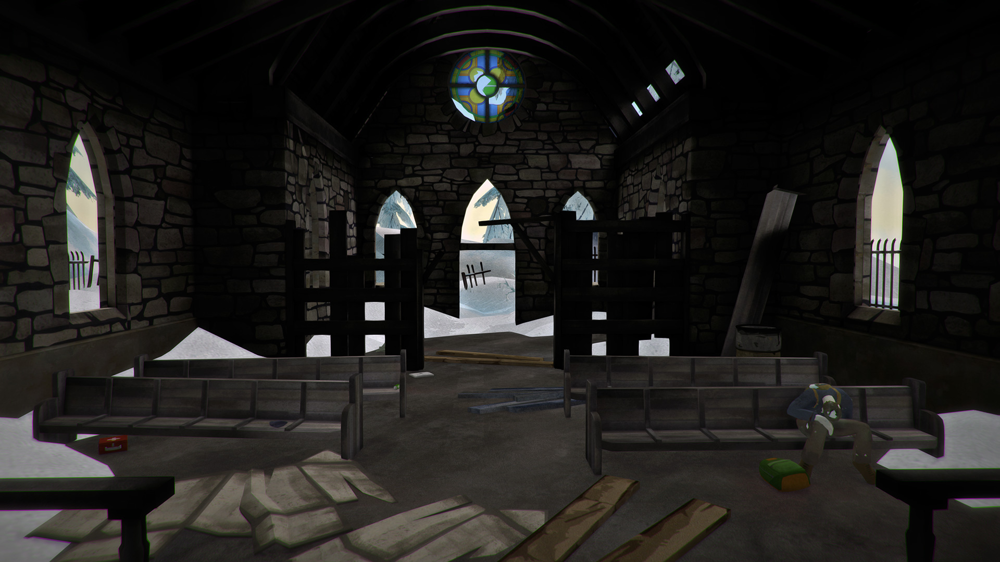
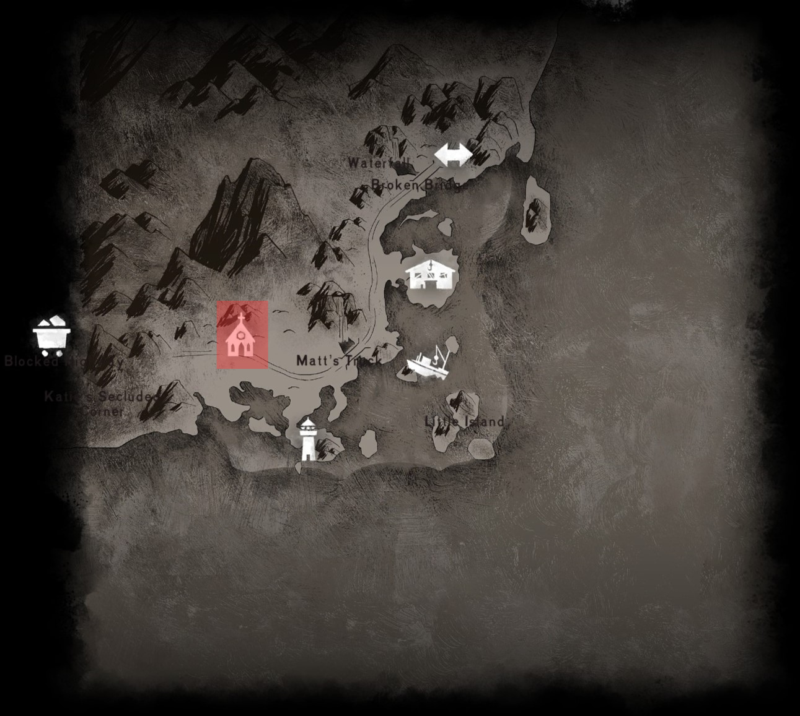
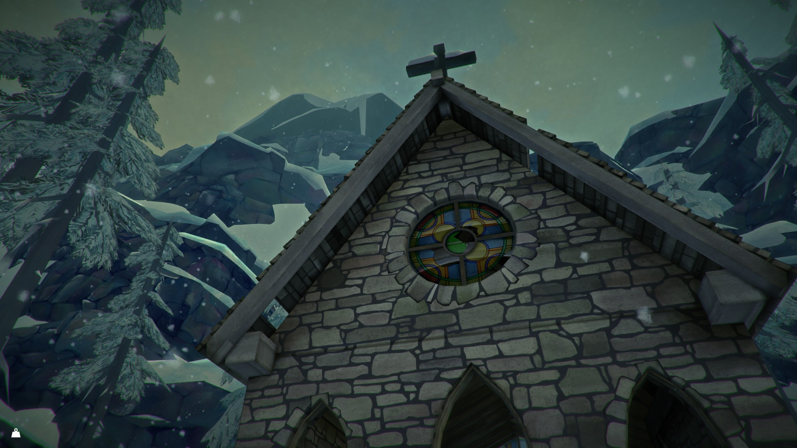
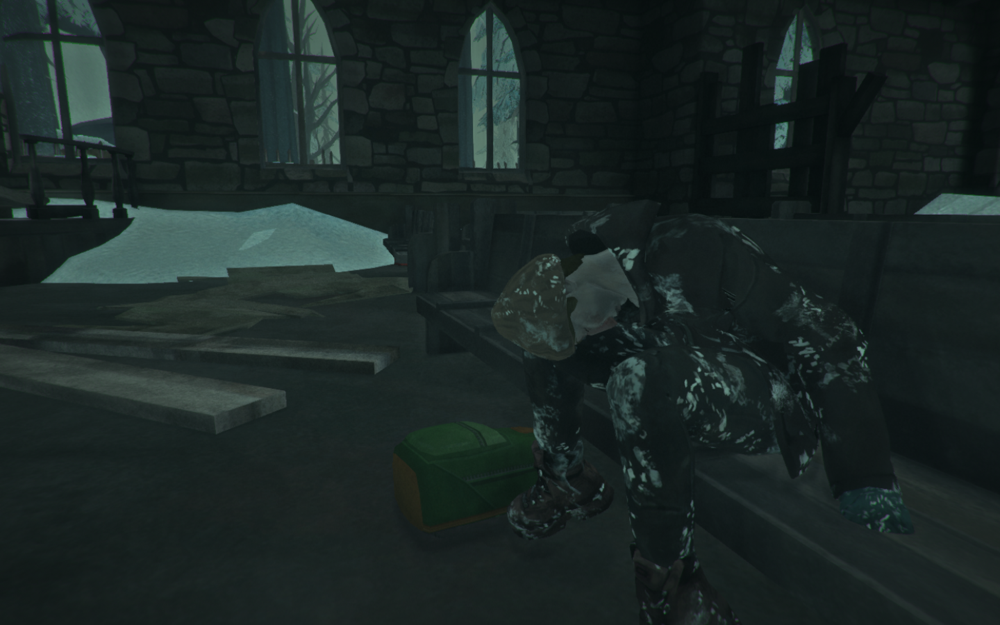
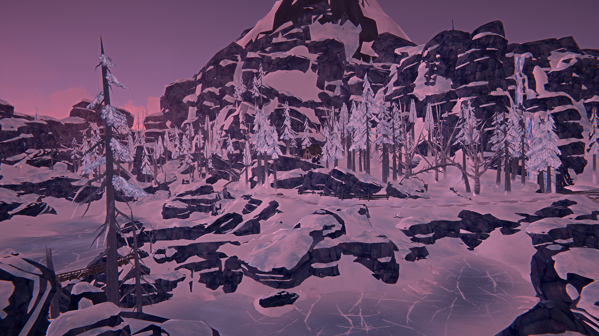

# Stone Church

**Categories:** Locations, Locations in Desolation Point, Outdoor locations, Sheltered locations · **Source:** [Fandom](https://thelongdark.fandom.com/wiki/Stone_Church)

**Stone Church**

\[\[File: /  / _Exterior_ /  / _Interior_

250px\]\]

_Exterior_

_Interior_

**Location**

_Stone\_Church\_Location.png_

Region

[Desolation Point](./Desolation%20Point.md)

Location

**General**

Type

Outdoors

Firebox

_A view of the interior of the church._

_20170305143322\_1.jpg_

_20170305144443\_1.jpg_

_Boring sermon?_

_A view from the [lighthouse](./Lonely%20Lighthouse.md)._
