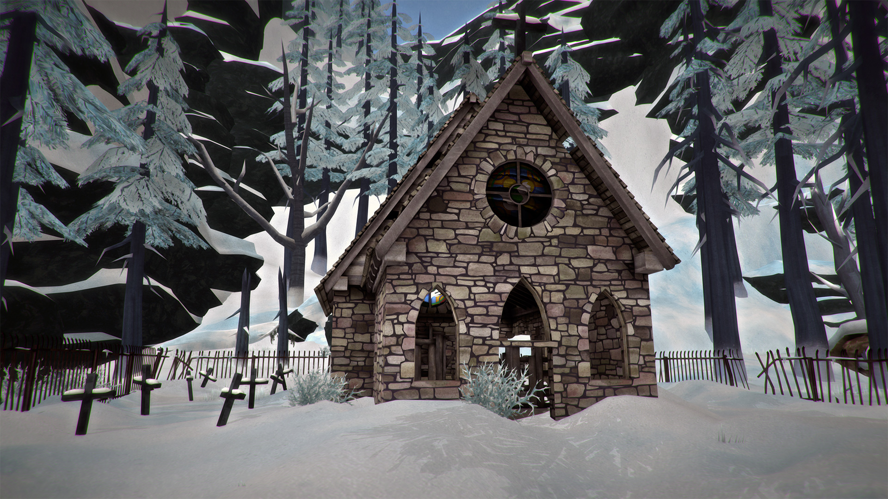

# Stone Church

**Categories:** Locations, Locations in Desolation Point, Outdoor locations, Sheltered locations · **Source:** [Fandom](https://thelongdark.fandom.com/wiki/Stone_Church)

**Stone Church**

| \[\[File: /  / _Exterior_ /  / _Interior_ | 250px\]\] |  |
| --- | --- | --- |
| **Location** |  |  |
|  / _Stone\_Church\_Location.png_ |  |  |
| Region | [Desolation Point](./Desolation%20Point.md)\|- | Location |
| **General** |  |  |
| Type | Outdoors\|- | Firebox |
