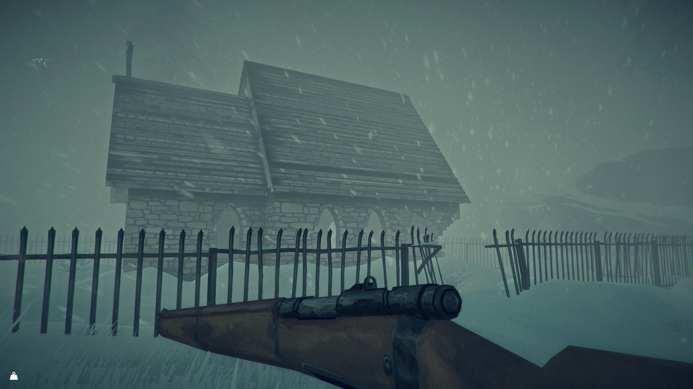

# Stone Church

**Categories:** Locations, Locations in Desolation Point, Outdoor locations, Sheltered locations · **Source:** [Fandom](https://thelongdark.fandom.com/wiki/Stone_Church)

**Stone Church**

\[\[File: /  / _Exterior_ /  / _Interior_

250px\]\]

**Location**

_Stone\_Church\_Location.png_

Region

[Desolation Point](./Desolation%20Point.md)

Location

**General**

Type

Outdoors

Firebox

Provides some shelter **Stone Church** is a dilapidated chapel found in [Desolation Point](./Desolation%20Point.md).

## Overview

The Stone Church lies just east of the [Abandoned Mine No. 5](./Abandoned%20Mine%20No.%205.md) (west entrance). Several [Reishi Mushrooms](./Reishi%20Mushroom.md) and a few other medicinal plants surround the church. Within the church you'll find a [Fire Barrel](./Fire%20Barrel.md), possibly a [Frozen Corpse](./Frozen%20Corpse.md), and some resources, potentially including:

- [Hunting Rifle](./Hunting%20Rifle.md)
- Sodas
- Firewood
- [Bedroll](./Bedroll.md)
- [Revolver](./Revolver.md) (Has a small chance to be found next to the corpse, if it does spawn.)

The church walls and windows are damaged, so the structure offers only modest protection against the cold and wind, and may not even protect against aggressive [wildlife](./Wildlife.md).

Despite these limitations, a player with decently warm [clothing](./Clothing.md), a bed roll, and/or plenty of fuel can usually wait out a blizzard or hide from prowling wolves. High-quality clothing can even allow the church to serve as a functional [Safe House](./Safehouse.md), although the nearby mine is safer and warmer.

The church is considered an indoor area (slow movement like a [Warm Cave](./Warm%20Cave.md)) and it gives a warmth bonus but it doesn't count towards [Cabin Fever Risk](./Cabin%20Fever%20Risk.md), which makes it an ideal location to pass time to reduce Cabin Fever risk.

## Trivia

- Based on its name and architecture the Stone Church is likely a Christian building, though it is unknown what denomination or time period it was constructed in. Considering its dilapidated state and emphasis on stone instead of more modern materials, it is likely the oldest church on Great Bear.
- The Stone Church is one of four churches on [Great Bear Island](./Great%20Bear%20Island.md); the other two being the Catholic [St. Christopher's Church](./St.%20Christopher%27s%20Church.md) of [Milton](./Milton.md), the inaccessible church at [Perseverance Mills](./Perseverance%20Mills.md), and the Catholic or Episcopal church of [Thompson's Crossing](./Thomson%27s%20Crossing.md).
- It is suggested Thompson's Crossing was the largest remaining settlement on Great Bear Island prior to [The First Flare](./First%20Flare.md), because Milton's church was closed due to the town's declining population (as detailed in [Buffer Memories](./Buffer%20Memories.md) and Notes), and the Desolation Point's church seems derelict for years if not decades.

## Gallery

_A view of the interior of the church._

_20170305143322\_1.jpg_

_20170305144443\_1.jpg_

_Boring sermon?_

_A view from the [lighthouse](./Lonely%20Lighthouse.md)._
