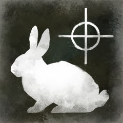

# Stone\-Age Sniper

<table class="infobox">
<caption>Stone-Age Sniper</caption>
<colgroup>
<col style="width: 50%" />
<col style="width: 50%" />
</colgroup>
<tbody>
<tr>
<td colspan="2"><figure>

<figcaption>Stone-Age_Sniper_icon.png</figcaption>
</figure></td>
</tr>
<tr>
<td colspan="2"></td>
</tr>
<tr>
<td>
Description
</td>
<td>
Stun a rabbit with a rock from over 25 meters (80 feet) away.
</td>
</tr>
</tbody>
</table>

**Stone-Age Sniper** is an <a href="./The%20Long%20Dark%20%E2%80%94%20Achievements.md" class="wikilink" title="achievement">achievement</a> in <a href="./The%20Long%20Dark.md" class="wikilink" title="The Long Dark">The Long Dark</a>.

## Guide

This achievement is obtained after stunning a <a href="./Rabbit.md" class="wikilink" title="Rabbit">Rabbit</a> with a <a href="./Stone.md" class="wikilink" title="Stone">Stone</a> from 25 meters away. This can be accomplished fairly quickly in <a href="./Episode%201%20-%20Do%20Not%20Go%20Gentle.md" class="wikilink" title="Episode 1: Do Not Go Gentle">Episode 1: Do Not Go Gentle</a> when you're first introduced to Rabbits by throwing stones down at the Rabbits crossing the ice.\[Missing image: Stone_Aim_Guide.png\] Aim in between the index finger and thumb. The red circle is where the Stone will land.

**Lua execution error in Module:Navbox function navbox**

