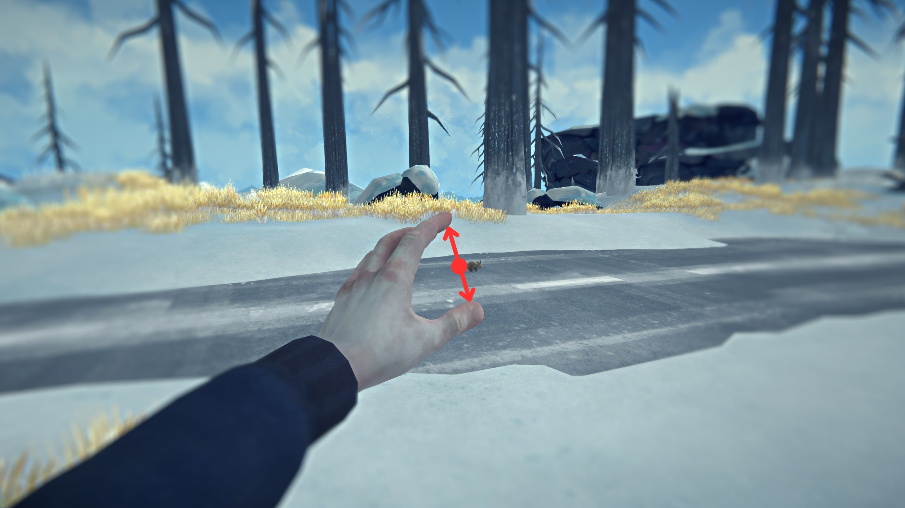
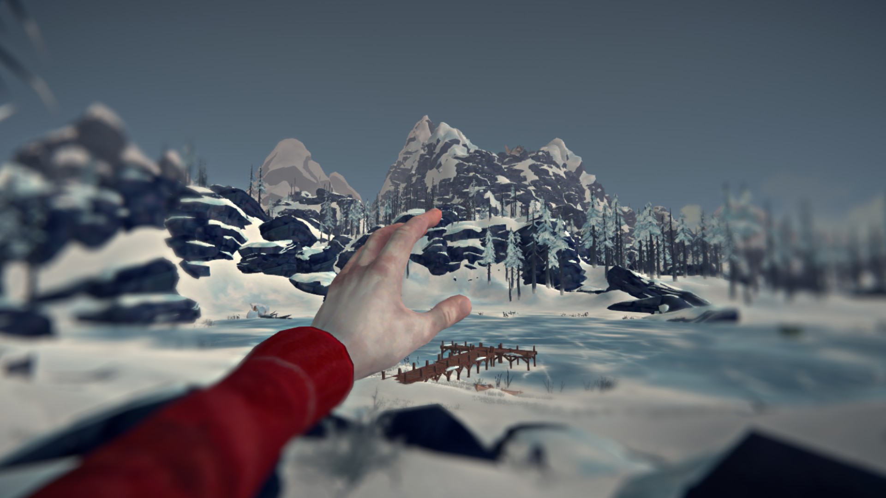
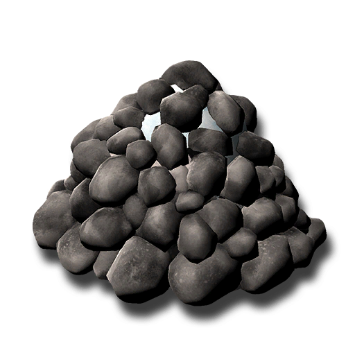

# Stone

**Categories:** Pages with update history, Tools · **Source:** [Fandom](https://thelongdark.fandom.com/wiki/Stone)

**Contents**

- [Products](#products)
- [Hunting](#hunting)
- [Aiming](#aiming)
- [Gallery](#gallery)
- [Update history](#update-history)

**Stone**

[Stone icon](../assets/Stone_icon.png)

**Release:** [8 June 2017](./The%20Long%20Dark%20%E2%80%94%20Changelog.md#0.423)

**Wintermute:** No

**Properties**

**Item type:** [Tools](./Tools.md)

**Stackable:** Yes

**Examine:** A small stone. Big enough to stun a small animal. Might be enough to scare off a bigger one.

**Values**

**Weight:** 0.15 kg (0.33 lbs)

**Actions**

**Backpack:** Toss from hip, Aim and Throw

A **Stone** is a throwable item found scattered around all maps. It can be picked up and used as a distraction or make-shift weapon against [Wolves](./Wolf.md).

Stones are an excellent tool for hunting [Rabbits](./Rabbit.md) and [Ptarmigans](./Ptarmigan.md); they are abundant, relatively simple to use, can stun these animals with no additional resources, and are reusable. Stones may also be strategically placed to mark paths or important locations the player may wish to remember later.

Stones can also be used to lower the morale of an attacking [Timberwolf](./Timberwolf.md) pack, by hitting or landing near one of its members.

## Products

| Item | Skills | Materials |
| --- | --- | --- |
| [Rock Cache](./Rock%20Cache.md) | None | - 50 × [Stone](./Stone.md) |

## Hunting

Rabbits and Ptarmigans are stunned by a direct hit with a stone, which requires some practice with sneaking near enough to the small animals and aiming roughly in the center of the thumb and forefinger "reticule." If the player picks up the animal within a few seconds, the game gives you the option to kill or release it, otherwise it will recover from its stunned state and flee the area.

Rabbits and [Deer](./Deer.md) will flee from the landing site of thrown stones, which is useful for flushing prey while hunting. [Wolves](./Wolf.md), [timberwolves](./Timberwolf.md) and [bears](./Bear.md) will investigate the landing sites of thrown stones (if not already stalking the player) before returning to their patrol. The distraction may provide enough time to escape from dead ends or through areas otherwise obstructed by patrolling predators.

[Ptarmigans](./Ptarmigan.md) will also flee and take to the air if a stone is thrown near them, making it impossible to lure them to predator animals for hunting.

- [Wolves](./Wolf.md) will flee after being directly struck in the head with a thrown stone, also causing a small patch of blood to fall to the ground (but not causing bleedout to begin). Throwing or even just aiming a stone if near a fire or an unreachable place for a wolf is most useful for discouraging wolves from stalking the player, or scaring them off of an animal carcass; however, aiming (right-click) at a stalking wolf may also provoke it to begin an attack run.

- [Timberwolves](./Timberwolf.md) behave similarly to wolves with thrown stones; if a timberwolf pack is engaging the player, thrown stones landing near them or directly striking them will lower the pack's morale.
- [Poisoned Wolves](./Poisoned%20Wolf.md) behave similarly to regular Wolves when Stones are used on or around them.

- [Bears](./Bear.md) will ignore thrown stones once they begin stalking.

- [Moose](./Moose.md) will flee from thrown stones as long as they have not detected the player, if they have detected the player they will become enraged instead.
- [Cougar](./Cougar.md) will investigate tossed stones, but will ignore them if they start stalking the player.

Like [arrows](./Simple%20Arrow.md), stones will ricochet off terrain and objects if striking at an oblique angle.

## Aiming

_Aim in between the index finger and thumb. The red circle is where the Stone will land._ By holding the "Aim" Option, position your target between the thumb and index finger as shown in the example photo. Stones typically land in this area, though a few factors need to be taken into account before throwing:

- Always be aware of where the target currently is and the timing of the throw. You will miss if you do not factor this in, it will alert your target when you miss.
- If the target is moving, always aim slightly in front of them before throwing, as aiming where the target currently is will cause the Stone to miss once it leaves your hand.
- Gloves can make throwing more difficult since the index finger is covered up. Try practicing with [Driving Gloves](./Driving%20Gloves.md) or similar non-mitten gloves or simply remove any mittens first, then when you become better with throwing Stones, practice with mittens on.

## Gallery

_A [Rock Cache](./Rock%20Cache.md) made of several Stones_

## Update history

- UPDATE **8 June 2017 ([Update](./The%20Long%20Dark%20%E2%80%94%20Early%20Access%20Changelog.md#0.423)):**
  - Added to game.
