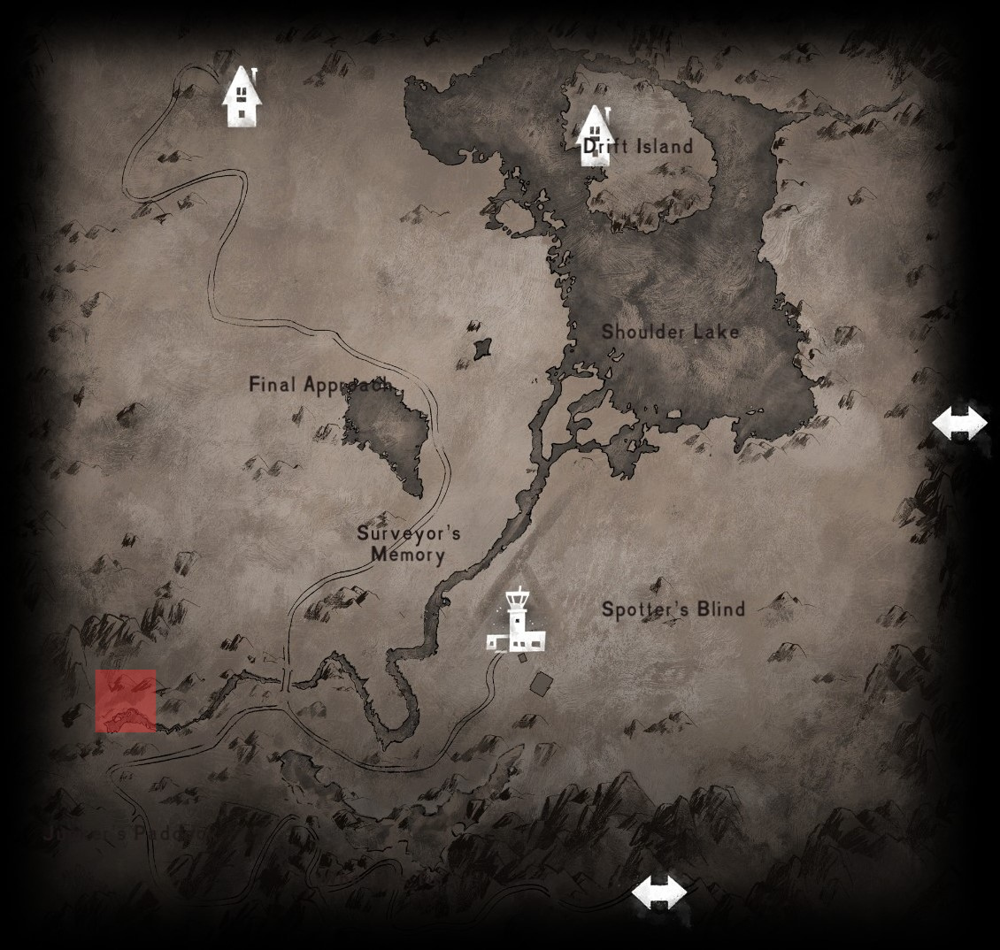

# Stony Passage

**Stony Passage**

| Property | Details |
| --- | --- |
|  |  / *Stony.png* |
| **Location** |  |
|  |  / *Stoney\_Passage\_Location.png* |
| Region | [Forsaken Airfield](./Forsaken%20Airfield.md)\|- |
| **General** |  |
| Type | Cave\|- |
