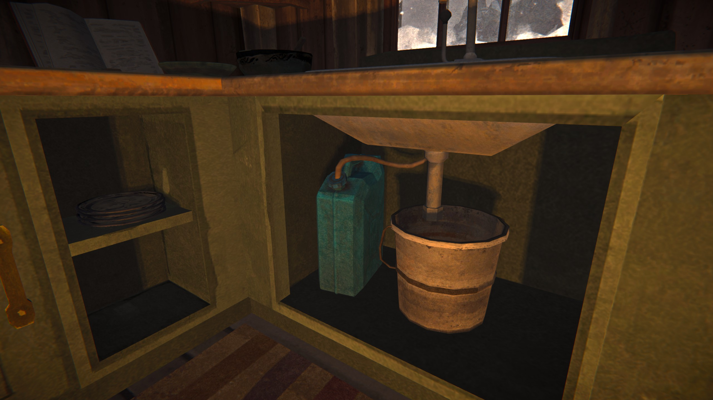

# Stored Water

**Stored Water**

| Property | Details |
| --- | --- |
|  |  / *Stored\_Water.jpg* |
| **General** |  |
| Item Type | Item |
| Wintermute | No |

| Column 1 | Column 2 | Column 3 |
| --- | --- | --- |
|  / *Ptarmigan\_icon.png* | **DLC-Exclusive content.** / This content requires the [Tales from the Far Territory](./Tales%20from%20the%20Far%20Territory.md) addon to be installed before it can be seen or used in regular gameplay. | \|} **Stored Water** is a blue water container found in a few locations within the Far Territory. They are a bright blue jug found in buildings that that do not connect to a water line grid, mainly being found in kitchens below the sinks of said buildings. They contain a varying amount of [Water (Potable)](./Water%20%28Potable%29.md) much like [Toilets](./Toilet.md). / They can be found in: / - [Mindful Cabin](./Mindful%20Cabin.md) / - [Island Cottage](./Island%20Cottage.md) / - Kitchen [Prepper Cache](./Prepper%20Cache.md) variant / - Kitchen on the top floor of the [Concentrator](./Concentrator.md) / - [Bunker Alpha](./Bunker%20Alpha.md), [Bunker Beta](./Bunker%20Beta.md), [Bunker Gamma](./Bunker%20Gamma.md), [Bunker Omega](./Bunker%20Omega.md) / - The avalanched [Cabin](./Cabin%20%28Sundered%20Pass%29.md) at [Old Settlement](./Old%20Settlement.md) / **Lua execution error in Module:Navbox function navbox** |
