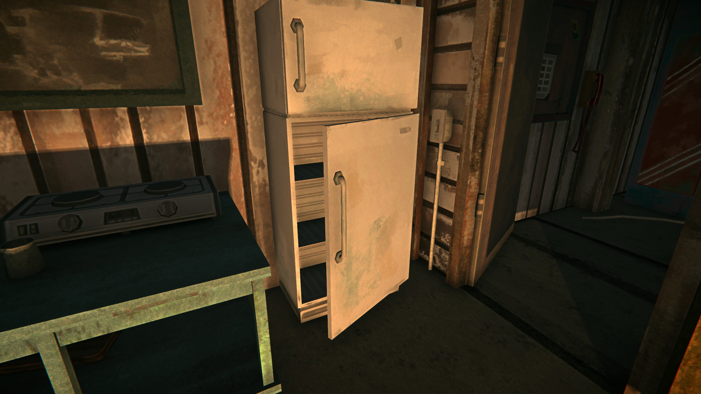
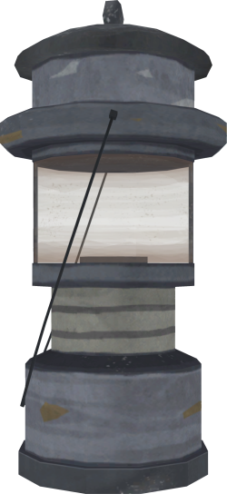

# Storm Lantern

**Categories:** Tools · **Source:** [Fandom](https://thelongdark.fandom.com/wiki/Storm_Lantern)

**Storm Lantern**

[Storm Lantern icon](../assets/Storm_Lantern_icon.png)

**General**

**Item Type:** Tool

**Statistics**

**Weight:** [Weight icon](../assets/Weight_icon.png)1.00 kg(2.2 lbs)

**Harvest:** 1 × [Scrap Metal](./Scrap%20Metal.md) 0.00-1.00 KG [Lantern Fuel](./Lantern%20Fuel.md)

**Repair:** [Simple Tools](./Simple%20Tools.md) or [Quality Tools](./Quality%20Tools.md) 1 × [Scrap Metal](./Scrap%20Metal.md) 45 to 30 min

> “**Wind-proof storm lantern with mechanical ignitor. Burns kerosene.**”
>
> — In-game description

_For the unique variant of the Storm Lantern, see [Spelunker's Lantern](./Spelunker%27s%20Lantern.md)._

The **Storm Lantern** is a mobile light source that creates a large amount of light and a paltry amount of [Warmth](./Warmth.md). The lantern's glass-encased flame allows the player to use it in even the windiest conditions, making it and the [Flare](./Flare.md) the only light sources not reduced or extinguished by wind.

## Overview

Storm Lantern is a mobile source of light and [Warmth](./Warmth.md) which does not require Matches or other firestarters to ignite. The lantern's flame is also windproof, but unlike [Flares](./Flare.md) it will not deter [wolves](./Wolf.md). The lantern requires no external ignition source, unlike [Torches](./Torch.md). Lanterns can be placed ("RMB") on any flat surface, even when lit such as to provide light while crafting or reading at night. Lanterns can be refueled from [Lantern Fuel](./Lantern%20Fuel.md) or a [Jerry Can](./Jerry%20Can.md).

The Storm Lantern does not degrade condition when used or over time, but may suffer damage during a [Bear Struggle](./Struggle.md). It can be repaired with [Scrap Metal](./Scrap%20Metal.md) and [Tools](./Simple%20Tools.md). If harvested, any fuel left inside of it it will be added to the survivor's inventory.

- Auto-igniter allows the Storm Lantern to be quickly ignited/extinguished without needing to use [Matches](./Wood%20Matches.md) like a [Torch](./Torch.md) would.
- A lit lantern adds 3*C the survivor's "Warmth" when ignited and equipped.
- Weighs 1.00kg when empty
- Can hold up to 1 liter (0.26 gallons) of Lantern Fuel which is enough to use continuously for 4 in-game hours (weighing 1.8 kg when fully fueled)
- The higher the amount of fuel stored inside Storm Lantern, the brighter the light it produces
- When below 10% (0.10kg) fuel and ignited, the Storm Lantern flame will flicker and sputter, and extinguishing itself at 0% fuel

The Storm Lantern can be quickly extinguished without needing to stop the survivor by pressing any hotkey (e.g. "2" to switch to a Weapon), while manually extinguishing it ("LMB") will cause the survivor to stop while extinguishing.

## Trivia

- You can skip the Extinguish animation (which forces you to stop) by simply holstering the Lamp outright.
- The in-game model for the storm lantern appears to lack several vital components needed for an ordinary kerosene pressure lamp to function; such as a mantle, generator tube, pressure pump, and pre heater cup.
- A Storm Lantern is much brighter compared to the [Spelunker's Lantern](./Spelunker%27s%20Lantern.md), but consumes fuel faster.
- The Storm Lantern is most likely based on the Coleman 335 or 321 gas mantle lantern, which burns naphthalene or low grade gasoline instead of kerosene.

## Gallery

