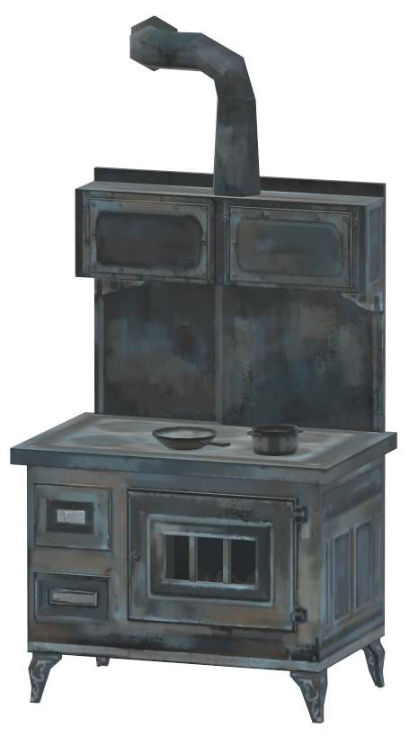

# Stove

<table class="infobox">
<caption>Stove</caption>
<colgroup>
<col style="width: 50%" />
<col style="width: 50%" />
</colgroup>
<tbody>
<tr>
<td colspan="2"><figure>

<figcaption>Stove.png</figcaption>
</figure></td>
</tr>
<tr>
<td colspan="2" class="section">
<strong>General</strong>
</td>
</tr>
<tr>
<td>
Type
</td>
<td>
Fire Starting|-
</td>
</tr>
<tr>
<td>
Cooking slots
</td>
<td>
6
</td>
</tr>
</tbody>
</table>

The **Stove** (technically a kitchen stove) is an immovable fire barrel. The wood stove functions identically to other contained fires and player-made <a href="./Campfire.md" class="wikilink" title="Campfire">Campfire</a>, and, like all contained fires, isn't blown out by high winds.

Stoves are considered the most valuable firebox, as they have <u>six</u> <a href="./Cooking.md" class="wikilink" title="Cooking">Cooking</a> slots, allowing the player to cook more food and drinks for the same amount of fuel than any other firebox. Usually one or more <a href="./Cooking%20Pot.md" class="wikilink" title="Cooking Pots">Cooking Pots</a> or <a href="./Recycled%20Can.md" class="wikilink" title="Recycled Cans">Recycled Cans</a> are found on the stove.

The Stove can be re-lit indefinitely, though it requires fresh starter, tinder, and fuel each time.

## Locations

Stoves have fixed locations that do not change between games. Only seven exist in-game:

- <a href="./Milton%20House%20%28Grey%20Mother%27s%29.md" class="wikilink" title="Milton House (Grey Mother&#39;s)">Milton House (Grey Mother's)</a>, in <a href="./Mountain%20Town.md" class="wikilink" title="Mountain Town">Mountain Town</a>
- <a href="./Paradise%20Meadows%20Farm.md" class="wikilink" title="Paradise Meadows Farm">Paradise Meadows Farm</a>, in <a href="./Mountain%20Town.md" class="wikilink" title="Mountain Town">Mountain Town</a>
- <a href="./Pleasant%20Valley%20Farmstead.md" class="wikilink" title="Pleasant Valley Farmstead">Pleasant Valley Farmstead</a>, in <a href="./Pleasant%20Valley.md" class="wikilink" title="Pleasant Valley">Pleasant Valley</a>
- <a href="./Hunting%20Lodge.md" class="wikilink" title="Hunting Lodge">Hunting Lodge</a>, in <a href="./Broken%20Railroad.md" class="wikilink" title="Broken Railroad">Broken Railroad</a>
- <a href="./Community%20Hall.md" class="wikilink" title="Community Hall">Community Hall</a> (<a href="./Thomson%27s%20Crossing.md" class="wikilink" title="Thomson&#39;s Crossing">Thomson's Crossing</a>), in <a href="./Pleasant%20Valley.md" class="wikilink" title="Pleasant Valley">Pleasant Valley</a>
- <a href="./Fallen%20Lighthouse.md" class="wikilink" title="Fallen Lighthouse">Fallen Lighthouse</a>, in <a href="./Bleak%20Inlet.md" class="wikilink" title="Bleak Inlet">Bleak Inlet</a> (The only outdoor stove in the game, allowing for the most efficient cooking time and fuel usage)
- <a href="./Idle%20Camp.md" class="wikilink" title="Idle Camp">Idle Camp</a> kitchen, in <a href="./Zone%20of%20Contamination.md" class="wikilink" title="Zone of Contamination">Zone of Contamination</a>

**Lua execution error in Module:Navbox function navbox** **Lua execution error in Module:Navbox function navbox** <a href="ru:%D0%9F%D0%B5%D1%87%D1%8C" class="wikilink" title="ru:Печь">ru:Печь</a>

