# Struggle

**Categories:** Gameplay, Wildlife · **Source:** [Fandom](https://thelongdark.fandom.com/wiki/Struggle)

**Contents**

- [Overview](#overview)
- [Weapons](#weapons)
- [Struggle Animals](#struggle-animals)
- [Wolf](#wolf)
- [Poisoned Wolf](#poisoned-wolf)
- [Timberwolf](#timberwolf)
- [Mauling](#mauling)
- [Bears](#bears)
- [Mechanics](#mechanics)
- [Moose](#moose)
- [Cougars](#cougars)
- [Pre Cougar Redux](#pre-cougar-redux)
- [Aurora Predator Struggles](#aurora-predator-struggles)
- [Gallery](#gallery)

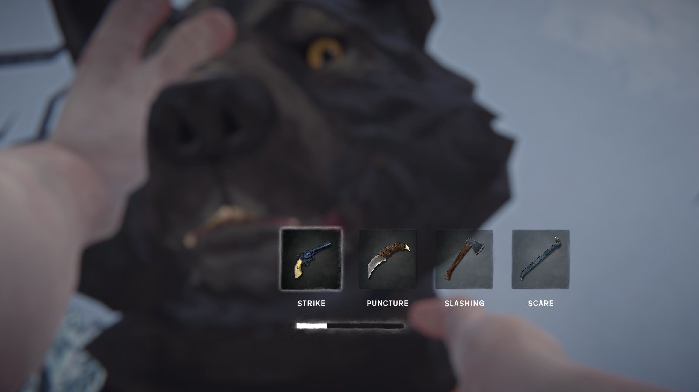A **Struggle** is a scripted event involving the player attempting to defend themselves from an attacking hostile animal. Such interactions typically occur most often when facing [Wolves](./Wolf.md), but other predator animals can attack the player.

## Overview

> “__Jeremiah: "Wolves - - they hate fire, like most wildlife. Campfire'll keep them away from you at night, most of the time. Improvise a torch if you have to. Flare will work too, you know one of those emergency ones for road accidents. Sometimes, if you get lucky, a stone to the head will scare them off."  
 Mackenzie: "And if I don't have any of those things?"__”
>
> — Jeremiah: "Then wait until they're close, and hit them with anything you can. Knife. Hammer. Hatchet. Or your own damn hands. And you don't stop hitting until one of you is dead." Mackenzie: "There's a theme here, isn't there?" Jeremiah: "Yeah. That is it: fight if you want to live. It's more Hobbes than Darwin. [Jeremiah](./Jeremiah.md) and [Mackenzie](./Will%20Mackenzie.md) discussing wolves (Predux)

Struggles typically result in a loss of [Condition](./Condition.md) via the following [Afflictions](./Afflictions.md):

Image

Affliction

Min Damage

Max Damage

_Blood\_Loss\_icon.png_

[Blood Loss](./Blood%20Loss.md)

15

20

_Sprained\_Ankle\_icon.png_

[Sprained Ankle](./Sprained%20Ankle.md)

0

0

_Sprained\_Wrist\_icon.png_

[Sprained Wrist](./Sprained%20Wrist.md)

0

0

_Laceration\_icon.png_

[Laceration](./Laceration.md)

5

10

_Minor\_Bruising\_icon.png_

[Minor Bruising](./Minor%20Bruising.md)

5

10

_Major\_Bruising\_icon.png_

[Major Bruising](./Major%20Bruising.md)

10

15

_Torn\_Clothing\_icon.png_

[Torn Clothing](./Torn%20Clothing.md)

15 (To Clothing)

25 (To Clothing)

The above damage values are always increased by 50% on Interloper.

The following Afflictions can also be acquired during Struggles:

Image

Affliction

Source

_Infection\_Risk\_icon.png_

[Infection Risk](./Infection%20Risk.md)

Acquire Blood Loss

_Chemical\_Poisoning\_Risk\_icon.png_

[Chemical Poisoning Risk](./Chemical%20Poisoning%20Risk.md)

[Poisoned Wolf](./Poisoned%20Wolf.md) Struggles

_Pain\_icon.png_

[Pain](./Pain.md)

Sprained Ankle/Wrist

_Broken\_Ribs\_icon.png_

[Broken Ribs](./Broken%20Ribs.md)

[Moose](./Moose.md) Struggles

_Severe\_Lacerations\_icon.png_

[Severe Lacerations](./Severe%20Lacerations.md)

[Cougar](./Cougar.md) Struggles

Wolf Struggles are partially scripted and can be defended against with certain [Tools](./Tools.md), Bear and Moose struggles are fully scripted and always result in a player defeat. Animals wounded prior to the start of a struggle can be killed during it, and Wolves wounded in struggles can later bleed out and die.

Only 4 Tool options appear once a Struggle begins regardless of how many tools the player is carrying, with higher quality tools appearing as options instead of the Improvised versions.

### Weapons

Different tools are more or less effective at ending the struggle (scaring the Wolf), injuring, or killing the wolf (e.g., a [Prybar](./Prybar.md) may only scare the animal away, while a [Hatchet](./Hatchet.md) can inflict fatal Blood Loss). If the player chooses a loaded [Revolver](./Revolver.md) for the Wolf struggle, the option to 'Take Shot' will be presented once half of the struggle bar is filled, this fires a round and ends the struggle immediately, scaring the Wolf and potentially killing it or wounding the Wolf.

Image

Weapon

Damage Type

Damage[¹](#fn1)

Flee Chance[²](#fn2)

Puncture Bleedout

Tool Decay

_Anywhere\_icon.png_

Bare Hands

Desperation

0.00%

1.00%

None

0

_Hunting\_Knife\_icon.png_

[Hunting Knife](./Hunting%20Knife.md)

Puncture

3.00%

1.30%

12 min

2

_Improvised\_Knife\_icon.png_

[Improvised Knife](./Improvised%20Knife.md)

Puncture

2.00%

1.30%

20 min

3

_Survival\_Knife\_icon.png_

[Survival Knife](./Survival%20Knife.md)

Puncture

3.50%

1.30%

16 min

1.5

_Scrap\_Metal\_Shard\_icon.png_

[Scrap Metal Shard](./Scrap%20Metal%20Shard.md)

Puncture

3.00%

1.30%

40 min

3

_Jeremiah's\_Knife\_icon.png_

[Jeremiah's Knife](./Jeremiah%27s%20Knife.md)

Puncture

3.00%

1.30%

12 min

2

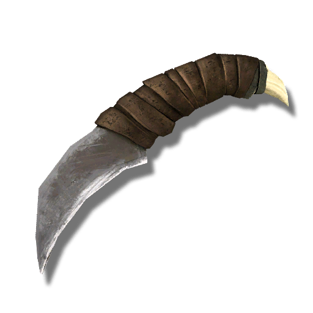

_Cougar\_Claw\_Knife\_icon.png_

[Cougar Claw Knife](./Cougar%20Claw%20Knife.md)

Puncture

4.00%

1.30%

10 min

2

_Hatchet\_icon.png_

[Hatchet](./Hatchet.md)

Slashing

4.00%

1.50%

30 min

2

_Improvised\_Hatchet\_icon.png_

[Improvised Hatchet](./Improvised%20Hatchet.md)

Slashing

3.00%

1.25%

40 min

3

_Prybar\_icon.png_

[Prybar](./Prybar.md)

Scare

1.25%

1.50%

None

2

_Heavy\_Hammer\_icon.png_

[Heavy Hammer](./Heavy%20Hammer.md)

Scare

2.00%

4.00%

None

1

_Revolver\_icon.png_

[Revolver](./Revolver.md)[³](#fn3)

Strike

1.00%

1.00%

None

1

_Forester's\_Revolver\_icon.png_

[Forester's Revolver](./Forester%27s%20Revolver.md)[⁴](#fn4)

Strike

1.00%

1.00%

None

1

_Hunter's\_Revolver\_icon.png_

[Hunter's Revolver](./Hunter%27s%20Revolver.md)[⁵](#fn5)

Strike

1.00%

1.00%

None

1

_Warden's\_Revolver\_icon.png_

[Warden's Revolver](./Warden%27s%20Revolver.md)[⁶](#fn6)

Strike

1.00%

1.00%

None

1

Note some [Tools](./Tools.md) cannot be selected as defense options during a Wolf Struggle, this includes the [Hacksaw](./Hacksaw.md), [Hunting Rifle](./Hunting%20Rifle.md), [Survival Bow](./Survival%20Bow.md), [Bear Spear](./Bear%20Spear.md), [Distress Pistol](./Distress%20Pistol.md), [Storm Lantern](./Storm%20Lantern.md), [Flashlight](./Flashlight.md), and [Stone](./Stone.md).

## Struggle Animals

### Wolf

Struggles with [Wolves](./Wolf.md) vary in length and severity based upon how quickly the left mouse button can be clicked, the player's [Fatigue](./Fatigue.md), [Survival Mode](./Survival%20Mode.md) difficulty, which Tools was selected, and RNG.

At the start of a Struggle with a Wolf, the world will slow down and the HUD will present a list of Tool options in the player's inventory for defense; while the struggle lasts the player can attack the wolf with this tool by left-clicking. At intervals the Wolf will attack the player, causing Condition loss and a chance to generate Afflictions.

The Wolf Struggle will end immediately if either the player or Wolf die, the Wolf is scared off (chance after losing 75% or more of its health), or after a set length of time (resulting in a 'Wolf Win', wherein the Wolf walks away and player regains consciousness and stands up). Wolves which are scared off will be scared until they reach a minimum distance of about 40 meters away from the player if they are not afflicted by Blood Loss from knife puncturing.

If the player is below 50% [Fatigue](./Fatigue.md), they will deal reduced damage to Wolves during struggles (except with Revolver 'Take Shot' action).

Higher Survival Mode difficulties increases the damage Wolves deal per attack during Struggles substantially, particularly on Interloper.

Injured Wolves are much easier to scare during Struggles than full health Wolves, and often can be killed during a Struggle.

### Poisoned Wolf

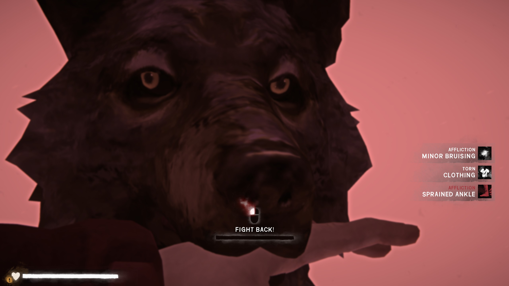_A Poisoned Wolf afflicting a Sprain during a Struggle._ Struggles with [Poisoned Wolves](./Poisoned%20Wolf.md) are virtually identical to regular Wolves, but will always result in [Chemical Poisoning Risk](./Chemical%20Poisoning%20Risk.md) buildup when a player is attacked. Due to the desperate and malnourished state that regular Poisoned Wolves suffer from, encounters with them are generally more likely to result in Struggles.

### Timberwolf

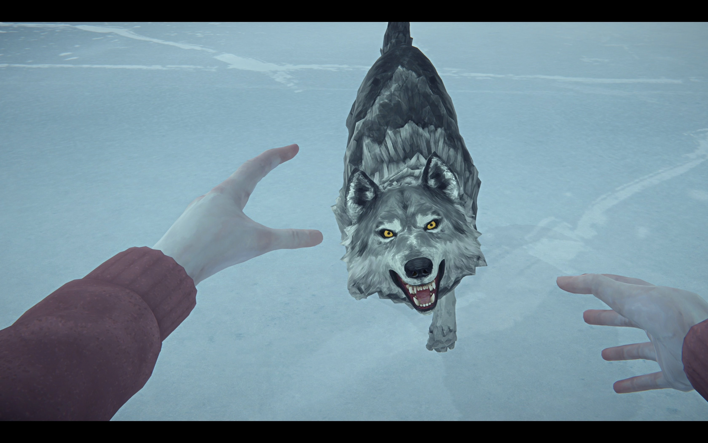_A Timberwolf initiating a Struggle_ Timberwolves typically perform "bite and run" tactics by performing a single bite attack and then quickly keeping their distance during a pack attack in order to wear the player's health down. Occasionally, a single [Timberwolf](./Timberwolf.md) will grapple the player and initiate a Struggle to finish a survivor off after enough time has passed in an encounter, or if a player remains still for too long. The same principles of regular Wolf Struggles apply to these situations, presenting the player with a choice to pick a weapon to defend one's self.

## Mauling

Maulings are a more aggressive version of Struggles, wherein the player is unable to defend one's self once a Struggle begins. This is typically an in-game cutscene where the player is helplessly overwhelmed and attacked by hostile wildlife.

### Bears

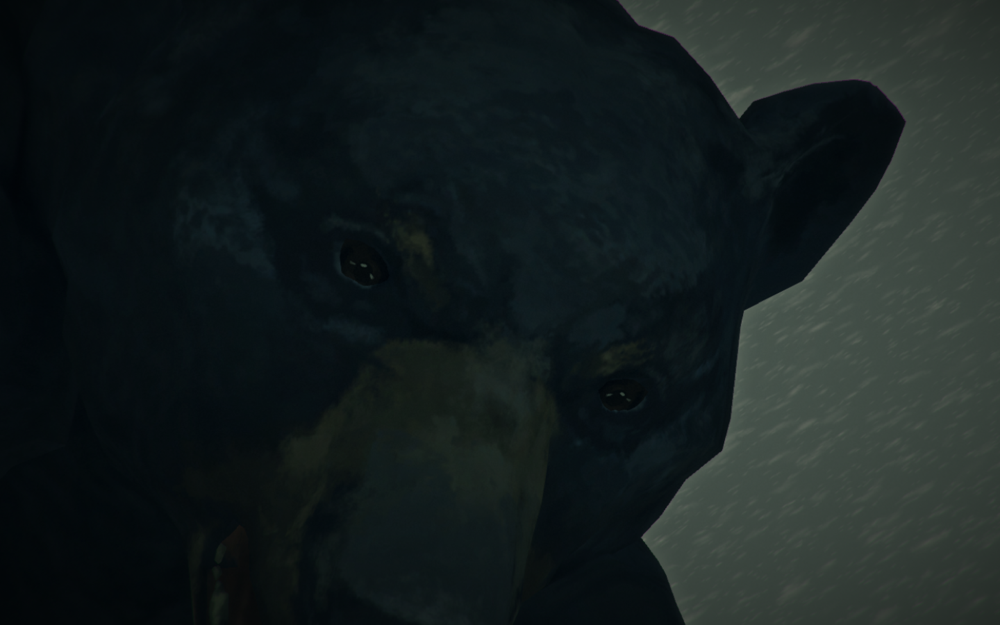 A Struggle with a [Bear](./Bear.md) will always result in a loss for the player, because they are unable to take any action during this time. This will result in a loss of -60-90% of pre-struggle condition remaining and two Afflictions: Blood Loss and Infection Risk. Any tools the player is currently holding will be dropped to the ground (along with a random item in the player's inventory) and must be picked up once the player regains consciousness. This can result in wasted [Torch](./Torch.md), [Storm Lantern](./Storm%20Lantern.md), [Flare](./Flare.md) fuel if the player is not careful.

During Wintermute's Chapter 2, the [Bear Spear](./Bear%20Spear.md) may be used against a charging Bear for a "Bear Spear Struggle", which can be won or lost by the player. Hinterland has stated that the spear may become available in Survival Mode in the future.

#### Mechanics

The in-game mechanics of bear mauling can be deduced from [this YouTube video](https://www.youtube.com/watch?v=ksxK6WhZK7I) by analyzing it [in slow motion](https://www.youtube.com/watch?v=RNON5hzr2lk).

- [Condition](./Condition.md) damage, along with [Blood Loss](./Blood%20Loss.md) and [Infection Risk](./Infection%20Risk.md), is applied as soon as the bear makes contact with the player's hitbox.
- Then the struggle begins, during which time the player cannot retaliate.
- The player's items are scattered about and [Clothing](./Clothing.md) is damaged _after the struggle is over_.
  - This is similar to a lost [Wolf](./Wolf.md) struggle.
  - If the bear dies during the struggle (i.e. from blood loss), then the player has "won", their clothing remains intact, and everything remains in their backpack.

### Moose

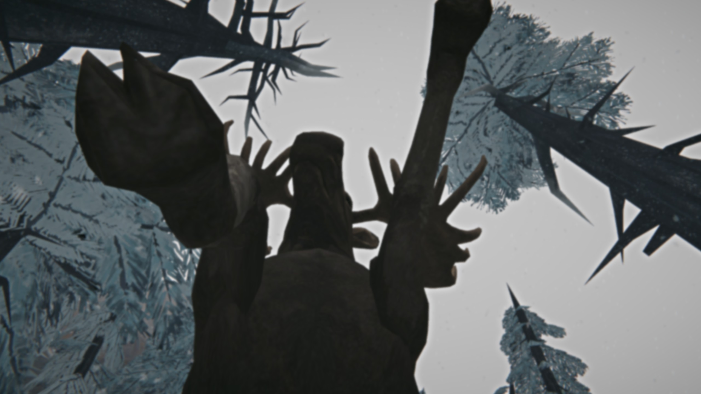 Similar to Bears, a Struggle with a [Moose](./Moose.md) will always result in a loss. The Moose tramples the player and knocks them to their feet, then stomps several times before the player passes out. Upon waking up, the player will be temporarily disoriented and lose about 50% Condition, as well as obtaining a [Broken Ribs](./Broken%20Ribs.md) Affliction. Any tools the player is holding when a Moose attacks will be lying on the ground nearby when the player regains consciousness, similar to a Bear mauling.

### Cougars

[Cougars](./Cougar.md) possess two types of attacks, a 'glancing blow' and a Cougar Struggle. Both occur when a cougar makes physical contact with the survivor, with glancing blows being more likely if the survivor recently struck the cougar with a ranged weapon.

Cougar [Struggles](./Struggle.md) are an event (similar to [Bear](./Bear.md) or [Moose](./Moose.md) struggles), featuring a mauling cutscene and does not grant the option for the survivor to defend themselves.

- **Glancing Attack**: (similar to [Timberwolves](./Timberwolf.md)) where The Cougar deals small amounts of [Condition](./Condition.md) damage, with a chance for [Blood Loss](./Blood%20Loss.md) and [Infection Risk](./Infection%20Risk.md), or [Torn Clothing](./Torn%20Clothing.md). Glancing Attacks are more likely if the survivor manages to hit a charging Cougar with a ranged weapon (e.g. [Hunting Rifle](./Hunting%20Rifle.md)).
- **Cougar Struggle**: which causes 50% Condition damage and the unique affliction [Severe Lacerations](./Severe%20Lacerations.md), which periodically inflicts Blood Loss and Infection Risk repeatedly over time.

## Pre Cougar Redux

The first iteration of the Cougar was unique in that their struggles were a mix of both a Mauling and a normal Struggle. Cougar struggles begins as an event while the survivor is outdoors in a Cougar infested region; it may be prevented by being indoors or leaving the infested region. Similar to [Bear](./Bear.md) and [Moose](./Moose.md) struggles, Cougar struggles are a Mauling cutscene and may not be defended against with a tool:

Cougar struggles always give the player the unique [Severe Lacerations](./Severe%20Lacerations.md) (As well as Blood Loss, Infection Risk, Sprains), and leave the player at 10% Condition afterwards.

- ~70% [Condition](./Condition.md) loss
- Affliction: 1-3 [Blood Loss](./Blood%20Loss.md) and [Infection Risk](./Infection%20Risk.md)
- Affliction: [Severe Lacerations](./Severe%20Lacerations.md)

1. **Note**: The "Severe Lacerations" affliction lasts for 72 in-game hours and periodically to afflicts the survivor with Blood Loss and Infection Risk every 12 hours (requiring a [Bandage](./Bandage.md) and [Antiseptic](./Antiseptic.md) to treat). This makes Time Accelerating (Sleep, Pass Time, Crafting, Harvesting, etc) extremely dangerous while afflicted.
2. **Note**: Blood Loss causes 30% Condition loss per hour, **and each application of the affliction stacks**. This can quickly kill a survivor without enough bandages to treat their wounds, or if Severe Lacerations applies a new Blood Loss.

If the player survives a Cougar struggle and has at least one weapon in their inventory, they will have the option to fire a single shot at the retreating animal.

- Strike (fire a single [Hunting Rifle](./Hunting%20Rifle.md), [Revolver](./Revolver.md) or [Survival Bow](./Survival%20Bow.md) shot, or faint after 10 seconds)
- Desperation (faint)

If a "Strike" is chosen, the survivor will get to their feet and draw that weapon your weapon of choice. The world will be in slow motion and the Cougar will be nearby, fleeing in a random direction and may be obscured by terrain or obstacles. The player can then aim at the animal, but the camera will shake and turn to reflect the critical state of the survivor after the struggle, making the shot very difficult. The player will be able to take a single shot (or they will pass out after 10 seconds if they wait too long) and the screen will go black before they wake up again.

- If the player's shot hits the Cougar, it will be found dead nearby when the player wakes up.
- If the shot misses the Cougar, it will escape and continue hunting the survivor. Failing to kill a Cougar can result in a new encounter and possible struggle as soon as 2 hours pass, possibly even sooner.

Note: [Stones](./Stone.md), [Distress Pistol](./Distress%20Pistol.md) and all other [tools](./Hatchet.md) may not be selected during a Cougar struggle.

## Aurora Predator Struggles

Struggles with Wolves during an [Aurora](./Aurora.md) will result in a far more aggressive attack. Wolves will typically deal more damage, have a higher willpower that prevents them from fleeing when using tools that Scare them during a Struggle, and require more force with tools to end a Struggle. Extreme caution should be taken when traveling during the Aurora when encountering Wolves.

Aurora Bears will also be just as aggressive, but their damage values remain consistent; resulting in -60-90% Condition lost in the attack.

## Gallery

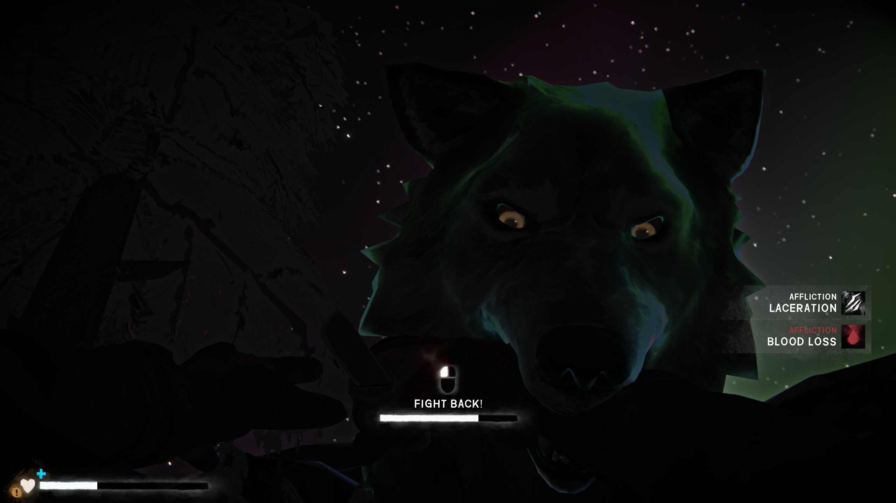

_An Aurora Wolf Struggle_

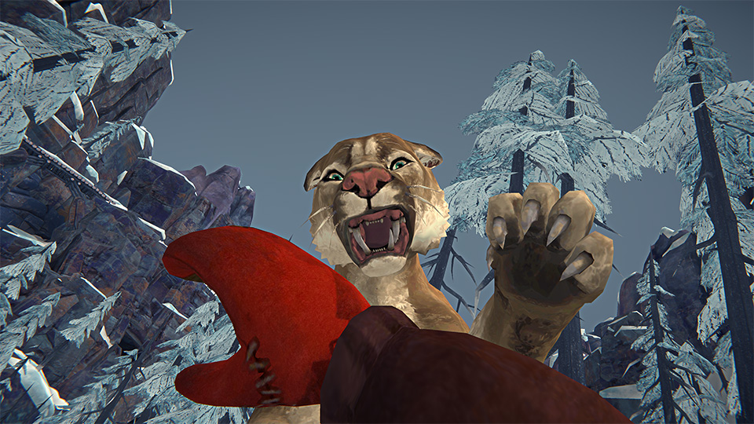

_Cougar Struggle_

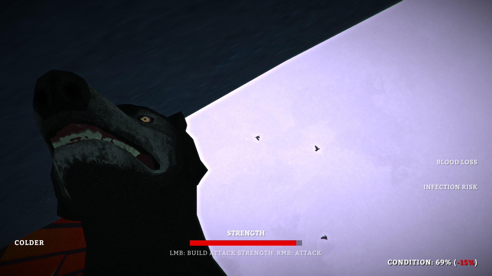

_Alpha version Struggle menu_

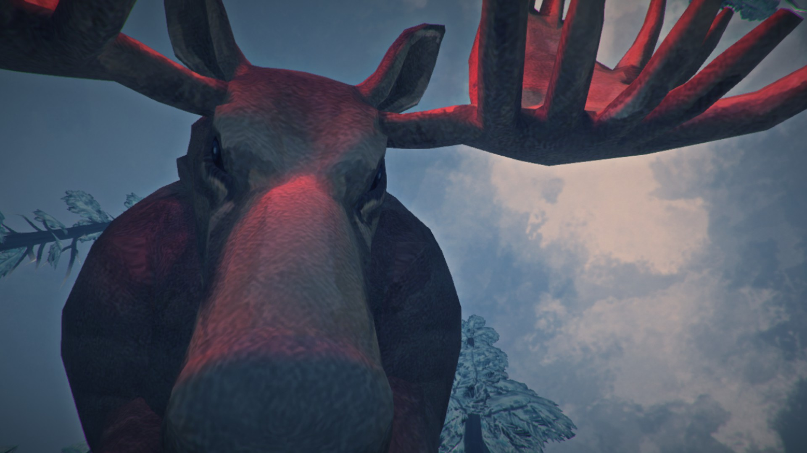

_A Moose staring at the player before stomping them_

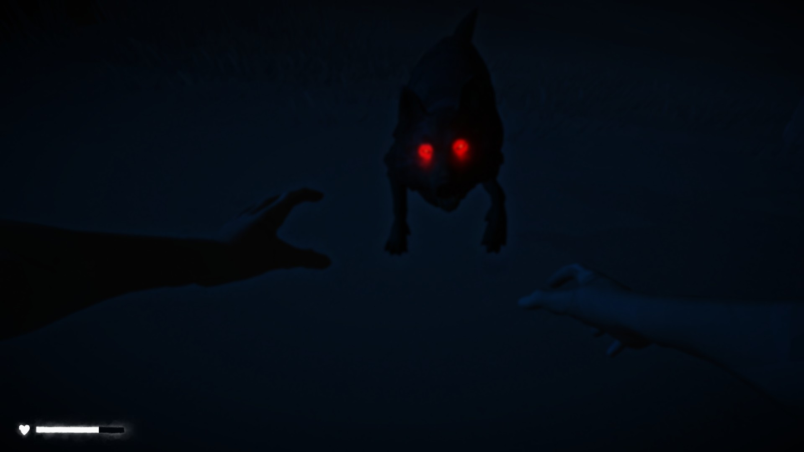

_A "Demon Wolf" in the [4 Days of Night Event](./4%20Days%20of%20Night%20Event.md) attacking the player_

## Notes

---

1. Per hit[↩︎](#fnref1)
2. Per hit[↩︎](#fnref2)
3. Struggle is guaranteed to end after "Take Shot" is chosen (70% to flee, 30% to kill)[↩︎](#fnref3)
